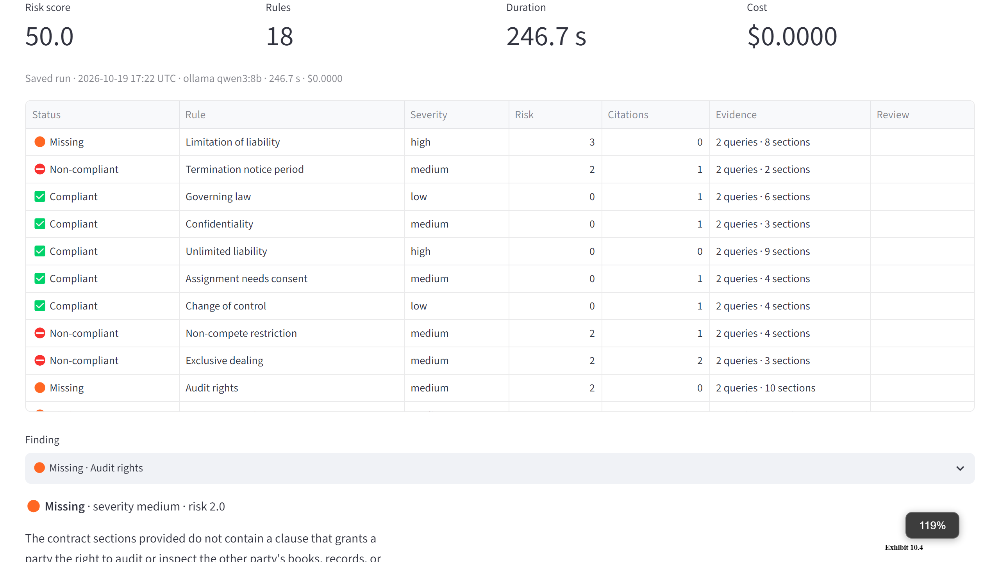
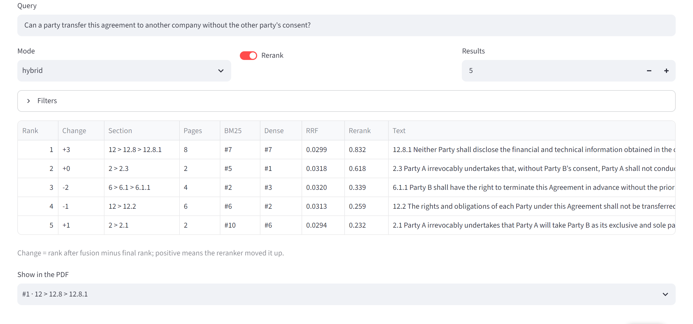
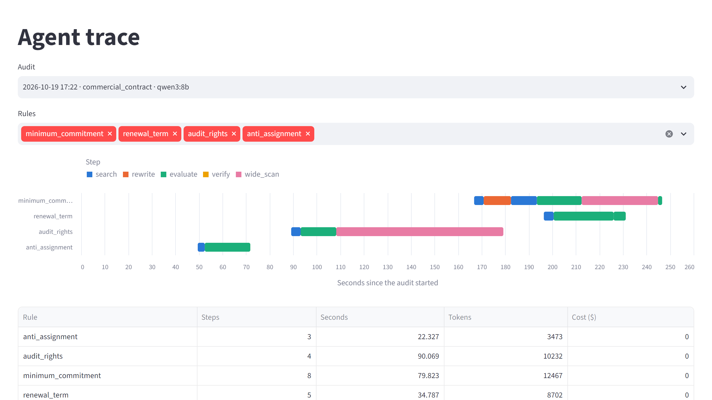
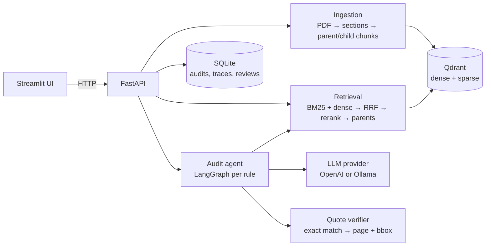

# Verifiable RAG: audit any document against a rule playbook

Checks a PDF against a list of rules and ties every finding to the exact text it rests on. Hybrid search (BM25 + dense + reranking) finds the relevant passages; an LLM agent judges each rule; every quote is verified word for word against the source and highlighted in the PDF. Runs with OpenAI or fully locally with Ollama.

The rules are a YAML playbook, so the domain is a file, not code. Three ship with it: commercial contracts, GDPR data processing agreements, and reporting checks for research papers. The same playbooks drive search, the agent and the report; the same index answers free questions on the Ask page.

- **Verifiable findings:** each finding cites quotes that exist verbatim in the document, with page and highlight boxes. A quote that cannot be found is dropped, never shown.
- **Measured, not claimed:** retrieval and audit quality are benchmarked on CUAD, contracts annotated by lawyers, because it is a public dataset with marked answer spans. Numbers below come from result files, not hand-typed.
- **Private mode:** with Ollama, no document leaves the machine.

**[How it works: one question, start to finish →](docs/how-it-works.md)** follows one question through all ten stages on a real contract, from PDF lines to the highlighted answer, with the actual rankings, prompt, model reply and quote check at each step; then one audit rule; then what each benchmark score means. The page is generated by running the pipeline, not written by hand.

## Example: a contract from the benchmark

The screenshots audit one of the 50 benchmark contracts, a 9-page cooperation agreement from [CUAD](https://www.atticusprojectai.org/cuad) (CC BY 4.0) whose clauses lawyers marked, with the `commercial_contract` playbook: 18 rules, qwen3:8b on an RTX 3060, 247 s, $0. They are taken by [`docs/screenshots.py`](docs/screenshots.py); [`docs/demo.md`](docs/demo.md) rebuilds the data.


*A finding. The playbook flags exclusive dealing; the model found clauses 2.1 and 2.3, and each quote on the left is boxed where it stands in the PDF.*


*The report: 9 compliant, 4 non-compliant, 4 missing, 1 uncertain. The risk score (50) is computed by code from severity and status, not by the model. Against the lawyers' labels, 13 of the 16 decided verdicts are right; [the walkthrough](docs/how-it-works.md#part-4-what-the-benchmark-scores-mean) lists all 18.*


*Each search stage ranks on its own. The clause that answers, 12.2, is #6 for BM25 and #2 for dense; the reranker puts the confidentiality clause 12.8.1 first, which also mentions consent. The answer still comes from 12.2: [steps 5–10](docs/how-it-works.md#part-2-answering-the-question) show why.*


*The agent per rule. anti_assignment: search, evaluate, verify. audit_rights: nothing found, so a wide scan read the top sections one by one before reporting it missing. minimum_commitment: weak evidence, so the query was rewritten first. renewal_term: the model's quote failed verification, it was asked again, and the rule ended uncertain instead of guessed.*

### The same engine on another domain


*A public research paper ([Federer et al. 2018, PLOS ONE, CC0](https://doi.org/10.1371/journal.pone.0194768)) with the `research_paper` playbook: 14 reporting rules, 335 s.*

The paper run also shows the limit of quote checking: 2 of its 14 verdicts are wrong. The model marked the ethics statement compliant citing the paper's copyright line, and justified the sample size with a sentence about text clusters. Both quotes exist word for word, so verification passes; it proves the text is real, not that it supports the claim. That is what the accept/reject review on each finding is for.

## Findings on contracts (CUAD)

| model | missing F1 | citation accuracy | seconds per audit | USD per audit |
|---|---|---|---|---|
| qwen3:14b (local) | 0.877 | 0.781 | 1584 | 0 |
| qwen3:8b (local, default) | 0.825 | 0.727 | 389 | 0 |
| gpt-5.4-mini | 0.752 | 0.659 | 151 | 0.117 |

_Same first 15 contracts of the 50-contract subset, 17 rules each; full tables under [Benchmarks](#benchmarks). What F1, precision, recall and citation accuracy mean: [the walkthrough, part 4](docs/how-it-works.md#part-4-what-the-benchmark-scores-mean)._

- **Hybrid search wins; lexical beats dense on contracts.** On 867 queries over 100 CUAD contracts, BM25 + dense fused with RRF reaches recall@5 0.820 and MRR 0.672, ahead of BM25 alone (0.802) and dense alone (0.739). Contract wording is formulaic, so exact terms matter.
- **The reranker does not improve ranking here.** Hybrid + rerank scores recall@5 0.796 and MRR 0.658, slightly below plain hybrid. It stays in the pipeline because its score is the evidence-sufficiency signal: below `min_rerank_score` the agent rewrites the query and, if still nothing, reports the clause missing. The threshold (0.005) is set from data so that 95% of clauses that are present stay above it.
- **Semantic chunking and an LLM context prefix bring nothing measurable.** Semantic chunks: recall@5 0.792 vs 0.796 for structural chunks, which also keep clause numbers for citations. A one-sentence context prefix per chunk (qwen3:8b): 0.808 with and without it on the 50-contract subset, so it stays off and uploads need no LLM call per chunk.
- **The LLM is what makes the verdict reliable.** On the same 850 contract–rule pairs (50 contracts × 17 rules), deciding "missing" from the retrieval score alone, with the threshold tuned on the other 98 contracts, gives F1 0.834 at precision 0.746. The qwen3:8b agent reaches F1 0.875 at precision 0.950, and 78% of its quotes overlap a span the lawyers marked.
- **A local 8B model is usable.** qwen3:8b (thinking off) audits a contract in about 6 minutes on an RTX 3060 with zero schema errors and $0 cost. llama3.1:8b and granite3.3:8b were clearly weaker on the first five contracts (F1 0.545 and 0.293, with schema errors). On the same first 15 contracts, qwen3:14b reached F1 0.877 against 0.825 for qwen3:8b, with citation accuracy 0.781 against 0.727, but it took about 26 minutes per contract instead of 6.5 minutes, because on a 12 GB card it only fits with the reranker moved to the CPU. The 8B model stays the default; 14B is worth it on a larger GPU.
- **The GDPR playbook works on a real DPA.** On the European Commission's Art. 28 standard contractual clauses (Decision 2021/915 annex, 16 pages), qwen3:8b marks 11 of 12 rules compliant with verified quotes in under 3 minutes; the twelfth (processor using data for its own purposes) comes out uncertain because the model claimed a clause without quoting it. This demo also exposed words hyphenated at PDF line breaks ("con-" / "troller"), which quote matching now ignores. The CUAD rows above were measured before that fix; CUAD text has almost no such breaks.
- **The local model beats the OpenAI models on this task.** On the same first 15 contracts, gpt-5.4-mini reaches F1 0.752 (precision 0.951, recall 0.622, citation accuracy 0.659) at $0.117 and about 2.5 minutes per audit, below qwen3:8b (0.825). It rarely calls a clause missing, so it misses absent clauses. On the first 5 contracts, gpt-5.5 as the judge reaches F1 0.867 against 0.800 for mini, but its citation accuracy is lower (0.594 against 0.698) and it costs $0.68 per audit; qwen3:8b scores 0.895 and qwen3:14b 0.914 on those 5. Five contracts are only a rough check. gpt-5.4-mini stays the OpenAI default for its cost; the free local model is the recommended default.

## Architecture



Per rule, the agent searches the document, rewrites the query when evidence is weak (at most twice), asks the evaluation model whether the item exists and meets the criteria, verifies every quote, and runs a wide scan of the top 15 sections before it reports the item as missing. The status comes from the model; the risk score comes from code: severity weight × status factor.

## Quick start (Docker)

```bash
cp .env.example .env          # local Ollama by default; for OpenAI set AUDITOR_PROVIDER=openai and OPENAI_API_KEY
docker compose up -d          # Qdrant, API on :8000, UI on :8501
```

GPU: `docker compose -f docker-compose.yml -f docker-compose.gpu.yml up -d`.
Local models in Docker: `docker compose --profile local up -d`, then `docker compose exec ollama ollama pull qwen3:8b`.
Ollama already running on the host: leave out `--profile local` (both would use port 11434) and set `DOCKER_OLLAMA_HOST=http://host.docker.internal:11434` in `.env`. `OLLAMA_HOST` in `.env` is for running without Docker; compose ignores it.
On a 12 GB GPU keep `OLLAMA_NUM_CTX=8192`: with the embedding and reranking models on the same card, a 16k context pushes an 8B model partly into system RAM.
The first upload downloads the embedding and reranking models (~4 GB) into a volume.

`docker compose down` keeps data in volumes. Stopping the API (Ctrl+C or `down`) waits for an audit that is still running to finish.

## Quick start (Python)

```bash
python -m venv .venv && .venv/Scripts/pip install -e ".[dev]"     # Linux/macOS: .venv/bin/pip
.venv/Scripts/python -m uvicorn --factory auditor.api.main:create_app --port 8000
.venv/Scripts/python -m streamlit run ui/app.py
```

Command line: `python -m auditor.cli ingest contract.pdf`, `... audit <document_id> commercial_contract`, `... ask "What is the liability cap?"`.

## Cloud or local

| | OpenAI | Ollama |
|---|---|---|
| Setting | `AUDITOR_PROVIDER=openai`, `OPENAI_API_KEY` | `AUDITOR_PROVIDER=ollama` (default), `OLLAMA_MODEL` |
| Models | `OPENAI_EVAL_MODEL` judges rules; `OPENAI_SMALL_MODEL` rewrites queries, scans, extracts metadata, answers questions | one model for everything |
| Data | the retrieved sections are sent to OpenAI | nothing leaves the machine; the only network traffic is the first model download |

The UI and the API let you pick the provider per audit. Saved audits are cached per document, playbook, model, prompt version and audit settings; "Run again" forces a new run.

## Writing a playbook

A playbook is a YAML file in `playbooks/`; it is validated on load and errors name the rule and field.

```yaml
name: Commercial contract
document: contract                # what the rules check, singular (default: document)
item: clause                      # what one rule looks for (default: passage)
rules:
  - id: liability_cap             # lowercase letters, digits, underscores
    title: Limitation of liability
    type: must_exist              # must_exist | must_not_exist | condition
    severity: high                # low | medium | high
    queries: ["limitation of liability", "liability cap aggregate amount"]
    criteria: "Total liability of a party is limited to a stated amount or a formula."
```

| type | item found, meets criteria | found, does not | not found |
|---|---|---|---|
| must_exist | compliant | non-compliant | missing |
| condition | compliant | non-compliant | missing |
| must_not_exist | non-compliant (prohibited item present) | compliant | compliant |

For `must_not_exist`, `criteria` describes the prohibited item. Good `queries` use the words such documents use, not the rule's name. `document` and `item` name the domain in the prompts ("You review research papers…"); the two contract playbooks set them to contract and clause, which gives the prompts the benchmarks were measured with, word for word.

Shipped playbooks: `commercial_contract` (18 rules, derived from CUAD clause types), `gdpr_dpa` (12 rules, GDPR Art. 28) and `research_paper` (14 reporting rules for an empirical paper: data and code availability, limitations, ethics, preregistration, funding).

## Benchmarks

Data: [CUAD v1](https://www.atticusprojectai.org/cuad) by The Atticus Project, CC BY 4.0 — 510 commercial contracts with lawyer-marked spans for 41 clause types. The audit benchmark uses a fixed 50-contract subset (`benchmarks/subset.json`).

<!-- BENCHMARKS:START -->

### Retrieval on CUAD (100 contracts)

| config | recall@5 | recall@30 | MRR | queries |
| --- | --- | --- | --- | --- |
| bm25 | 0.802 | 0.958 | 0.661 | 867 |
| dense | 0.739 | 0.948 | 0.585 | 867 |
| hybrid | 0.82 | 0.972 | 0.672 | 867 |
| hybrid + rerank | 0.796 | 0.972 | 0.658 | 867 |

- Each query searches one contract; a hit is the first chunk overlapping a span the lawyers marked. Structural chunking, no context prefix.

_Source: retrieval.json; measured 2026-10-15._

### Chunking (hybrid + rerank)

| config | recall@5 | recall@30 | MRR | queries |
| --- | --- | --- | --- | --- |
| structural | 0.796 | 0.972 | 0.658 | 867 |
| semantic | 0.792 | 0.983 | 0.667 | 867 |

- Semantic chunks break where adjacent sentence embeddings drift furthest (90th percentile), at most 400 tokens; structural chunks follow clause numbering.

_Source: chunking.json; measured 2026-10-15._

### Context prefix (50-contract subset, hybrid + rerank)

| config | context model | recall@5 | recall@30 | MRR | queries |
| --- | --- | --- | --- | --- | --- |
| off | - | 0.808 | 0.995 | 0.685 | 365 |
| on | ollama qwen3:8b | 0.808 | 0.992 | 0.684 | 365 |

- One LLM sentence per chunk, prepended before embedding. Cost $0.00; 0 chunks without a prefix.

_Source: context_prefix.json; measured 2026-10-16._

### Clause presence from retrieval alone (hybrid + rerank)

| threshold rule | threshold | missing precision | missing recall | missing F1 |
| --- | --- | --- | --- | --- |
| provisional default | 0.05 | 0.877 | 0.786 | 0.829 |
| best F1 | 0.3193 | 0.811 | 0.966 | 0.882 |
| keeps 95% of present clauses | 0.005 | 0.948 | 0.284 | 0.437 |

- Positive class: clause missing. 3600 contract-category pairs. Recommended min_rerank_score: 0.0050 (keeps 95% of present clauses above it).

_Source: presence.json; measured 2026-10-15._

### Audit on the CUAD subset

#### 50 contracts

| provider | models | rules | missing precision | missing recall | missing F1 | citation accuracy | undecided % | errors | seconds per audit | USD per audit |
| --- | --- | --- | --- | --- | --- | --- | --- | --- | --- | --- |
| ollama | qwen3:8b | 17 | 0.95 | 0.811 | 0.875 | 0.782 | 5.9 | 0 | 370.5 | 0 |

- 50 of 50 subset contracts; positive class: clause missing; citation accuracy counts quotes overlapping a marked span; undecided % includes errors.

#### 15 contracts

| provider | models | rules | missing precision | missing recall | missing F1 | citation accuracy | undecided % | errors | seconds per audit | USD per audit |
| --- | --- | --- | --- | --- | --- | --- | --- | --- | --- | --- |
| ollama | qwen3:14b | 17 | 0.934 | 0.826 | 0.877 | 0.781 | 4.3 | 0 | 1584.2 | 0 |
| ollama | qwen3:8b | 17 | 0.925 | 0.745 | 0.825 | 0.727 | 7.8 | 0 | 389 | 0 |
| openai | gpt-5.4-mini | 17 | 0.951 | 0.622 | 0.752 | 0.659 | 2.7 | 0 | 151 | 0.1174 |

- 15 of the first 15 of 50 subset contracts; positive class: clause missing; citation accuracy counts quotes overlapping a marked span; undecided % includes errors.

#### 5 contracts

| provider | models | rules | missing precision | missing recall | missing F1 | citation accuracy | undecided % | errors | seconds per audit | USD per audit |
| --- | --- | --- | --- | --- | --- | --- | --- | --- | --- | --- |
| ollama | qwen3:8b | 17 | 0.911 | 0.879 | 0.895 | 0.682 | 4.7 | 0 | 461.8 | 0 |
| openai | gpt-5.4-mini | 17 | 0.933 | 0.7 | 0.8 | 0.698 | 0 | 0 | 156.4 | 0.1322 |
| openai | gpt-5.5+gpt-5.4-mini | 17 | 0.925 | 0.817 | 0.867 | 0.594 | 0 | 0 | 223 | 0.6823 |

- 5 of the first 5 of 50 subset contracts; positive class: clause missing; citation accuracy counts quotes overlapping a marked span; undecided % includes errors.

_Source: audit-ollama-qwen3-14b-first15.json, audit-ollama-qwen3-8b-first15.json, audit-ollama-qwen3-8b-first5.json, audit-ollama-qwen3-8b.json, audit-openai-gpt-5-4-mini-first15.json, audit-openai-gpt-5-4-mini-first5.json, audit-openai-gpt-5-5-gpt-5-4-mini-first5.json; measured 2026-10-16._

<!-- BENCHMARKS:END -->

Reproduce:

```bash
python -m benchmarks.get_cuad
python -m benchmarks.retrieval_bench --contracts 100 --part modes --part chunking   # LLM-free; omit --contracts for all 510
python -m benchmarks.retrieval_bench --part prefix --provider ollama
python -m benchmarks.audit_bench --provider ollama --ollama-model qwen3:8b
python -m benchmarks.audit_bench --provider openai --max-cost 3        # paid; stops at the cap
python -m benchmarks.make_readme_table
```

## API

| Endpoint | Purpose |
|---|---|
| `POST /documents` | upload and index a PDF |
| `GET /documents`, `GET /documents/{id}`, `GET /documents/{id}/file` | list, metadata, PDF |
| `POST /search` | search with per-stage scores |
| `POST /ask` | answer with verified quotes, or "not found" |
| `GET /playbooks`, `GET /providers` | playbooks, model availability |
| `POST /audits`, `GET /audits`, `GET /audits/{id}` | start (cached result or 202), list, report |
| `GET /audits/{id}/trace` | per-rule agent steps with time, tokens and cost |
| `POST /audits/{id}/findings/{rule_id}/review` | accept or reject a finding |
| `GET /audits/{id}/export?format=json\|pdf` | report; the PDF appends the document with highlights |
| `GET /benchmarks` | benchmark result files |

## Tests

```bash
.venv/Scripts/python -m pytest              # offline: fake models and LLMs
.venv/Scripts/python -m pytest -m slow      # real models and LLM calls
```

## Limits

- Scanned PDFs without a text layer are rejected; there is no OCR.
- One API process: audits run on background threads and are lost if the process stops mid-run.
- No user accounts; run it on a trusted network.

## License

MIT, see [LICENSE](LICENSE).
