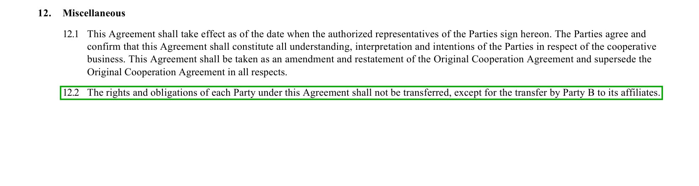
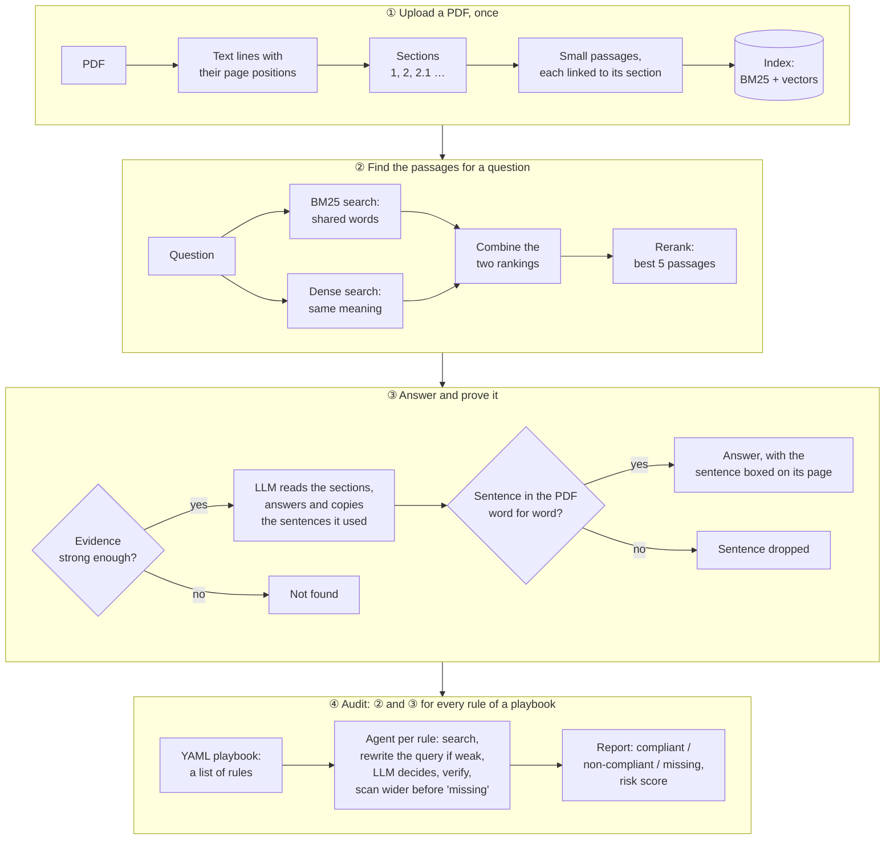
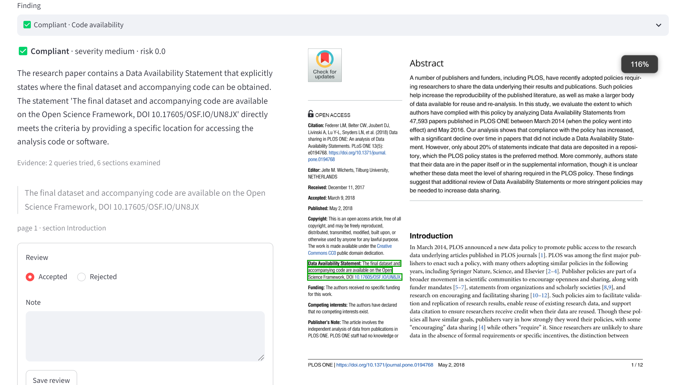

# Verifiable RAG: audit any document against a rule playbook

Ask a PDF a question, or check it against a list of rules. Every answer comes with the exact sentence it rests on, found in the document and boxed on the page; an answer whose sentence cannot be found is not shown. Runs locally with Ollama (nothing leaves the machine) or with OpenAI.

## Example

On a 9-page contract from [CUAD](https://www.atticusprojectai.org/cuad), a public set of contracts annotated by lawyers:

> **Question:** Can a party transfer this agreement to another company without the other party's consent?
>
> **Answer:** No, a party cannot transfer this agreement to another company without the other party's consent.
>
> **Evidence:** "The rights and obligations of each Party under this Agreement shall not be transferred, except for the transfer by Party B to its affiliates." (page 6, clause 12.2)



## How it works



1. **Read.** The PDF is split into sections and small passages; each passage keeps its place on the page.
2. **Find.** The question is matched two ways, by shared words (BM25) and by meaning (vectors), and a reranking model orders the best passages.
3. **Answer.** An LLM reads the sections around those passages and answers, copying the sentences it relies on.
4. **Verify.** Each copied sentence must exist word for word in the PDF. It is then boxed on its page; if none survives, the answer is "not found".

An **audit** runs the same steps for every rule of a playbook, a YAML list of rules such as "liability must be capped" or "no exclusive dealing", and reports each rule as compliant, non-compliant or missing. Playbooks for commercial contracts, GDPR data processing agreements and research papers ship with it; a new domain is a new YAML file.


*An audit finding on the same contract: the rule forbids exclusive dealing, the system found clauses 2.1 and 2.3 and marked the rule non-compliant.*

**[See every step with real values →](docs/how-it-works.md)** the same question through all ten stages, from PDF lines to the boxed answer: the rankings, the prompt, the model's raw reply, the quote check; then one audit rule.

## How good is it

Measured on CUAD, where lawyers marked which clauses each contract has:

- **Finding the passage:** the right one is in the top 5 for 80% of 867 questions over 100 contracts.
- **Finding missing clauses** (50 contracts, local qwen3:8b): when it says a clause is missing it is right 95% of the time, and it finds 81% of the clauses that really are missing (F1 0.875). 78% of its quotes land on text the lawyers marked. About 6 minutes per contract, $0.
[Benchmarks](docs/benchmarks.md) has every table and finding; [what the scores mean](docs/how-it-works.md#part-4-what-the-benchmark-scores-mean) works them out on one contract.

## Which model?

Six LLMs ran the same audit on the same first 5 benchmark contracts (17 rules each); only the model changed. *Finds missing clauses* is F1: 1.0 means every missing clause found with no false alarm.

| model | runs | finds missing clauses (F1) | quotes on the lawyers' text | unsure or failed | per contract | in short |
|---|---|---|---|---|---|---|
| qwen3:14b | local | **0.914** | 70% | 2% | 30 min, $0 | the most accurate, but 4× slower than 8B on a 12 GB GPU |
| qwen3:8b | local | 0.895 | 68% | 5% | 8 min, $0 | **the default**: nearly as accurate, fast enough, free |
| gpt-5.5 judging, gpt-5.4-mini helping | OpenAI | 0.867 | 59% | 0% | 4 min, $0.68 | good at finding gaps, but of the top four its quotes land on the lawyers' text least often, and it costs the most |
| gpt-5.4-mini | OpenAI | 0.800 | 70% | 0% | 2.5 min, $0.13 | the fastest; rarely says "missing", so it overlooks 3 in 10 absent clauses |
| llama3.1:8b | local | 0.545 | 48% | 27% | 9 min, $0 | a quarter of its answers unusable, 4 replies failed outright |
| granite3.3:8b | local | 0.293 | 53% | 27% | 15 min, $0 | almost never says "missing" (finds 17%); one of its 5 audits did not finish |

Five contracts is a small sample, so the top three were also run on 15 contracts: qwen3:14b 0.877, qwen3:8b 0.825, gpt-5.4-mini 0.752, the same order. In all, the benchmarks scored 5,932 searches (867 questions under up to seven search settings) and 1,598 audit decisions (94 contract audits × 17 rules); every row comes from a file in [`benchmarks/results`](benchmarks/results).

## Run it

```bash
cp .env.example .env          # local Ollama by default; for OpenAI set AUDITOR_PROVIDER=openai and OPENAI_API_KEY
docker compose --profile local up -d && docker compose exec ollama ollama pull qwen3:8b
```

Open http://localhost:8501, upload a PDF, then use Ask or Audit. Without Docker:

```bash
python -m venv .venv && .venv/Scripts/pip install -e ".[dev]"     # Linux/macOS: .venv/bin/pip
.venv/Scripts/python -m uvicorn --factory auditor.api.main:create_app --port 8000
.venv/Scripts/python -m streamlit run ui/app.py
```

## More

- [How it works](docs/how-it-works.md): one question and one audit rule, every stage, real values.
- [Benchmarks](docs/benchmarks.md): all measurements and what they showed.
- [Reference](docs/reference.md): the screens, architecture, GPU and Ollama setup, writing a playbook, API, tests.
- [Demo data](docs/demo.md): the documents behind the screenshots and how to rebuild them.

**Limits:** no OCR, so scanned PDFs without a text layer are rejected; audits run in the API process and are lost if it stops mid-run; no user accounts, so run it on a trusted network.

MIT license, see [LICENSE](LICENSE).
