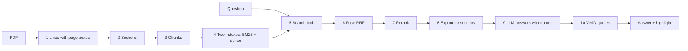

# How it works: one question, start to finish

This page follows one question through every stage of the system on a real contract, then one audit rule, then explains the benchmark scores. Every number, ranking, prompt and model answer below was produced by the code, not typed by hand: [`docs/walkthrough.py`](walkthrough.py) runs the pipeline and writes this page.

- **Document:** `TUNIUCORP_03_06_2014-EX-10-COOPERATION AGREEMENT` from [CUAD](https://www.atticusprojectai.org/cuad) (CC BY 4.0), a 9-page cooperation agreement between two companies, one of the 50 contracts in the audit benchmark. Lawyers marked its clauses, so every verdict can be checked.
- **Question:** *Can a party transfer this agreement to another company without the other party's consent?*
- **Models:** BAAI/bge-m3 (dense vectors), BM25 (word matching), BAAI/bge-reranker-v2-m3 (reranking), qwen3:8b (answer).



## Part 1: Reading the PDF (done once, at upload)

### Step 1. Text lines with their position on the page

PyMuPDF reads the text layer: **9 pages, 184 lines, 17,754 characters**. Each line keeps its page, its box on the page (x0, y0, x1, y1 in PDF points) and where it sits in the full text (character offsets). The boxes are what lets the system draw a highlight later; the offsets tie a quote back to an exact place.

| text | page | box on page | font size | characters |
| --- | --- | --- | --- | --- |
| This Cooperation Agreement (2014 Amendment) (this “Agreement”) is ente… | 1 | (50, 122, 489, 130) | 8.2 | 55–180 |
| Nanjing Tuniu Technology Co., Ltd., with its registered address at 3-5… | 1 | (70, 138, 539, 147) | 8.2 | 185–323 |
| Street, Xuanwu District, Nanjing and its legal representative being Yu… | 1 | (70, 149, 371, 157) | 8.2 | 324–413 |
| Beijing Tuniu Technology Co., Ltd., with its registered address at R10… | 1 | (70, 165, 541, 173) | 8.2 | 418–560 |

### Step 2. Sections

Headings are found from numbering (`1.`, `2.1`, `Article 3`) and from lines set in a larger font. This contract gives **58 sections**; the path shows nesting, so `2 > 2.1` is clause 2.1 inside clause 2. Citations carry this path.

| section path | title | lines |
| --- | --- | --- |
| Preamble | Preamble | 0–16 |
| 1 | Party A is a company with exclusively domestic cap… | 16–18 |
| 2 | Party B is a limited liability company incorporate… | 18–22 |
| 3 | Party A intends to authorize Party B to provide to… | 22–26 |
| 4 | After an amiable consideration, the Parties unanim… | 26–28 |
| 5 | The Parties have entered into the Cooperation Agre… | 28–33 |
| 1 | Business Cooperation | 33–39 |
| 2 | Exclusive Cooperation | 39–41 |
| 2 > 2.1 | Party A irrevocably undertakes that Party A will t… | 41–46 |
| 2 > 2.2 | Party A irrevocably undertakes that it will make b… | 46–49 |
| 2 > 2.3 | Party A irrevocably undertakes that, without Party… | 49–53 |
| 3 | Party B’s Services | 53–58 |

### Step 3. Chunks: small for search, large for reading

Each section is split into **child chunks** of at most 400 tokens; this contract gives **58 chunks** (median 45 tokens). Small chunks keep search precise: a match is about one clause, not a whole page. Each chunk also points to a **parent**: its enclosing section, up to 2,000 tokens (18 parents here). Search finds children; the LLM later reads parents, so it sees the whole clause around a match.

### Step 4. Two indexes

Every chunk is stored twice in Qdrant: as a **dense vector** (1024 numbers from bge-m3, which encode meaning: *transfer* and *assign* land close together) and as a **sparse BM25 vector** (which words occur and how rare they are: exact terms such as *assign* or *consent* score high). The two catch different things, so both are searched.

## Part 2: Answering the question

### Step 5. Search both indexes

The question is encoded both ways and each index returns its own top 30 chunks of this document. The top five of each:

| rank | BM25 (words) | score | dense (meaning) | score |
| --- | --- | --- | --- | --- |
| 1 | 4 > 4.1 · 4.1 Party A and Party B unanimously agree that the… | 16.5 | 2 > 2.3 · 2.3 Party A irrevocably undertakes that, without P… | 0.62 |
| 2 | 6 > 6.1 > 6.1.1 · 6.1.1 Party B shall have the right to term… | 14.76 | 12 > 12.2 · 12.2 The rights and obligations of each Party un… | 0.618 |
| 3 | 2 · 2. Party B is a limited liability company incorporated u… | 12.07 | 6 > 6.1 > 6.1.1 · 6.1.1 Party B shall have the right to term… | 0.606 |
| 4 | 2 > 2.3 · 2.3 Party A irrevocably undertakes that, without P… | 11.96 | 6 > 6.4 · 6.4 Party A hereby expressly undertakes that it wa… | 0.605 |
| 5 | 12 > 12.2 · 12.2 The rights and obligations of each Party un… | 11.2 | 3 > 3.5 · 3.5 Other services as agreed by the Parties. Party… | 0.592 |

### Step 6. Fuse the two rankings (RRF)

Scores from BM25 and from vectors are on different scales, so only ranks are combined. Reciprocal Rank Fusion gives each chunk `1/(60 + rank)` from each list it appears in and adds them. A chunk ranked well by both beats one ranked first by only one.

For the chunk that ends up first: BM25 rank #6, dense rank #7 → RRF = 1/(60 + 6) + 1/(60 + 7) = **0.0301**, fused rank #5.

### Step 7. Rerank

The 30 fused candidates go to a cross-encoder (bge-reranker-v2-m3), which reads the question and each chunk together and scores how well the chunk answers it, from 0 to 1. It is slower than vector search, so it only sees these candidates. The top 5 after reranking (the whole search, with models loaded, took 0.9 s):

| final | section | BM25 | dense | RRF | fused | rerank | text |
| --- | --- | --- | --- | --- | --- | --- | --- |
| 1 | 12 > 12.8 > 12.8.1 | #6 | #7 | 0.0301 | #5 | 0.832 | 12.8.1 Neither Party shall disclose the financial and technical inform… |
| 2 | 2 > 2.3 | #4 | #1 | 0.0320 | #1 | 0.618 | 2.3 Party A irrevocably undertakes that, without Party B’s consent, Pa… |
| 3 | 6 > 6.1 > 6.1.1 | #2 | #3 | 0.0320 | #2 | 0.339 | 6.1.1 Party B shall have the right to terminate this Agreement in adva… |
| 4 | 12 > 12.2 | #5 | #2 | 0.0315 | #3 | 0.259 | 12.2 The rights and obligations of each Party under this Agreement sha… |
| 5 | 2 > 2.1 | #8 | #6 | 0.0299 | #6 | 0.232 | 2.1 Party A irrevocably undertakes that Party A will take Party B as i… |

The rerank score is also the evidence check: if the best one were below 0.005 (a threshold set from the benchmark), the system would answer "not found" instead of asking the LLM. Here the best is 0.832, so it goes on.

### Step 8. Expand to whole sections

The 5 chunks belong to **3 parent sections**; those are what the LLM reads, so it never judges a clause from a fragment:

| section | characters | tokens | from chunks |
| --- | --- | --- | --- |
| 12 | 13396–17754 | 804 | #1, #4 |
| 2 | 2901–4002 | 195 | #2, #5 |
| 6 | 7092–9371 | 432 | #3 |

### Step 9. The LLM answers, with quotes

The model gets a fixed instruction and the numbered sections, and must reply in a JSON schema: an answer and the sentences it relies on, copied word for word. The instruction:

```text
You answer questions about documents using only the numbered sections you receive. Answer in one to three sentences. Copy the sentences that support the answer into quotes word for word, without changing, joining or shortening them. If the sections do not answer the question, return an empty answer and no quotes.
```

<details><summary>The full prompt (1470 tokens)</summary>

```text
Question: Can a party transfer this agreement to another company without the other party's consent?

Sections:

[Section 1: 12]
12. Miscellaneous

12.1 This Agreement shall take effect as of the date when the authorized representatives of the Parties sign hereon. The Parties agree and
confirm that this Agreement shall constitute all understanding, interpretation and intentions of the Parties in respect of the cooperative
business. This Agreement shall be taken as an amendment and restatement of the Original Cooperation Agreement and supersede the
Original Cooperation Agreement in all respects.

12.2 The rights and obligations of each Party under this Agreement shall not be transferred, except for the transfer by Party B to its affiliates.

12.3 The Parties agree that any and all intellectual property researched and developed, created and invented by the Parties (including their
employees) in the course of performance of this Agreement shall be owned by Party B. For the purpose of this Article 12.3, “Intellectual
Property” means the patent, patent application right, trademark, service mark, logo, image, trade name, internet domain name, design
right, copyright (including copyright of computer software) and moral rights, database right, right of semiconductor design drawing,
utility model, proprietary technology and other intellectual property that are registered and unregistered including those that have
applied for registration, as well as all other rights or protection methods with same or similar effect on a global scope.

12.4 To the extent permitted under the laws of the People’s Republic of China, the failure or delay of performance of any right under this
Agreement by any Party shall not be deemed as a waive of such right, and any single or partial exercise of any right shall not preclude
the further exercise of such right in the future.

12.5 This Agreement shall constitute an entire agreement between the Parties in respect of the subject matter of this Agreement and
supersede any and all prior expression of intention or understanding reached by the Parties in relation to this Agreement. This
Agreement shall not be amended or modified unless the authorized representatives of the Parties sign a written agreement thereof.
12.6 This Agreement shall be executed in two (2) copies, each of which shall have the same legal effect.

12.7 Any notice or written communication sent by a Party to the other Party under this Agreement shall be made in writing and delivered by
courier service or by facsimile accompanied with a confirmation hard copy delivered by courier service. The notice, communication or
letter sent under this Agreement shall be deemed as effectively received on the seventh (7) day after sending to the courier service, or
shall be deemed as effectively received on the first (1) day after delivered by facsimile, which shall be evidenced by the transmission
confirmation. All notice and communication shall be sent to the following addresses until a Party notify the other Party in writing to
change such addresses:

Party A: Nanjing Tuniu Technology Co., Ltd.
Address: Tuiniu Building, 699-32Xuanwu Avenue, Xuanwu District, Nanjing
Fax No.: (86 25) 86853999
Attention: General Manager

Party B: Beijing Tuniu Technology Co., Ltd.
Address: Tuiniu Building, 699-32Xuanwu Avenue, Xuanwu District, Nanjing
Fax No.: (86 25) 86853999
Attention: General Manager

12.8 Confidentiality Obligations

12.8.1 Neither Party shall disclose the financial and technical information obtained in the course of conclusion of this Agreement to
any third party nor use such information for matters irrelevant to this Agreement, regardless of written or oral information,
unless the other Party gives a prior written consent thereto.

12.8.2 The Parties shall be obligated to take measures (including without limitation preparing the confidentiality rules, entering into
the confidentiality agreement, establishing the archive management system and etc.) to ensure their respective employees will
observe the confidentiality obligations specified hereunder.

(The remaining of this page is intentionally left blank)

In witness whereof, this Agreement has been executed by the duly authorized representatives of the Parties on the date first mentioned above.
Party A: Nanjing Tuniu Technology Co., Ltd.

By:  /s/ Yu Dunde
Name: Yu Dunde
Title: Chairman

Party B: Beijing Tuniu Technology Co., Ltd.

By:  /s/ Yu Dunde
Name: Yu Dunde
Title: Chairman

[Section 2: 2]
2. Exclusive Cooperation

2.1 Party A irrevocably undertakes that Party A will take Party B as its exclusive and sole partner to provide the business consultancy and
technical services as well as technical consultancy to Party A and its subsidiaries. Party A shall not establish any same or similar
cooperative relationship with any third party in respect of such businesses nor shall it make any same or similar arrangement, unless
with the prior written consent of Party B.

2.2 Party A irrevocably undertakes that it will make best efforts to assist and endeavor to achieve the exclusive operation of the
cooperative business to the extent permitted by laws.

2.3 Party A irrevocably undertakes that, without Party B’s consent, Party A shall not conduct any other business or make any commercial
arrangement, including without limitation being engaged in or otherwise participating in any commercial activities and businesses
independently or together with any other person or entity, nor shall it carry out any activities that may be competitive with or cause
adverse effect to Party B’s business.

[Section 3: 6]
6. Termination

6.1 Prior to the expiration of the Term of Cooperation , this Agreement shall only be terminated upon occurrence of the following
circumstances:

6.1.1 Party B shall have the right to terminate this Agreement in advance without the prior written consent from Party A, by
sending a written notice to Party A but Party A may not terminate or rescind this Agreement;
6.1.2 One Party requests to terminate this Agreement when the other Party is declared bankrupt in accordance with the laws;
6.1.3 Party B fails to provide Party B’s Services to Party A for more than three consecutive years due to the force majeure event.

6.2 Rights and Obligations of the Parties upon Termination

6.2.1 If this Agreement is terminated according to the aforementioned Article 6.1.1, neither Party shall assume any obligations or
liabilities to the other Party as of the termination hereof, unless as otherwise agreed by the Parties, provided that the liabilities
for breach occurring prior to the termination shall not be exempted;

6.2.2 If this Agreement is terminated according to the aforementioned Article 6.1.2, the rights and obligations of the Parties at the
time of termination hereof shall be subject to the relevant bankruptcy laws;

6.2.3 If this Agreement is terminated according to the aforementioned Article 6.1.3, neither Party shall assume any obligations or
liabilities to the other Party as of the termination hereof, provided that the liabilities for breach that occured prior to the force
majeure event shall not be exempted.

6.3 Each Party hereby irrevocably waives other rights to terminate this Agreement it may have under any applicable laws, except for the
rights of the Parties agreed under this Article 6.

6.4 Party A hereby expressly undertakes that it waives the right to request amendment and revocation of any term of this Agreement on the
ground of material misunderstanding or unconscionability, regardless of whether such request is based on the percentage and amount
of payment specified hereunder or the quantity and quality of any service provided by Party B, or is raised against the provisions under
which Party A is prohibited from having any cooperation with a third party and conducting any businesses other than those agreed
hereunder.
```

</details>

The raw reply (qwen3:8b, 3049 tokens in, 82 out, 11.5 s, $0.0000):

```json
{
  "answer": "No, a party cannot transfer this agreement to another company without the other party's consent. \"The rights and obligations of each Party under this Agreement shall not be transferred, except for the transfer by Party B to its affiliates.\"",
  "quotes": [
    "The rights and obligations of each Party under this Agreement shall not be transferred, except for the transfer by Party B to its affiliates."
  ]
}
```

### Step 10. Verify every quote

A model can paraphrase or invent a sentence, so its quotes are not trusted. Each one is searched for in the document text (quote marks, spacing and words hyphenated at a line end are normalized; nothing else). A quote found gets its exact character range, page and line boxes; a quote not found is dropped and never shown. If no quote survives, the answer is "not found".

| quote from the model | check | characters | page | line boxes | section |
| --- | --- | --- | --- | --- | --- |
| The rights and obligations of each Party under this Agreement shall not be trans… | verified | 13875–14015 | 6 | 1 | 12 |

Note that the quote is not from the top-ranked chunk #1 (section 12 > 12.8 > 12.8.1) but from chunk #4 (section 12 > 12.2). Ranking is not perfect; the answer survives because the LLM reads whole parent sections (step 8) and picks the sentence that actually answers, and because that sentence must then pass this check.

### Result

> **No, a party cannot transfer this agreement to another company without the other party's consent. "The rights and obligations of each Party under this Agreement shall not be transferred, except for the transfer by Party B to its affiliates."**


*The boxes are drawn from the line coordinates found in step 10, on page 6.*

## Part 3: One audit rule

An audit runs the same machinery once per rule of a playbook. The rule here, from `playbooks/commercial_contract.yaml`:

```yaml
id: anti_assignment
title: Assignment needs consent
type: must_exist
severity: medium
queries: ["assignment of this agreement requires consent", "may not assign or transfer this agreement"]
criteria: "A party may assign or transfer the contract to a third party only with the other party's consent or after notice."
```

An agent (a small LangGraph state machine) handles each rule: **search** with the rule's queries → if the best rerank score is too weak, **rewrite** the queries and search again (at most twice) → **evaluate**: the LLM gets the sections and the rule and answers *is the clause there, and does it meet the criteria?* with quotes → **verify** the quotes as in step 10 → if it says the clause is missing, a **wide scan** checks the top 15 sections one by one before accepting that. The prompt starts like this:

```text
You review contracts against compliance rules. You receive one rule and numbered sections from a single contract. Set clause_found to true if the sections contain a clause on the rule's topic. Set matches_criteria to true if that clause matches the rule's criteria. When the rule says the clause is prohibited, the criteria describe the prohibited clause, and matches_criteria means the text is that prohibited clause. Copy the decisive sentences into quotes word for word from the sections, without changing, joining or shortening them. If clause_found is false, return no quotes and set matches_criteria to false. Explain the decision in reasoning in two or three sentences.
```

<details><summary>The rule part of the evaluation prompt</summary>

```text
Rule: Assignment needs consent
Kind: The contract must contain this clause.
Criteria: A party may assign or transfer the contract to a third party only with the other party's consent or after notice.
```

</details>

What the agent did for this rule in the saved audit (2026-10-19 17:22 UTC, qwen3:8b):

| step | input | output | seconds | tokens |
| --- | --- | --- | --- | --- |
| search | assignment of this agreement requires consent; may not assig… | 4 new sections, insufficient=False | 3.0 | 0 |
| evaluate | 4 sections | found=True matches=True quotes=1 | 19.3 | 3473 |
| verify | 1 quotes | 1 verified, status=compliant | 0.0 | 0 |

**Verdict: compliant.** Section 12.2 contains the clause that addresses assignment of rights and obligations under the contract. It states that 'The rights and obligations of each Party under this Agreement shall not be transferred, except for the transfer by Party B to its affiliates.' This matches the rule's criteria that a party may assign or transfer the contract only with the other party's consent or after notice. The clause explicitly restricts transfer without consent, aligning with the rule's requirement.

> The rights and obligations of each Party under this Agreement shall not be transferred, except for the transfer by Party B to its affiliates  
> — page 6, section 12

The status comes from two yes/no answers of the model and the rule type, by a fixed table:

| type | found, meets criteria | found, does not | not found |
| --- | --- | --- | --- |
| must_exist | compliant | non-compliant | missing |
| condition | compliant | non-compliant | missing |
| must_not_exist | non-compliant | compliant | compliant |

The **risk score** of the whole audit is computed by code, not by the model: each rule weighs by severity (low 1, medium 2, high 3) times a status factor (compliant 0.0, uncertain 0.5, non-compliant and missing 1.0); the products are summed, divided by the largest possible sum and shown as a percentage: 0 means every rule passed, 100 means every rule failed. This audit: **50.0** over 18 rules.

## Part 4: What the benchmark scores mean

The README reports scores measured on CUAD, where lawyers marked which clauses each contract contains. Here is what each one means, worked out on this contract's audit.

### Audit: finding missing clauses

For every contract × rule pair there are two answers: the system's (present or missing) and the lawyers'. The risky mistake in an audit is to overlook a missing clause, so the class being detected is **missing**:

|  | lawyers: missing | lawyers: present |
| --- | --- | --- |
| **system: missing** | TP, a correct catch | FP, a false alarm |
| **system: present** | FN, a missed gap | correct, not counted here |

- **Precision** = TP / (TP + FP): when the system says *missing*, how often it is right.
- **Recall** = TP / (TP + FN): of the clauses that really are missing, how many it found.
- **F1** = 2 · precision · recall / (precision + recall): one number that is high only when both are. Calling every clause missing gives recall 1.0 but poor precision, and a low F1.
- **Citation accuracy:** when both say *present*, the share of the system's quotes that overlap the text the lawyers marked. A quote that misses can still be a relevant sentence the lawyers did not mark, so this is a lower bound.
- **Undecided %:** findings left uncertain or failed. They are left out of precision and recall, so they are reported on their own; otherwise answering *uncertain* would hide errors.

This contract, the audit above against the lawyers' labels:

| rule | verdict | system says | lawyers say | counts as |
| --- | --- | --- | --- | --- |
| liability_cap | missing | missing | present | FP |
| termination_notice | non-compliant | present | present | both present |
| governing_law | compliant | present | present | both present |
| confidentiality | compliant | present | – | no CUAD label |
| unlimited_liability | compliant | missing | missing | TP |
| anti_assignment | compliant | present | present | both present |
| change_of_control | compliant | present | missing | FN |
| non_compete | non-compliant | present | present | both present |
| exclusivity | non-compliant | present | present | both present |
| audit_rights | missing | missing | missing | TP |
| insurance | missing | missing | missing | TP |
| warranty_duration | missing | missing | missing | TP |
| ip_ownership | compliant | present | present | both present |
| liquidated_damages | non-compliant | present | present | both present |
| minimum_commitment | compliant | missing | missing | TP |
| post_termination_services | compliant | present | missing | FN |
| third_party_beneficiary | compliant | missing | missing | TP |
| renewal_term | uncertain | – | missing | undecided |

TP 6, FP 1, FN 2 → precision 6/7 = **0.857**, recall 6/8 = **0.750**, F1 **0.800**. Citation accuracy: 8 of 8 quotes overlap a marked span = **1.000**. The README numbers are the same counts summed over 50 contracts. (Here overlap is checked by words, because CUAD's offsets refer to its own text file; the benchmark itself compares offsets.)

### Search: is the right passage near the top?

For each CUAD question the lawyers' passage is known; the score looks at the rank of the first result that touches it.

- **recall@5:** the share of questions where that passage is in the top 5 (recall@30: top 30).
- **MRR** (mean reciprocal rank): the average of 1 / rank of the first correct result: rank 1 counts 1, rank 2 counts 0.5, rank 5 counts 0.2, not found counts 0. An MRR of 0.67 means the right passage is usually first or second.

