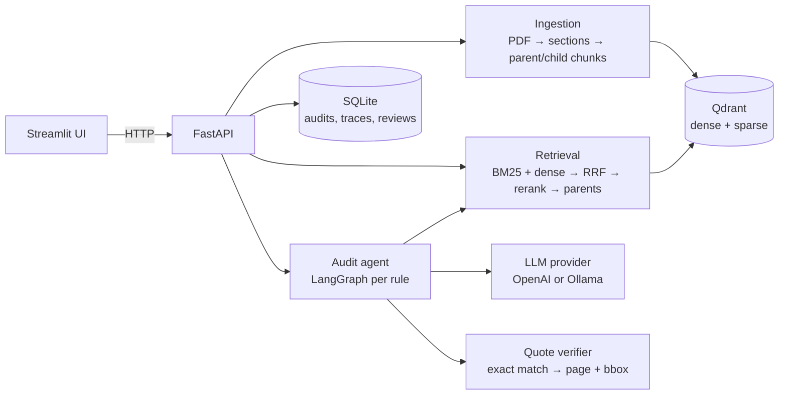

# Reference

## The screens

The UI has six pages in its sidebar. **Documents** uploads and lists PDFs; **Benchmarks** shows the result files. The other four, on the benchmark contract from the README:

**Ask.** Type a question, get a short answer, the sentences it rests on, and those sentences boxed in the PDF. If no quote can be verified, the answer is "not found". See the [walkthrough](how-it-works.md) for what happens in between.

**Search.** The retrieval step on its own, without an answer. Each row is a passage of the document; the columns show where each method ranked it, so you can see why it came out where it did.


*How to read it: BM25 ranks by shared words, dense by meaning, RRF combines the two ranks, rerank is a model's 0–1 score for "does this passage answer the question"; the table is sorted by it. Here the clause that answers (12.2) is BM25 #6, dense #2 and ends 4th; the confidentiality clause 12.8.1, which also mentions consent, is put first. Change is how far the reranker moved a passage.*

**Audit.** Checks every rule of a playbook and shows a report. Pick a row to see the finding: the model's reasoning, its verified quotes and the boxes in the PDF, with accept/reject buttons for a human reviewer.


*How to read it: one row per rule. ✅ compliant, ⛔ non-compliant (a required clause is wrong or a prohibited one is there), 🟠 missing, ❔ uncertain (the model's quote could not be verified twice). Risk is severity × status, from code; Citations is the number of verified quotes; Evidence is how many queries and sections the agent used.*

**Agent trace.** What the agent did for each rule during an audit, on a timeline.


*How to read it: blue search, orange rewrite (evidence was weak, so new queries), green evaluate (the LLM decides), yellow verify, pink wide scan (before calling a clause missing, the top 15 sections are checked one by one). anti_assignment went straight through; audit_rights found nothing and was scanned before being reported missing; renewal_term was evaluated twice because its first quote failed verification.*

The same Audit page on a research paper with the `research_paper` playbook:


## Architecture



Per rule, the agent searches the document, rewrites the query when evidence is weak (at most twice), asks the evaluation model whether the item exists and meets the criteria, verifies every quote, and runs a wide scan of the top 15 sections before it reports the item as missing. The status comes from the model; the risk score comes from code: severity weight × status factor.

Per rule, the agent searches the document, rewrites the query when evidence is weak (at most twice), asks the evaluation model whether the item exists and meets the criteria, verifies every quote, and runs a wide scan of the top 15 sections before it reports the item as missing. The status comes from the model; the risk score comes from code.

## Running it

GPU: `docker compose -f docker-compose.yml -f docker-compose.gpu.yml up -d`.
Local models in Docker: `docker compose --profile local up -d`, then `docker compose exec ollama ollama pull qwen3:8b`.
Ollama already running on the host: leave out `--profile local` (both would use port 11434) and set `DOCKER_OLLAMA_HOST=http://host.docker.internal:11434` in `.env`. `OLLAMA_HOST` in `.env` is for running without Docker; compose ignores it.
On a 12 GB GPU keep `OLLAMA_NUM_CTX=8192`: with the embedding and reranking models on the same card, a 16k context pushes an 8B model partly into system RAM.
The first upload downloads the embedding and reranking models (~4 GB) into a volume.

`docker compose down` keeps data in volumes. Stopping the API (Ctrl+C or `down`) waits for an audit that is still running to finish.

Command line: `python -m auditor.cli ingest contract.pdf`, `... audit <document_id> commercial_contract`, `... ask "What is the liability cap?"`.

### Cloud or local

| | OpenAI | Ollama |
|---|---|---|
| Setting | `AUDITOR_PROVIDER=openai`, `OPENAI_API_KEY` | `AUDITOR_PROVIDER=ollama` (default), `OLLAMA_MODEL` |
| Models | `OPENAI_EVAL_MODEL` judges rules; `OPENAI_SMALL_MODEL` rewrites queries, scans, extracts metadata, answers questions | one model for everything |
| Data | the retrieved sections are sent to OpenAI | nothing leaves the machine; the only network traffic is the first model download |

The UI and the API let you pick the provider per audit. Saved audits are cached per document, playbook, model, prompt version and audit settings; "Run again" forces a new run.

## Writing a playbook

A playbook is a YAML file in `playbooks/`; it is validated on load and errors name the rule and field.

```yaml
name: Commercial contract
document: contract                # what the rules check, singular (default: document)
item: clause                      # what one rule looks for (default: passage)
rules:
  - id: liability_cap             # lowercase letters, digits, underscores
    title: Limitation of liability
    type: must_exist              # must_exist | must_not_exist | condition
    severity: high                # low | medium | high
    queries: ["limitation of liability", "liability cap aggregate amount"]
    criteria: "Total liability of a party is limited to a stated amount or a formula."
```

| type | item found, meets criteria | found, does not | not found |
|---|---|---|---|
| must_exist | compliant | non-compliant | missing |
| condition | compliant | non-compliant | missing |
| must_not_exist | non-compliant (prohibited item present) | compliant | compliant |

For `must_not_exist`, `criteria` describes the prohibited item. Good `queries` use the words such documents use, not the rule's name. `document` and `item` name the domain in the prompts ("You review research papers…"); the two contract playbooks set them to contract and clause, which gives the prompts the benchmarks were measured with, word for word.

Shipped playbooks: `commercial_contract` (18 rules, derived from CUAD clause types), `gdpr_dpa` (12 rules, GDPR Art. 28) and `research_paper` (14 reporting rules for an empirical paper: data and code availability, limitations, ethics, preregistration, funding).

## API

| Endpoint | Purpose |
|---|---|
| `POST /documents` | upload and index a PDF |
| `GET /documents`, `GET /documents/{id}`, `GET /documents/{id}/file` | list, metadata, PDF |
| `POST /search` | search with per-stage scores |
| `POST /ask` | answer with verified quotes, or "not found" |
| `GET /playbooks`, `GET /providers` | playbooks, model availability |
| `POST /audits`, `GET /audits`, `GET /audits/{id}` | start (cached result or 202), list, report |
| `GET /audits/{id}/trace` | per-rule agent steps with time, tokens and cost |
| `POST /audits/{id}/findings/{rule_id}/review` | accept or reject a finding |
| `GET /audits/{id}/export?format=json\|pdf` | report; the PDF appends the document with highlights |
| `GET /benchmarks` | benchmark result files |

## Tests

```bash
.venv/Scripts/python -m pytest              # offline: fake models and LLMs
.venv/Scripts/python -m pytest -m slow      # real models and LLM calls
```
