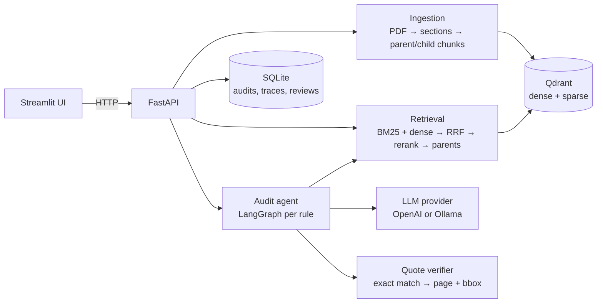

# Plan 4: Benchmark, Playbook'lar, Docker Compose ve README — Implementation Plan

> **For agentic workers:** REQUIRED SUB-SKILL: Use superpowers:subagent-driven-development (recommended) or superpowers:executing-plans to implement this plan task-by-task. Steps use checkbox (`- [ ]`) syntax for tracking.

**Goal:** Sistemin ne kadar iyi çalıştığını CUAD üzerinde ölçmek. Arama satırları ve "yalnız arama ile madde var/yok" satırı LLM'siz; denetim satırları Ollama ve OpenAI ile. Ölçümle rerank eşiğini ve varsayılan modelleri seçmek. İkinci playbook (GDPR DPA) ile alandan bağımsızlığı göstermek. Sistemi `docker compose up` ile ayağa kaldırmak. Rakamları sonuç dosyalarından üretilen bir README yazmak.

**Architecture:**
- Ölçüm mantığı `src/auditor/bench/` paketinde (CUAD yükleyici, metrikler, bütçe sınırı) ve birim testli.
- `benchmarks/` altındaki betikler bu paketi ve çekirdeği kullanır, sonuçları `benchmarks/results/*.json` dosyalarına `BenchmarkFile` biçiminde yazar. README tablosu yalnız bu dosyalardan üretilir.
- Semantic chunking ve bağlam öneki çekirdeğe Indexer kancası olarak girer.
- Çalıştırma sırası kullanıcının isteğiyle sabit: önce ücretsiz ve yerel koşular (LLM'siz arama, Ollama), sonra bir değerlendirme durağı (hatalar, başarı ölçütleri, maliyet tahmini), en son ve yalnız onayla ücretli OpenAI koşuları.

**Tech Stack:** Python 3.12, PyMuPDF, Qdrant 1.19 (yerel dosya modu ve Docker'da sunucu), bge-m3, bge-reranker-v2-m3, Ollama (`qwen3:8b`, `qwen3:14b` ve 8B adayları), OpenAI (`gpt-5.4-mini`, `gpt-5.5`), FastAPI, Streamlit, Docker Compose, pytest.

**Spec:** `docs/superpowers/specs/2026-10-12-rag-compliance-auditor-design.md` (bölüm 1 başarı ölçütleri, 3 "Bağlam öneki", 4 "Yetersiz kanıt sinyali", 5 "Modeller", 9, 10, 12, 13)

## Plan dizisi

1. Ingestion ve arama hattı (tamamlandı)
2. LLM sağlayıcıları, denetim ajanı, belgeye sor, SQLite, metadata (tamamlandı)
3. FastAPI ve Streamlit arayüzü (tamamlandı)
4. **Benchmark, playbook'lar, Docker Compose, README** (bu plan)

Önceki planlardan devreden işler bu planda kapanır:
- rerank eşiğinin (`min_rerank_score`, şimdi geçici 0.05) ölçümle ayarlanması: Task 6 ve Task 12
- denetim önbellek anahtarına ayar parmak izi: Task 5
- varsayılan Ollama modeli: Task 10
- README'de "Ctrl+C sürmekte olan denetimi bekler" notu: Task 15

## Global Constraints

- Python 3.12 (`.venv/Scripts/python`), Windows 11 geliştirme makinesi; GPU RTX 3060 12 GB.
- Kod, tanımlayıcılar, prompt'lar, API ve arayüz metinleri İngilizce. Plan açıklamaları ve kullanıcıya yazılan mesajlar Türkçe.
- CUAD verisi (`data/cuad/`) depoya girmez; `data/` zaten `.gitignore`'da. Depoya giren benchmark dosyaları: betikler, `benchmarks/subset.json` (sabit 50 sözleşmelik alt küme), `benchmarks/results/*.json`.
- CUAD lisansı CC BY 4.0'dır; README'de The Atticus Project'e atıf yapılır.
- Sonuç dosyaları `auditor.benchmark_results.BenchmarkFile` biçimindedir: `title`, `created_at`, `rows`, `notes`. Sütun adlarında `.` ve `[` olmaz. İlk sütun satır etiketidir. Rakamlar README'ye elle yazılmaz, `benchmarks/make_readme_table.py` üretir.
- **Ücretli koşu kuralı:**
  - OpenAI çağıran her betik `--max-cost` ister (varsayılan 3.0 USD).
  - Betik ilk birimin gerçek maliyetinden toplamı tahmin eder ve tavanı aşacaksa durur (`Budget`). Önbellekten gelen birimler bedavadır ve tahmine girmez.
  - Ücretli koşular yalnız Task 14'te ve kullanıcının Task 13 sonundaki açık onayıyla yapılır.
- Arama ölçümü sözleşme başına filtrelidir: her sorgu yalnız kendi sözleşmesinde arar (`SearchFilter(document_ids=[...])`), denetimdeki gibi.
- İsabet tanımı: bulunan chunk'ın karakter aralığı uzman işaretli bir aralıkla örtüşüyor. CUAD metni `parse_text` ile değişmeden indekslenir; her sözleşmede `doc.text == contract.text` kontrol edilir.
- Varsayılan test koşusu ağ, gerçek model ve GPU gerektirmez. CUAD indirme testi sahte indirici kullanır.
- Her commit mesajı, commit'i yazan modelin kendi atıf satırıyla biter (`Co-Authored-By: Claude <model> <noreply@anthropic.com>`).
- Çalışma `plan-4-benchmarks-packaging` dalında yapılır; bitince master'a merge edilip push edilir (PR açılmaz).

## Review Focus

Spec'in söylemediği ama kullanıcının karşılaşacağı durumlar. Her birinin testi ilgili task'e eklendi.

1. **CUAD işaret aralıkları indekslenen metinle hizalı değil** (ör. satır sonu normalizasyonu metni kaydırır) → ölçüm sessizce yanlış çıkar. Betik her sözleşmede `doc.text == contract.text` kontrol eder, uymazsa açık hatayla durur (Task 6).
2. **Bütçe koşunun ortasında doluyor** → betik yeni birime başlamadan durur, o ana kadarki sonucu `contracts` sayısı ve "stopped by budget" notuyla yazar. Yeniden çalıştırınca önbellekten devam eder, tamamlanmış denetimlere tekrar para ödenmez (Task 2, Task 8).
3. **Bir saatlik koşu yarıda kesiliyor (Ctrl+C, elektrik)** → yeniden çalıştırma baştan başlamaz. İndekslenmiş sözleşmeler atlanır (Task 6). Hesaplanmış sıralar diskte saklanır (Task 6). Denetimler önbellekten gelir (Task 8).
4. **README tablosu üretilirken bir sonuç dosyası bozuk ya da README'de işaretler yok** → açık hata, README bozulmadan kalır. Bozuk dosya tabloda hata satırı olarak görünür, sessizce atlanmaz (Task 9).
5. **Docker'da API, Qdrant hazır olmadan başlıyor ya da `.env` yok** → API sağlıklı olana kadar UI başlamaz, `.env` yokken compose yine çalışır (OpenAI'sız, Ollama'lı mod), veriler yeniden başlatmada kaybolmaz (Task 11: compose dosyası testi + elle doğrulama).

## File Structure

```
pyproject.toml                    pytest pythonpath'e "." (benchmarks paketi)
.env.example                      AUDITOR_CONTEXT_PREFIX, RERANK_DEVICE, OLLAMA_THINK, önerilen modeller
.dockerignore, Dockerfile, docker-compose.yml, docker-compose.gpu.yml
README.md                         mimari, kurulum, bulut/yerel, playbook yazma, benchmark tablosu
docs/video-shot-list.md           video çekim sırası
playbooks/
  commercial_contract.yaml        18 kural; 17'si bir CUAD kategorisine karşılık gelir
  gdpr_dpa.yaml                   GDPR madde 28 veri işleme sözleşmesi kontrol listesi
src/auditor/
  bench/
    __init__.py
    cuad.py                       CUAD_CATEGORIES, load_cuad, clause_categories, query_for, select_subset, download_cuad
    metrics.py                    overlaps, first_hit, recall_at, mrr, prf, absence_prf, best_f1_threshold, threshold_for_present_recall
    budget.py                     Budget, BudgetExceeded
  ingestion/
    semantic.py                   build_semantic_chunks (yalnız benchmark)
    context.py                    LLMContextualizer (bağlam öneki)
    indexer.py                    chunker parametresi
  audit/runner.py                 config_fingerprint, cache_key(settings=...)
  llm/ollama_provider.py          think ayarı
  config.py, services.py          context_prefix, rerank_device, ollama_think
benchmarks/
  __init__.py
  get_cuad.py                     CUAD indir, sabit alt kümeyi yaz
  retrieval_bench.py              arama, chunking, bağlam öneki ve "yalnız arama ile var/yok" ölçümleri
  audit_bench.py                  denetim ölçümü (Ollama veya OpenAI), bütçe sınırlı
  compare_ollama.py               8B adaylarını örnek sözleşmede karşılaştırır
  make_readme_table.py            results/*.json → README tablosu
  subset.json                     sabit 50 sözleşme (Task 12'de üretilir)
  results/*.json                  ölçüm sonuçları
tests/
  cuad_fixture.py                 üç sözleşmelik sahte CUAD dosyası
  test_bench_cuad.py, test_bench_metrics.py, test_semantic.py, test_context.py
  test_retrieval_bench.py, test_audit_bench.py, test_readme_table.py, test_shipped_files.py
```

---

### Task 1: CUAD yükleyici, indirici ve sabit alt küme

**Files:**
- Modify: `pyproject.toml`
- Create: `src/auditor/bench/__init__.py`, `src/auditor/bench/cuad.py`, `benchmarks/__init__.py`, `benchmarks/get_cuad.py`, `tests/cuad_fixture.py`, `tests/test_bench_cuad.py`

**Interfaces:**
- Consumes: —
- Produces:
  - `CUAD_CATEGORIES: tuple[str, ...]` (41 kategori, CUAD sırasıyla), `METADATA_CATEGORIES: frozenset[str]`
  - `@dataclass(frozen=True) CuadContract(title: str, text: str, spans: dict[str, list[tuple[int, int]]])` — kategori → uzman işaretli karakter aralıkları; boş liste = madde yok
  - `load_cuad(path) -> tuple[list[CuadContract], dict[str, str]]` (sözleşmeler ve kategori → açıklama)
  - `clause_categories(details: dict[str, str]) -> list[str]` (meta kategoriler hariç, sıralı)
  - `query_for(category: str, details: dict[str, str]) -> str` → `"<kategori>: <açıklama>"`
  - `select_subset(contracts, n: int, seed: int = 13) -> list[str]` (sıralı başlıklar), `save_subset(path, titles)`, `load_subset(path) -> list[str]`
  - `download_cuad(dest, *, url=CUAD_URL, zip_md5=CUAD_ZIP_MD5, json_sha256=CUAD_JSON_SHA256) -> Path`
  - `tests/cuad_fixture.py`: `write_cuad(path) -> Path`, `CONTRACTS: dict[str, str]`, `CAP`, `LAW`, `DETAILS`
  - `benchmarks.get_cuad.main(argv=None) -> int`, `SUBSET_FILE`

CUAD gerçek dosyasında doğrulanan gerçekler (2026-10-14):
- Zenodo kaydı 4595826. Zip 105 883 672 bayt, md5 `c38f490a984420b8a62600db401fafd5`.
- `CUAD_v1/CUAD_v1.json`'ın sha256'sı `ed0b77d85bdf4014d7495800e8e4a70565b48ee6f8a2e5dca9cf8655dbf10eae`.
- SQuAD biçiminde 510 sözleşme, her biri tek paragraf ve 41 soru. Soru kimliği `"<başlık>__<kategori>"`.
- `answer_start` ofsetleri `context` metnine birebir uyar; metinlerde `\r` yok.
- Açıklamalar sorudaki `Details:` sonrasıdır ve `\xa0` içerir.
- 20 910 çiftin 6 702'sinde işaret var.

- [ ] **Step 1: Dal aç ve test yolunu ayarla**

```bash
git checkout -b plan-4-benchmarks-packaging
```

`pyproject.toml` içinde `pythonpath = ["ui"]` satırını şu yap:

```toml
pythonpath = ["ui", "."]
```

- [ ] **Step 2: Sahte CUAD dosyasını yaz**

`tests/cuad_fixture.py`:

```python
"""A three-contract file in CUAD's SQuAD format, for benchmark tests."""

import json
from pathlib import Path

QUESTION = ('Highlight the parts (if any) of this contract related to "{0}" that should be '
            'reviewed by a lawyer. Details: {1}')
DETAILS = {
    "Document Name": "The name of the contract",
    "Cap On Liability": "Does the contract include a cap on liability upon the breach of a party’s obligation?",
    "Governing Law": "Which state/country's law governs the interpretation of the contract?",
}
CAP = "The total liability of either party shall not exceed the fees paid in the twelve months before the claim."
LAW = "This Agreement is governed by the laws of the State of New York."

CONTRACTS = {
    "ALPHA-SUPPLY": ("SUPPLY AGREEMENT\n\n1. Definitions\nProducts means the goods listed in Exhibit A.\n\n"
                     f"2. Limitation of Liability\n{CAP}\n\n3. Governing Law\n{LAW}\n"),
    "BETA-SERVICES": ("SERVICES AGREEMENT\n\n1. Services\nThe provider performs the services in Exhibit B.\n\n"
                      f"2. Governing Law\n{LAW}\n\n3. Payment\nFees are due within thirty days of invoice.\n"),
    "GAMMA-LICENSE": ("LICENSE AGREEMENT\n\n1. License\nLicensor grants a non-exclusive license to use the software.\n\n"
                      f"2. Liability\n{CAP}\n\n3. Term\nThis agreement lasts two years.\n"),
}


def _answers(text: str, needle: str) -> list[dict]:
    return [{"text": needle, "answer_start": text.index(needle)}] if needle in text else []


def write_cuad(path: Path) -> Path:
    data = []
    for title, text in CONTRACTS.items():
        needles = {"Document Name": text.split("\n", 1)[0], "Cap On Liability": CAP, "Governing Law": LAW}
        qas = []
        for category, needle in needles.items():
            answers = _answers(text, needle)
            qas.append({"id": f"{title}__{category}", "question": QUESTION.format(category, DETAILS[category]),
                        "answers": answers, "is_impossible": not answers})
        data.append({"title": title, "paragraphs": [{"context": text, "qas": qas}]})
    path.write_text(json.dumps({"version": "aok_v1.0", "data": data}), encoding="utf-8")
    return path
```

- [ ] **Step 3: Failing testleri yaz**

`tests/test_bench_cuad.py`:

```python
import hashlib
import shutil
import urllib.request
import zipfile

import pytest
from cuad_fixture import CAP, CONTRACTS, LAW, write_cuad

import benchmarks.get_cuad as get_cuad
from auditor.bench.cuad import (
    CUAD_CATEGORIES,
    METADATA_CATEGORIES,
    clause_categories,
    download_cuad,
    load_cuad,
    load_subset,
    query_for,
    save_subset,
    select_subset,
)


def test_categories_constant():
    assert len(CUAD_CATEGORIES) == 41
    assert METADATA_CATEGORIES <= set(CUAD_CATEGORIES)
    assert len(METADATA_CATEGORIES) == 5


def test_load_cuad_spans_and_details(tmp_path):
    contracts, details = load_cuad(write_cuad(tmp_path / "cuad.json"))
    by_title = {c.title: c for c in contracts}
    assert set(by_title) == set(CONTRACTS)
    alpha = by_title["ALPHA-SUPPLY"]
    start = alpha.text.index(CAP)
    assert alpha.spans["Cap On Liability"] == [(start, start + len(CAP))]
    assert alpha.text[slice(*alpha.spans["Governing Law"][0])] == LAW
    assert by_title["BETA-SERVICES"].spans["Cap On Liability"] == []
    assert details["Cap On Liability"] == ("Does the contract include a cap on liability upon the breach "
                                           "of a party’s obligation?")


def test_clause_categories_and_query(tmp_path):
    _, details = load_cuad(write_cuad(tmp_path / "cuad.json"))
    assert clause_categories(details) == ["Cap On Liability", "Governing Law"]
    assert query_for("Governing Law", details) == (
        "Governing Law: Which state/country's law governs the interpretation of the contract?")


def test_subset_is_deterministic_sorted_and_round_trips(tmp_path):
    contracts, _ = load_cuad(write_cuad(tmp_path / "cuad.json"))
    first = select_subset(contracts, 2)
    assert first == select_subset(contracts, 2) == sorted(first)
    assert len(first) == 2
    with pytest.raises(ValueError):
        select_subset(contracts, 4)
    save_subset(tmp_path / "subset.json", first)
    assert load_subset(tmp_path / "subset.json") == first


def _zip_with(tmp_path, json_path):
    archive = tmp_path / "source.zip"
    with zipfile.ZipFile(archive, "w") as zf:
        zf.write(json_path, "CUAD_v1/CUAD_v1.json")
    return archive


def _digest(path, algorithm):
    return hashlib.new(algorithm, path.read_bytes()).hexdigest()


def test_download_verifies_and_extracts(tmp_path, monkeypatch):
    json_path = write_cuad(tmp_path / "real.json")
    archive = _zip_with(tmp_path, json_path)
    calls = []
    monkeypatch.setattr(urllib.request, "urlretrieve",
                        lambda url, target: calls.append(url) or shutil.copy(archive, target))
    sums = {"zip_md5": _digest(archive, "md5"), "json_sha256": _digest(json_path, "sha256")}

    target = download_cuad(tmp_path / "dest", url="https://example.test/cuad.zip", **sums)
    assert target.read_bytes() == json_path.read_bytes()
    assert not (tmp_path / "dest" / "CUAD_v1.zip").exists()
    download_cuad(tmp_path / "dest", url="https://example.test/cuad.zip", **sums)
    assert calls == ["https://example.test/cuad.zip"]


def test_download_rejects_wrong_checksum(tmp_path, monkeypatch):
    archive = _zip_with(tmp_path, write_cuad(tmp_path / "real.json"))
    monkeypatch.setattr(urllib.request, "urlretrieve", lambda url, target: shutil.copy(archive, target))
    with pytest.raises(ValueError, match="checksum"):
        download_cuad(tmp_path / "dest", zip_md5="0" * 32, json_sha256="0" * 64)
    assert not (tmp_path / "dest" / "CUAD_v1.json").exists()


def test_get_cuad_writes_subset_once(tmp_path, monkeypatch, capsys):
    json_path = write_cuad(tmp_path / "cuad.json")
    monkeypatch.setattr(get_cuad, "download_cuad", lambda dest: json_path)
    monkeypatch.setattr(get_cuad, "SUBSET_FILE", tmp_path / "subset.json")
    assert get_cuad.main(["--subset-size", "2"]) == 0
    assert len(load_subset(tmp_path / "subset.json")) == 2
    assert get_cuad.main(["--subset-size", "3"]) == 0
    assert len(load_subset(tmp_path / "subset.json")) == 2
    assert "subset kept" in capsys.readouterr().out
```

- [ ] **Step 4: Testlerin başarısız olduğunu gör**

Run: `.venv/Scripts/python -m pytest tests/test_bench_cuad.py -v`
Expected: FAIL — `No module named 'auditor.bench'`

- [ ] **Step 5: Yükleyiciyi yaz**

`src/auditor/bench/__init__.py` ve `benchmarks/__init__.py`: boş dosyalar.

`src/auditor/bench/cuad.py`:

```python
"""CUAD v1, the Contract Understanding Atticus Dataset (CC BY 4.0, The Atticus Project):
510 commercial contracts in which lawyers marked the text of 41 clause categories.
The benchmarks use it as an answer key."""

import hashlib
import json
import random
import re
import urllib.request
import zipfile
from dataclasses import dataclass
from pathlib import Path

CUAD_URL = "https://zenodo.org/records/4595826/files/CUAD_v1.zip"
CUAD_ZIP_MD5 = "c38f490a984420b8a62600db401fafd5"
CUAD_JSON_SHA256 = "ed0b77d85bdf4014d7495800e8e4a70565b48ee6f8a2e5dca9cf8655dbf10eae"
JSON_MEMBER = "CUAD_v1/CUAD_v1.json"

CUAD_CATEGORIES = (
    "Document Name", "Parties", "Agreement Date", "Effective Date", "Expiration Date",
    "Renewal Term", "Notice Period To Terminate Renewal", "Governing Law", "Most Favored Nation",
    "Non-Compete", "Exclusivity", "No-Solicit Of Customers", "Competitive Restriction Exception",
    "No-Solicit Of Employees", "Non-Disparagement", "Termination For Convenience",
    "Rofr/Rofo/Rofn", "Change Of Control", "Anti-Assignment", "Revenue/Profit Sharing",
    "Price Restrictions", "Minimum Commitment", "Volume Restriction", "Ip Ownership Assignment",
    "Joint Ip Ownership", "License Grant", "Non-Transferable License",
    "Affiliate License-Licensor", "Affiliate License-Licensee",
    "Unlimited/All-You-Can-Eat-License", "Irrevocable Or Perpetual License", "Source Code Escrow",
    "Post-Termination Services", "Audit Rights", "Uncapped Liability", "Cap On Liability",
    "Liquidated Damages", "Warranty Duration", "Insurance", "Covenant Not To Sue",
    "Third Party Beneficiary",
)
# Facts about the contract rather than clauses to look for.
METADATA_CATEGORIES = frozenset(
    {"Document Name", "Parties", "Agreement Date", "Effective Date", "Expiration Date"}
)

Span = tuple[int, int]
_SPACES = re.compile(r"\s+")


@dataclass(frozen=True)
class CuadContract:
    title: str
    text: str
    spans: dict[str, list[Span]]  # category -> expert-marked spans; empty when the clause is absent


def _details(question: str) -> str:
    _, _, details = question.partition("Details:")
    return _SPACES.sub(" ", details).strip()


def load_cuad(path: str | Path) -> tuple[list[CuadContract], dict[str, str]]:
    raw = json.loads(Path(path).read_text(encoding="utf-8"))
    contracts: list[CuadContract] = []
    details: dict[str, str] = {}
    for entry in raw["data"]:
        paragraph = entry["paragraphs"][0]
        spans: dict[str, list[Span]] = {}
        for qa in paragraph["qas"]:
            category = qa["id"].split("__", 1)[1]
            details.setdefault(category, _details(qa["question"]))
            spans[category] = sorted({(a["answer_start"], a["answer_start"] + len(a["text"]))
                                      for a in qa["answers"]})
        contracts.append(CuadContract(entry["title"], paragraph["context"], spans))
    return contracts, details


def clause_categories(details: dict[str, str]) -> list[str]:
    return sorted(c for c in details if c not in METADATA_CATEGORIES)


def query_for(category: str, details: dict[str, str]) -> str:
    return f"{category}: {details[category]}"


def select_subset(contracts: list[CuadContract], n: int, seed: int = 13) -> list[str]:
    titles = sorted(c.title for c in contracts)
    if n > len(titles):
        raise ValueError(f"subset of {n} asked from {len(titles)} contracts")
    return sorted(random.Random(seed).sample(titles, n))


def save_subset(path: str | Path, titles: list[str]) -> None:
    Path(path).write_text(json.dumps(titles, indent=2) + "\n", encoding="utf-8")


def load_subset(path: str | Path) -> list[str]:
    return json.loads(Path(path).read_text(encoding="utf-8"))


def _digest(path: Path, algorithm: str) -> str:
    digest = hashlib.new(algorithm)
    with open(path, "rb") as fh:
        for block in iter(lambda: fh.read(1 << 20), b""):
            digest.update(block)
    return digest.hexdigest()


def download_cuad(dest: str | Path, *, url: str = CUAD_URL, zip_md5: str = CUAD_ZIP_MD5,
                  json_sha256: str = CUAD_JSON_SHA256) -> Path:
    """Downloads the CUAD zip, checks it, and keeps only CUAD_v1.json."""
    dest = Path(dest)
    dest.mkdir(parents=True, exist_ok=True)
    target = dest / "CUAD_v1.json"
    if target.exists() and _digest(target, "sha256") == json_sha256:
        return target
    archive = dest / "CUAD_v1.zip"
    urllib.request.urlretrieve(url, archive)
    try:
        if _digest(archive, "md5") != zip_md5:
            raise ValueError(f"{archive.name}: checksum mismatch; the download is incomplete or changed")
        with zipfile.ZipFile(archive) as zf:
            data = zf.read(JSON_MEMBER)
    finally:
        archive.unlink(missing_ok=True)
    if hashlib.sha256(data).hexdigest() != json_sha256:
        raise ValueError(f"{JSON_MEMBER}: checksum mismatch")
    target.write_bytes(data)
    return target
```

`benchmarks/get_cuad.py`:

```python
"""Downloads CUAD v1 (CC BY 4.0, The Atticus Project) into data/cuad and writes the fixed
50-contract subset the audit benchmark uses. The subset is written once and committed.

Run: python -m benchmarks.get_cuad
"""

import argparse
from pathlib import Path

from auditor.bench.cuad import download_cuad, load_cuad, save_subset, select_subset

SUBSET_FILE = Path(__file__).parent / "subset.json"


def main(argv: list[str] | None = None) -> int:
    parser = argparse.ArgumentParser(prog="get_cuad")
    parser.add_argument("--dest", default="data/cuad")
    parser.add_argument("--subset-size", type=int, default=50)
    args = parser.parse_args(argv)
    path = download_cuad(args.dest)
    print(f"CUAD ready: {path}")
    if SUBSET_FILE.exists():
        print(f"subset kept: {SUBSET_FILE}")
        return 0
    contracts, _ = load_cuad(path)
    save_subset(SUBSET_FILE, select_subset(contracts, args.subset_size))
    print(f"subset written: {SUBSET_FILE}")
    return 0


if __name__ == "__main__":
    raise SystemExit(main())
```

- [ ] **Step 6: Testleri çalıştır**

Run: `.venv/Scripts/python -m pytest tests/test_bench_cuad.py -v`
Expected: 7 passed

Run: `.venv/Scripts/python -m pytest -q`
Expected: tüm testler PASS.

- [ ] **Step 7: Commit**

```bash
git add pyproject.toml src/auditor/bench benchmarks/__init__.py benchmarks/get_cuad.py tests/cuad_fixture.py tests/test_bench_cuad.py
git commit -m "feat: CUAD loader, checked downloader and fixed subset selection

Co-Authored-By: <kendi atıf satırın>"
```

---

### Task 2: Ölçüm metrikleri ve bütçe sınırı

**Files:**
- Create: `src/auditor/bench/metrics.py`, `src/auditor/bench/budget.py`, `tests/test_bench_metrics.py`

**Interfaces:**
- Consumes: —
- Produces:
  - `overlaps(a: Span, b: Span) -> bool`
  - `first_hit(ranked: list[Span], gold: list[Span]) -> int | None` (1 tabanlı sıra)
  - `recall_at(ranks: list[int | None], k: int) -> float`, `mrr(ranks) -> float`
  - `@dataclass(frozen=True) PRF(precision, recall, f1, tp, fp, fn)`, `prf(tp, fp, fn) -> PRF`
  - `absence_prf(pairs: list[tuple[float, bool]], threshold: float) -> PRF` — `pairs` = (en iyi rerank skoru, madde var mı). Pozitif sınıf **madde yok**: skor < eşik ise "yok" tahmini.
  - `best_f1_threshold(pairs) -> tuple[float, PRF]`
  - `threshold_for_present_recall(pairs, min_recall: float = 0.95) -> float` — var olan maddelerin en az %95'ini kaçırmayan en yüksek eşik
  - `citation_hits(citations: list[Span], gold: list[Span]) -> int`
  - `Budget(max_usd: float)`: `record(cost_usd)`, `projected(remaining) -> float`, `check(remaining)` (aşarsa `BudgetExceeded`), alanlar `spent`, `done`

- [ ] **Step 1: Failing testleri yaz**

`tests/test_bench_metrics.py`:

```python
import pytest

from auditor.bench.budget import Budget, BudgetExceeded
from auditor.bench.metrics import (
    PRF,
    absence_prf,
    best_f1_threshold,
    citation_hits,
    first_hit,
    mrr,
    overlaps,
    prf,
    recall_at,
    threshold_for_present_recall,
)


def test_overlaps_is_strict_on_touching_edges():
    assert overlaps((0, 10), (5, 20))
    assert overlaps((5, 6), (0, 10))
    assert not overlaps((0, 10), (10, 20))


def test_first_hit_and_rank_metrics():
    gold = [(100, 150)]
    assert first_hit([(0, 50), (140, 200), (100, 120)], gold) == 2
    assert first_hit([(0, 50)], gold) is None
    assert first_hit([(0, 50)], []) is None
    ranks = [1, 3, None, 30]
    assert recall_at(ranks, 1) == 0.25
    assert recall_at(ranks, 5) == 0.5
    assert recall_at(ranks, 30) == 0.75
    assert mrr(ranks) == pytest.approx((1 + 1 / 3 + 1 / 30) / 4)
    assert recall_at([], 5) == 0.0 and mrr([]) == 0.0


def test_prf_handles_zero_division():
    assert prf(3, 1, 2) == PRF(0.75, 0.6, pytest.approx(2 * 0.75 * 0.6 / 1.35), 3, 1, 2)
    assert prf(0, 0, 0) == PRF(0.0, 0.0, 0.0, 0, 0, 0)


PAIRS = [(0.01, False), (0.02, False), (0.03, True), (0.20, False), (0.50, True), (0.90, True)]


def test_absence_prf_counts_missing_as_positive():
    result = absence_prf(PAIRS, 0.05)
    assert (result.tp, result.fp, result.fn) == (2, 1, 1)


def test_best_f1_threshold_sweeps_every_score():
    threshold, result = best_f1_threshold(PAIRS)
    brute = max((absence_prf(PAIRS, t).f1, -t) for t in [s for s, _ in PAIRS] + [1.0])
    assert result.f1 == pytest.approx(brute[0])
    assert absence_prf(PAIRS, threshold).f1 == pytest.approx(result.f1)


def test_threshold_for_present_recall():
    present = [(s, True) for s in (0.1, 0.2, 0.3, 0.4, 0.5, 0.6, 0.7, 0.8, 0.9, 1.0)]
    assert threshold_for_present_recall(present + [(0.0, False)], 0.9) == 0.2
    assert threshold_for_present_recall(present, 1.0) == 0.1
    assert threshold_for_present_recall([(0.3, False)], 0.95) == 0.0


def test_citation_hits():
    assert citation_hits([(0, 5), (100, 110), (200, 210)], [(103, 300)]) == 2


def test_budget_projects_from_average_and_stops():
    budget = Budget(max_usd=1.0)
    budget.check(remaining=10)
    budget.record(0.15)
    assert budget.projected(remaining=5) == pytest.approx(0.9)
    budget.check(remaining=5)
    with pytest.raises(BudgetExceeded, match=r"\$1.00 cap"):
        budget.check(remaining=6)
```

- [ ] **Step 2: Testlerin başarısız olduğunu gör**

Run: `.venv/Scripts/python -m pytest tests/test_bench_metrics.py -v`
Expected: FAIL — `No module named 'auditor.bench.metrics'`

- [ ] **Step 3: Metrikleri ve bütçeyi yaz**

`src/auditor/bench/metrics.py`:

```python
from dataclasses import dataclass

Span = tuple[int, int]


def overlaps(a: Span, b: Span) -> bool:
    return a[0] < b[1] and b[0] < a[1]


def first_hit(ranked: list[Span], gold: list[Span]) -> int | None:
    for rank, span in enumerate(ranked, start=1):
        if any(overlaps(span, g) for g in gold):
            return rank
    return None


def recall_at(ranks: list[int | None], k: int) -> float:
    if not ranks:
        return 0.0
    return sum(1 for r in ranks if r is not None and r <= k) / len(ranks)


def mrr(ranks: list[int | None]) -> float:
    if not ranks:
        return 0.0
    return sum(1 / r for r in ranks if r is not None) / len(ranks)


@dataclass(frozen=True)
class PRF:
    precision: float
    recall: float
    f1: float
    tp: int
    fp: int
    fn: int


def prf(tp: int, fp: int, fn: int) -> PRF:
    precision = tp / (tp + fp) if tp + fp else 0.0
    recall = tp / (tp + fn) if tp + fn else 0.0
    f1 = 2 * precision * recall / (precision + recall) if precision + recall else 0.0
    return PRF(precision, recall, f1, tp, fp, fn)


def absence_prf(pairs: list[tuple[float, bool]], threshold: float) -> PRF:
    """Positive class is a missing clause: a score below the threshold predicts 'missing'."""
    tp = sum(1 for score, present in pairs if score < threshold and not present)
    fp = sum(1 for score, present in pairs if score < threshold and present)
    fn = sum(1 for score, present in pairs if score >= threshold and not present)
    return prf(tp, fp, fn)


def best_f1_threshold(pairs: list[tuple[float, bool]]) -> tuple[float, PRF]:
    """Tries every distinct score (and one above the maximum) in one sorted sweep."""
    ordered = sorted(pairs)
    total_missing = sum(1 for _, present in ordered if not present)
    best: tuple[float, PRF] | None = None
    tp = fp = 0
    candidates = sorted({score for score, _ in ordered}) + [ordered[-1][0] + 1e-9] if ordered else []
    i = 0
    for threshold in candidates:
        while i < len(ordered) and ordered[i][0] < threshold:
            if ordered[i][1]:
                fp += 1
            else:
                tp += 1
            i += 1
        result = prf(tp, fp, total_missing - tp)
        if best is None or result.f1 > best[1].f1:
            best = (threshold, result)
    return best if best is not None else (0.0, prf(0, 0, 0))


def threshold_for_present_recall(pairs: list[tuple[float, bool]], min_recall: float = 0.95) -> float:
    """The highest threshold that still keeps min_recall of the present clauses above it."""
    present = sorted(score for score, is_present in pairs if is_present)
    if not present:
        return 0.0
    allowed_misses = int((1 - min_recall) * len(present) + 1e-9)
    return present[allowed_misses]


def citation_hits(citations: list[Span], gold: list[Span]) -> int:
    return sum(1 for c in citations if any(overlaps(c, g) for g in gold))
```

`src/auditor/bench/budget.py`:

```python
from dataclasses import dataclass


class BudgetExceeded(Exception):
    pass


@dataclass
class Budget:
    """Stops a paid run before its projected spend passes max_usd. The projection uses the
    average cost of the paid units so far, so the first unit always runs. Units served
    from cache cost nothing and are not recorded."""

    max_usd: float
    spent: float = 0.0
    done: int = 0

    def record(self, cost_usd: float) -> None:
        self.spent += cost_usd
        self.done += 1

    def projected(self, remaining: int) -> float:
        if self.done == 0:
            return self.spent
        return self.spent + self.spent / self.done * remaining

    def check(self, remaining: int) -> None:
        projected = self.projected(remaining)
        if projected > self.max_usd:
            raise BudgetExceeded(
                f"projected ${projected:.2f} for the remaining {remaining} would pass the "
                f"${self.max_usd:.2f} cap (spent ${self.spent:.2f})"
            )
```

- [ ] **Step 4: Testleri çalıştır**

Run: `.venv/Scripts/python -m pytest tests/test_bench_metrics.py -v`
Expected: 8 passed

- [ ] **Step 5: Commit**

```bash
git add src/auditor/bench/metrics.py src/auditor/bench/budget.py tests/test_bench_metrics.py
git commit -m "feat: retrieval and presence metrics, threshold search, budget guard

Co-Authored-By: <kendi atıf satırın>"
```

---

### Task 3: Semantic chunking ve Indexer'a chunker kancası

**Files:**
- Modify: `src/auditor/ingestion/indexer.py`
- Create: `src/auditor/ingestion/semantic.py`, `tests/test_semantic.py`

**Interfaces:**
- Consumes: `chunker.py` yardımcıları (`_split_on`, `_PARA_SEP`, `_SENT_SEP`, `_trim`, `_hard_split`, `locate`, `Chunk`), `Embedder`
- Produces:
  - `sentence_spans(text: str, max_tokens: int) -> list[tuple[int, int]]`
  - `percentile(values: list[float], q: float) -> float`
  - `build_semantic_chunks(doc, embedder, max_tokens: int = 400, breakpoint_percentile: float = 90.0) -> list[Chunk]` — parent = chunk'ın kendisi, bölüm yolu boş
  - `Indexer(..., chunker: Callable[[ParsedDocument], list[Chunk]] | None = None)` (yoksa yapısal `build_chunks`)

Semantic chunker yalnız benchmark içindir: embedder'ı Indexer'ın kilidi dışında çağırır, API yapısal chunker'la kalır.

- [ ] **Step 1: Failing testleri yaz**

`tests/test_semantic.py`:

```python
from fakes import FakeEmbedder, FakeSparseEncoder

from auditor.index.qdrant_store import QdrantStore
from auditor.ingestion.indexer import Indexer
from auditor.ingestion.parser import parse_text
from auditor.ingestion.semantic import build_semantic_chunks, percentile, sentence_spans
from auditor.storage.docstore import DocumentStore
from auditor.tokens import count_tokens

TEXT = (
    "Liability fees cap liability fees. Liability cap fees total liability. "
    "The liability fees cap applies.\n\n"
    "Governing law New York courts. New York law governs courts. Courts of New York law apply."
)


def test_sentence_spans_cover_sentences():
    spans = sentence_spans(TEXT, 400)
    assert [TEXT[s:e] for s, e in spans][:2] == ["Liability fees cap liability fees.",
                                                 "Liability cap fees total liability."]
    assert len(spans) == 6


def test_percentile():
    assert percentile([0.1, 0.2, 0.3, 0.4, 0.5], 100) == 0.5
    assert percentile([0.1, 0.2, 0.3, 0.4, 0.5], 60) == 0.3
    assert percentile([0.4], 90) == 0.4


def test_splits_where_the_topic_changes():
    doc = parse_text(TEXT, "c.txt")
    chunks = build_semantic_chunks(doc, FakeEmbedder(), breakpoint_percentile=100)
    assert len(chunks) == 2
    assert chunks[0].text.endswith("The liability fees cap applies.")
    assert chunks[1].text.startswith("Governing law New York courts.")
    for chunk in chunks:
        assert doc.text[chunk.char_start:chunk.char_end] == chunk.text
        assert (chunk.parent_start, chunk.parent_end) == (chunk.char_start, chunk.char_end)
        assert chunk.parent_id == f"{doc.document_id}:{chunk.char_start}-{chunk.char_end}"


def test_token_limit_is_respected():
    doc = parse_text(TEXT, "c.txt")
    chunks = build_semantic_chunks(doc, FakeEmbedder(), max_tokens=8, breakpoint_percentile=100)
    assert len(chunks) >= 6
    assert all(count_tokens(chunk.text) <= 8 for chunk in chunks)


def test_empty_document_has_no_chunks():
    assert build_semantic_chunks(parse_text("  \n ", "e.txt"), FakeEmbedder()) == []


def test_indexer_uses_the_given_chunker(tmp_path):
    embedder = FakeEmbedder()
    chunker = lambda doc: build_semantic_chunks(doc, embedder, breakpoint_percentile=100)
    indexer = Indexer(QdrantStore.in_memory(), embedder, FakeSparseEncoder(),
                      DocumentStore(tmp_path / "docs"), chunker=chunker)
    assert indexer.ingest_text(TEXT, "c.txt").chunk_count == 2
```

- [ ] **Step 2: Testlerin başarısız olduğunu gör**

Run: `.venv/Scripts/python -m pytest tests/test_semantic.py -v`
Expected: FAIL — `No module named 'auditor.ingestion.semantic'`

- [ ] **Step 3: Semantic chunker'ı yaz**

`src/auditor/ingestion/semantic.py`:

```python
"""Semantic chunking for the benchmark comparison: start a new chunk where the next
sentence's embedding moves furthest from the previous one. Benchmark only — it calls the
embedder outside the indexer's store lock, so the API keeps the structural chunker."""

import math
import uuid

from auditor.index.embedder import Embedder
from auditor.ingestion.chunker import (
    _PARA_SEP,
    _SENT_SEP,
    Chunk,
    Span,
    _hard_split,
    _split_on,
    _trim,
    locate,
)
from auditor.ingestion.parser import ParsedDocument
from auditor.tokens import count_tokens


def sentence_spans(text: str, max_tokens: int) -> list[Span]:
    spans: list[Span] = []
    for p_start, p_end in _split_on(text, 0, len(text), _PARA_SEP):
        for s_start, s_end in _split_on(text, p_start, p_end, _SENT_SEP):
            start, end = _trim(text, s_start, s_end)
            if start >= end:
                continue
            if count_tokens(text[start:end]) <= max_tokens:
                spans.append((start, end))
            else:
                spans.extend(_hard_split(text, start, end, max_tokens))
    return spans


def percentile(values: list[float], q: float) -> float:
    ordered = sorted(values)
    index = max(0, math.ceil(q / 100 * len(ordered)) - 1)
    return ordered[index]


def _chunk(doc: ParsedDocument, start: int, end: int) -> Chunk:
    boxes = locate(doc, start, end)
    return Chunk(
        chunk_id=str(uuid.uuid5(uuid.NAMESPACE_URL, f"{doc.document_id}:semantic:{start}-{end}")),
        document_id=doc.document_id,
        text=doc.text[start:end],
        char_start=start,
        char_end=end,
        pages=sorted({box.page for box in boxes}),
        bboxes=boxes,
        section_title="",
        section_path="",
        parent_id=f"{doc.document_id}:{start}-{end}",
        parent_start=start,
        parent_end=end,
        parent_section_path="",
    )


def build_semantic_chunks(doc: ParsedDocument, embedder: Embedder, max_tokens: int = 400,
                          breakpoint_percentile: float = 90.0) -> list[Chunk]:
    units = sentence_spans(doc.text, max_tokens)
    if not units:
        return []
    vectors = embedder.embed_documents([doc.text[s:e] for s, e in units])
    # Embeddings are normalized, so the dot product is the cosine similarity.
    distances = [1.0 - sum(a * b for a, b in zip(vectors[i], vectors[i + 1]))
                 for i in range(len(units) - 1)]
    cut = percentile(distances, breakpoint_percentile) if distances else math.inf
    groups: list[Span] = []
    start, end = units[0]
    for i in range(1, len(units)):
        u_start, u_end = units[i]
        if distances[i - 1] >= cut or count_tokens(doc.text[start:u_end]) > max_tokens:
            groups.append((start, end))
            start = u_start
        end = u_end
    groups.append((start, end))
    return [_chunk(doc, s, e) for s, e in groups]
```

- [ ] **Step 4: Indexer'a chunker parametresi ekle**

`src/auditor/ingestion/indexer.py` içinde `__init__` imzasına `contextualizer`'dan sonra ekle:

```python
        chunker: Callable[[ParsedDocument], list[Chunk]] | None = None,
```

gövdeye `self._chunker = chunker` ekle. `_index` içindeki `chunks = build_chunks(...)` satırı şu olur:

```python
        if self._chunker is not None:
            chunks = self._chunker(doc)
        else:
            chunks = build_chunks(
                doc, detect_sections(doc.lines), self._max_child_tokens, self._max_parent_tokens
            )
```

- [ ] **Step 5: Testleri çalıştır**

Run: `.venv/Scripts/python -m pytest tests/test_semantic.py tests/test_indexer.py -v`
Expected: tümü PASS. `test_splits_where_the_topic_changes` FakeEmbedder'ın kelime karması çakışması yüzünden başarısız olursa iki konunun kelimelerini değiştirme; ikinci paragrafa üçüncü bir aynı-konu cümlesi ekleyip konu sınırının en büyük uzaklık olduğunu doğrula ve sapmayı raporla.

- [ ] **Step 6: Commit**

```bash
git add src/auditor/ingestion/semantic.py src/auditor/ingestion/indexer.py tests/test_semantic.py
git commit -m "feat: semantic chunker for the chunking benchmark, pluggable indexer chunker

Co-Authored-By: <kendi atıf satırın>"
```

---

### Task 4: Bağlam öneki (LLM contextualizer)

**Files:**
- Modify: `src/auditor/config.py`, `src/auditor/services.py`, `tests/test_config.py`, `tests/test_services.py`, `.env.example`
- Create: `src/auditor/ingestion/context.py`, `tests/test_context.py`

**Interfaces:**
- Consumes: `complete_with_retry`, `first_pages_text` (metadata.py), `Indexer(contextualizer=...)` (Plan 1)
- Produces:
  - `CONTEXT_SYSTEM: str`, `class ContextLine(BaseModel): sentence: str`
  - `LLMContextualizer(provider_factory: Callable[[], LLMProvider], max_doc_chars: int = 6000)`: `__call__(doc, chunk) -> str`, alanlar `usage: Usage`, `failures: int`
  - `Settings.context_prefix: bool` (`AUDITOR_CONTEXT_PREFIX`, `1/true/yes/on` → açık; varsayılan kapalı)
  - `build_services` bağlam öneki açıksa Indexer'a `LLMContextualizer(lambda: provider(settings.provider))` verir

Spec bölüm 3: "Açıkken embedding'den önce her chunk'a tek cümlelik belge bağlamı eklenir. Varsayılan kapalı."

- [ ] **Step 1: Failing testleri yaz**

`tests/test_context.py`:

```python
from fakes import FakeLLM

from auditor.ingestion.chunker import build_chunks
from auditor.ingestion.context import ContextLine, LLMContextualizer
from auditor.ingestion.parser import parse_text
from auditor.ingestion.structure import detect_sections
from auditor.llm.base import LLMError

SENTENCE = " A services agreement between Acme Corp and Beta LLC; this passage caps liability. "


def _doc_and_chunk(sample_contract):
    doc = parse_text(sample_contract, "msa.txt")
    chunks = build_chunks(doc, detect_sections(doc.lines))
    return doc, next(c for c in chunks if "aggregate liability" in c.text)


def test_returns_one_stripped_sentence_and_counts_usage(sample_contract):
    llm = FakeLLM({"ContextLine": ContextLine(sentence=SENTENCE)})
    contextualizer = LLMContextualizer(lambda: llm)
    doc, chunk = _doc_and_chunk(sample_contract)
    assert contextualizer(doc, chunk) == SENTENCE.strip()
    contextualizer(doc, chunk)
    assert contextualizer.usage.input_tokens == 200
    [(schema, tier, prompt), _] = llm.calls
    assert (schema, tier) == ("ContextLine", "small")
    assert prompt.startswith("Contract opening:\nMASTER SERVICES AGREEMENT")
    assert prompt.index("Contract opening:") < prompt.index(f"Passage (section {chunk.section_path}):")
    assert prompt.endswith(chunk.text)


def test_failure_gives_empty_prefix(sample_contract):
    contextualizer = LLMContextualizer(lambda: FakeLLM({"ContextLine": LLMError("schema")}))
    doc, chunk = _doc_and_chunk(sample_contract)
    assert contextualizer(doc, chunk) == ""
    assert contextualizer.failures == 1
    assert contextualizer.usage.input_tokens == 0
```

`tests/test_config.py`: `ENV_NAMES`'e `"AUDITOR_CONTEXT_PREFIX"` ekle; `test_defaults` sonuna:

```python
    assert s.context_prefix is False


def test_context_prefix_flag(monkeypatch):
    for value, expected in [("1", True), ("true", True), ("ON", True), ("0", False), ("no", False)]:
        monkeypatch.setenv("AUDITOR_CONTEXT_PREFIX", value)
        assert Settings.from_env().context_prefix is expected
```

`tests/test_services.py` sonuna (aynı dosyadaki model yamalarını tekrar kullanır):

```python
def test_context_prefix_wires_a_contextualizer(tmp_path, monkeypatch):
    from auditor.ingestion.context import LLMContextualizer

    for module, name in [(embedder_module, "BgeM3Embedder"), (embedder_module, "Bm25SparseEncoder"),
                         (reranker_module, "BgeReranker")]:
        monkeypatch.setattr(module, name, type(name, (), {"__init__": lambda self, *a, **k: None}))
    base = replace(Settings.from_env(), data_dir=tmp_path, qdrant_url=None)
    off = build_services(replace(base, context_prefix=False))
    off.store._client.close()
    on = build_services(replace(base, data_dir=tmp_path / "on", context_prefix=True))
    on.store._client.close()
    assert off.indexer._contextualizer is None
    assert isinstance(on.indexer._contextualizer, LLMContextualizer)
```

- [ ] **Step 2: Testlerin başarısız olduğunu gör**

Run: `.venv/Scripts/python -m pytest tests/test_context.py tests/test_config.py tests/test_services.py -v`
Expected: FAIL — `No module named 'auditor.ingestion.context'`; `Settings` için `context_prefix` yok.

- [ ] **Step 3: Contextualizer'ı yaz**

`src/auditor/ingestion/context.py`:

```python
import logging
import threading
from typing import Callable

from pydantic import BaseModel

from auditor.ingestion.chunker import Chunk
from auditor.ingestion.metadata import first_pages_text
from auditor.ingestion.parser import ParsedDocument
from auditor.llm.base import LLMError, LLMProvider, Usage, complete_with_retry

log = logging.getLogger(__name__)

CONTEXT_SYSTEM = (
    "You place a passage within its contract to improve search. Reply with one sentence of at "
    "most 30 words naming the contract type, the parties if stated, and what the passage is "
    "about. Do not quote the passage."
)


class ContextLine(BaseModel):
    sentence: str


class LLMContextualizer:
    """Writes one sentence that places a chunk in its contract; the indexer embeds it in
    front of the chunk text. The contract's opening comes first in every prompt so a
    provider that caches prompt prefixes bills the repeated part at a discount."""

    def __init__(self, provider_factory: Callable[[], LLMProvider], max_doc_chars: int = 6000):
        self._provider_factory = provider_factory
        self._max_doc_chars = max_doc_chars
        self._lock = threading.Lock()
        self.usage = Usage()
        self.failures = 0

    def __call__(self, doc: ParsedDocument, chunk: Chunk) -> str:
        prompt = (f"Contract opening:\n{first_pages_text(doc, max_chars=self._max_doc_chars)}\n\n"
                  f"Passage (section {chunk.section_path or '-'}):\n{chunk.text}")
        try:
            result = complete_with_retry(self._provider_factory(), CONTEXT_SYSTEM, prompt,
                                         ContextLine, "small")
        except LLMError as exc:
            log.warning("context prefix failed for %s: %s", doc.filename, exc)
            with self._lock:
                self.failures += 1
            return ""
        with self._lock:
            self.usage = self.usage + result.usage
        return result.value.sentence.strip()
```

- [ ] **Step 4: Ayarı ve servis bağlantısını ekle**

`src/auditor/config.py`'ye `_int`'in altına:

```python
def _flag(name: str) -> bool:
    return os.environ.get(name, "").strip().lower() in ("1", "true", "yes", "on")
```

`Settings`'e `benchmarks_dir`'den sonra `context_prefix: bool` alanı; `from_env` içine:

```python
            context_prefix=_flag("AUDITOR_CONTEXT_PREFIX"),
```

`src/auditor/services.py`: import'lara `from auditor.ingestion.context import LLMContextualizer` ekle. `build_services` içinde `provider = cached_provider_factory(settings)` satırından sonra:

```python
    contextualizer = (LLMContextualizer(lambda: provider(settings.provider))
                      if settings.context_prefix else None)
```

ve `Services(...)` içindeki Indexer satırı:

```python
        indexer=Indexer(store, embedder, sparse, docstore, lock=lock, contextualizer=contextualizer),
```

`.env.example`'daki "Storage and models" bloğuna:

```
# AUDITOR_CONTEXT_PREFIX=0   # 1 = one LLM sentence of context per chunk before embedding (costs an LLM call per chunk)
```

- [ ] **Step 5: Testleri çalıştır**

Run: `.venv/Scripts/python -m pytest tests/test_context.py tests/test_config.py tests/test_services.py -v`
Expected: tümü PASS.

Run: `.venv/Scripts/python -m pytest -q`
Expected: tüm testler PASS.

- [ ] **Step 6: Commit**

```bash
git add src/auditor/ingestion/context.py src/auditor/config.py src/auditor/services.py tests/test_context.py tests/test_config.py tests/test_services.py .env.example
git commit -m "feat: optional LLM context prefix per chunk (off by default)

Co-Authored-By: <kendi atıf satırın>"
```

---

### Task 5: Önbellek anahtarına ayar parmak izi

**Files:**
- Modify: `src/auditor/audit/runner.py`, `tests/test_auditor.py`

**Interfaces:**
- Consumes: `AuditConfig`, `RetrievalConfig`
- Produces:
  - `config_fingerprint(config: AuditConfig) -> str` (16 hex; `concurrency` hariç, çünkü sonucu değiştirmez)
  - `cache_key(document_id, playbook_sha256, provider_name, model_label, prompt_version=PROMPT_VERSION, settings: str = "") -> str`
  - `Auditor.prepare` anahtara `settings=config_fingerprint(self._config)` verir

Neden: benchmark farklı `max_sections`, `wide_scan_k` veya rerank eşiğiyle koşarsa eski ayarın önbellekli raporu dönmemeli. Not: anahtar değiştiği için `data/plan2`'deki eski önbellekli denetim bir kez yeniden çalışır.

- [ ] **Step 1: Failing testleri yaz**

`tests/test_auditor.py` import'una `config_fingerprint` ekle (`from auditor.audit.runner import Auditor, cache_key, config_fingerprint`), `from dataclasses import replace` ekle. `test_cache_key_changes_with_each_part` içindeki listeye ekle:

```python
        cache_key("doc", "pb", "openai", "m1", settings="abc"),
```

Dosya sonuna:

```python
def test_config_fingerprint_ignores_concurrency_only():
    base = AuditConfig()
    assert config_fingerprint(base) == config_fingerprint(AuditConfig(concurrency=8))
    assert config_fingerprint(base) != config_fingerprint(AuditConfig(max_sections=3))
    looser = replace(base, retrieval=replace(base.retrieval, min_rerank_score=0.2))
    assert config_fingerprint(base) != config_fingerprint(looser)
    assert len(config_fingerprint(base)) == 16


def test_changed_audit_settings_do_not_reuse_the_cache(env):
    first = Auditor(env.retriever, env.docstore, env.audits, env.playbooks, lambda name: audit_llm(),
                    AuditConfig(max_sections=6))
    first.run(env.doc_id, "test_pb", "openai")
    assert first.run(env.doc_id, "test_pb", "openai")["cached"] is True
    other = Auditor(env.retriever, env.docstore, env.audits, env.playbooks, lambda name: audit_llm(),
                    AuditConfig(max_sections=3))
    assert other.run(env.doc_id, "test_pb", "openai")["cached"] is False
```

- [ ] **Step 2: Testlerin başarısız olduğunu gör**

Run: `.venv/Scripts/python -m pytest tests/test_auditor.py -v`
Expected: FAIL — `cannot import name 'config_fingerprint'`

- [ ] **Step 3: Parmak izini ekle**

`src/auditor/audit/runner.py` import'larına `import json` ve `from dataclasses import asdict, dataclass` (mevcut `dataclass` import'unu genişlet) ekle. `cache_key`'i şununla değiştir:

```python
def config_fingerprint(config: AuditConfig) -> str:
    """Settings that change audit results; concurrency only changes speed."""
    values = asdict(config)
    del values["concurrency"]
    return hashlib.sha256(json.dumps(values, sort_keys=True).encode("utf-8")).hexdigest()[:16]


def cache_key(document_id: str, playbook_sha256: str, provider_name: str, model_label: str,
              prompt_version: str = PROMPT_VERSION, settings: str = "") -> str:
    raw = "\n".join([document_id, playbook_sha256, provider_name, model_label, prompt_version,
                     settings])
    return hashlib.sha256(raw.encode("utf-8")).hexdigest()
```

`prepare` içindeki anahtar satırı:

```python
        key = cache_key(document_id, loaded.sha256, provider.name, models_label(provider),
                        settings=config_fingerprint(self._config))
```

- [ ] **Step 4: Testleri çalıştır**

Run: `.venv/Scripts/python -m pytest tests/test_auditor.py -v`
Expected: tümü PASS.

Run: `.venv/Scripts/python -m pytest -q`
Expected: tüm testler PASS.

- [ ] **Step 5: Commit**

```bash
git add src/auditor/audit/runner.py tests/test_auditor.py
git commit -m "feat: audit cache key includes a fingerprint of the audit settings

Co-Authored-By: <kendi atıf satırın>"
```

---
### Task 6: Arama benchmark betiği

**Files:**
- Create: `benchmarks/retrieval_bench.py`, `tests/test_retrieval_bench.py`

**Interfaces:**
- Consumes: `load_cuad`, `clause_categories`, `query_for`, `load_subset` (Task 1); metrikler ve `Budget` (Task 2); `build_semantic_chunks`, `Indexer(chunker=...)` (Task 3); `LLMContextualizer` (Task 4); `BenchmarkFile` (Plan 3); `build_provider` (Plan 2)
- Produces:
  - `MODES: dict[str, RetrievalConfig]` (`bm25`, `dense`, `hybrid`, `hybrid + rerank`; hepsi `final_k=30`), `RERANKED = "hybrid + rerank"`
  - `@dataclass Stack(indexer: Indexer, retriever: Retriever)`
  - `real_stack(settings, variant: str, directory: Path, contextualizer=None) -> Stack` (`variant`: `structural` | `semantic` | `prefix`; modeller tüm varyantlarda bir kez yüklenir)
  - `index_contracts(contracts, indexer, on_indexed=None, log=print) -> dict[str, str]` (başlık → belge id; metin hizası bozuksa `ValueError`)
  - `evaluate(contracts, ids, retriever, details, modes, cache_path, log=print) -> dict` → `{"ranks": {mod: {anahtar: sıra|None}}, "top": {anahtar: skor}}`; anahtar `"<başlık>__<kategori>"`; diskteki önbellekten devam eder
  - `write_result(out_dir, name, title, rows, notes)`
  - Sonuç dosyaları: `retrieval.json`, `presence.json`, `chunking.json`, `context_prefix.json`
  - `main(argv=None, stack_factory=None, provider_factory=None) -> int` (0 tamam, 1 kullanım hatası, 2 bütçe durdurdu)

Ölçüm tanımları:
- **Sorgu:** `query_for(kategori)`, yani CUAD'ın kendi açıklaması. Arama yalnız o sözleşmede, sonuç listesi 30 uzunlukta.
- **İsabet:** ilk örtüşen chunk'ın sırası. recall@5, recall@30 ve MRR yalnız işaretli çiftlerde hesaplanır.
- **"Yalnız arama ile madde var/yok":** her çiftte (işaretli olsun olmasın) `hybrid + rerank` en iyi skoru kullanılır. Pozitif sınıf "madde yok".
- **Önerilen `min_rerank_score`:** var olan maddelerin %95'ini eşiğin üstünde tutan en yüksek eşik. Kaçırılan bir madde, gereksiz bir LLM çağrısından pahalıdır.

- [ ] **Step 1: Failing testleri yaz**

`tests/test_retrieval_bench.py`:

```python
import json
import threading

import pytest
from cuad_fixture import write_cuad
from fakes import FakeEmbedder, FakeLLM, FakeReranker, FakeSparseEncoder

import benchmarks.retrieval_bench as bench
from auditor.bench.cuad import CuadContract, save_subset
from auditor.index.qdrant_store import QdrantStore
from auditor.ingestion.context import ContextLine
from auditor.ingestion.indexer import Indexer
from auditor.ingestion.semantic import build_semantic_chunks
from auditor.llm.base import LLMResult, Usage
from auditor.retrieval.pipeline import Retriever
from auditor.storage.docstore import DocumentStore


def fake_stack(variant, directory, contextualizer=None):
    store, docstore = QdrantStore.in_memory(), DocumentStore(directory / "documents")
    embedder, sparse, lock = FakeEmbedder(), FakeSparseEncoder(), threading.Lock()
    chunker = ((lambda doc: build_semantic_chunks(doc, embedder, breakpoint_percentile=100))
               if variant == "semantic" else None)
    return bench.Stack(
        Indexer(store, embedder, sparse, docstore, lock=lock, chunker=chunker, contextualizer=contextualizer),
        Retriever(store, embedder, sparse, FakeReranker(), docstore, lock),
    )


def _read(path):
    return json.loads(path.read_text(encoding="utf-8"))


@pytest.fixture
def paths(tmp_path):
    return {"cuad": write_cuad(tmp_path / "cuad.json"), "data": tmp_path / "bench",
            "out": tmp_path / "results", "subset": tmp_path / "subset.json"}


def _args(paths, *parts, extra=()):
    argv = ["--cuad", str(paths["cuad"]), "--data-dir", str(paths["data"]), "--out", str(paths["out"]),
            "--subset", str(paths["subset"])]
    for part in parts:
        argv += ["--part", part]
    return argv + list(extra)


def test_modes_write_retrieval_and_presence(paths):
    assert bench.main(_args(paths, "modes"), stack_factory=fake_stack) == 0
    retrieval = _read(paths["out"] / "retrieval.json")
    assert [row["config"] for row in retrieval["rows"]] == list(bench.MODES)
    assert all(row["queries"] == 4 for row in retrieval["rows"])
    assert all(row["recall@30"] == 1.0 for row in retrieval["rows"])
    presence = _read(paths["out"] / "presence.json")
    assert [row["threshold rule"] for row in presence["rows"]] == [
        "provisional default", "best F1", "keeps 95% of present clauses"]
    assert "Recommended min_rerank_score" in presence["notes"]
    assert "6 contract-category pairs" in presence["notes"]


def test_rerun_resumes_from_saved_ranks(paths):
    bench.main(_args(paths, "modes"), stack_factory=fake_stack)

    def no_search_stack(variant, directory, contextualizer=None):
        stack = fake_stack(variant, directory, contextualizer)
        stack.retriever.search = lambda *a, **k: (_ for _ in ()).throw(AssertionError("searched again"))
        return stack

    assert bench.main(_args(paths, "modes"), stack_factory=no_search_stack) == 0


def test_chunking_compares_structural_and_semantic(paths):
    assert bench.main(_args(paths, "chunking"), stack_factory=fake_stack) == 0
    rows = _read(paths["out"] / "chunking.json")["rows"]
    assert [row["config"] for row in rows] == ["structural", "semantic"]


def test_context_prefix_on_the_subset(paths):
    save_subset(paths["subset"], ["ALPHA-SUPPLY", "GAMMA-LICENSE"])
    llm = FakeLLM({"ContextLine": ContextLine(sentence="A contract passage.")})
    code = bench.main(_args(paths, "prefix", extra=["--provider", "ollama"]),
                      stack_factory=fake_stack, provider_factory=lambda name: llm)
    assert code == 0
    data = _read(paths["out"] / "context_prefix.json")
    assert [row["config"] for row in data["rows"]] == ["off", "on"]
    assert all(row["queries"] == 3 for row in data["rows"])
    assert llm.count("ContextLine") > 0


def test_context_prefix_stops_at_the_budget(paths, capsys):
    save_subset(paths["subset"], ["ALPHA-SUPPLY", "BETA-SERVICES", "GAMMA-LICENSE"])

    class PaidLLM(FakeLLM):
        def complete(self, system, user, schema, tier):
            result = super().complete(system, user, schema, tier)
            return LLMResult(result.value, result.model, Usage(1000, 50, 0.5))

    llm = PaidLLM({"ContextLine": ContextLine(sentence="A contract passage.")})
    code = bench.main(_args(paths, "prefix", extra=["--max-cost", "0.6"]),
                      stack_factory=fake_stack, provider_factory=lambda name: llm)
    assert code == 2
    assert "stopped by budget" in capsys.readouterr().out
    assert not (paths["out"] / "context_prefix.json").exists()


def test_misaligned_text_stops_the_run(tmp_path):
    contract = CuadContract("X", "SUPPLY AGREEMENT\r\n1. Term\r\nTwo years.", {})
    stack = fake_stack("structural", tmp_path)
    with pytest.raises(ValueError, match="spans would not line up"):
        bench.index_contracts([contract], stack.indexer, log=lambda message: None)
```

- [ ] **Step 2: Testlerin başarısız olduğunu gör**

Run: `.venv/Scripts/python -m pytest tests/test_retrieval_bench.py -v`
Expected: FAIL — `No module named 'benchmarks.retrieval_bench'`

- [ ] **Step 3: Betiği yaz**

`benchmarks/retrieval_bench.py`:

```python
"""Retrieval benchmark on CUAD. For every contract and clause category the lawyers marked,
search that contract alone and record the rank of the first chunk overlapping a marked
span. The best rerank score of every (contract, category) pair, marked or not, measures
clause presence from retrieval alone and picks min_rerank_score.

Free:            python -m benchmarks.retrieval_bench --part modes --part chunking
Context prefix:  python -m benchmarks.retrieval_bench --part prefix --provider ollama
Index, ranks and scores are saved under --data-dir, so an interrupted run resumes.
"""

import argparse
import json
import threading
import time
from dataclasses import dataclass
from datetime import datetime, timezone
from functools import cache, partial
from pathlib import Path
from typing import Callable

from dotenv import load_dotenv

from auditor.bench.budget import Budget, BudgetExceeded
from auditor.bench.cuad import CuadContract, clause_categories, load_cuad, load_subset, query_for
from auditor.bench.metrics import (
    absence_prf,
    best_f1_threshold,
    first_hit,
    mrr,
    recall_at,
    threshold_for_present_recall,
)
from auditor.benchmark_results import BenchmarkFile
from auditor.config import Settings
from auditor.index.qdrant_store import QdrantStore
from auditor.index.store import SearchFilter
from auditor.ingestion.context import LLMContextualizer
from auditor.ingestion.indexer import IngestResult, Indexer
from auditor.ingestion.parser import parse_text
from auditor.ingestion.semantic import build_semantic_chunks
from auditor.llm.base import LLMProvider, ProviderUnavailableError, models_label
from auditor.llm.factory import PROVIDERS, build_provider
from auditor.retrieval.config import RetrievalConfig
from auditor.retrieval.pipeline import Retriever
from auditor.storage.docstore import DocumentStore

MODES = {
    "bm25": RetrievalConfig(mode="bm25", rerank=False, final_k=30),
    "dense": RetrievalConfig(mode="dense", rerank=False, final_k=30),
    "hybrid": RetrievalConfig(mode="hybrid", rerank=False, final_k=30),
    "hybrid + rerank": RetrievalConfig(mode="hybrid", rerank=True, final_k=30),
}
RERANKED = "hybrid + rerank"
SUBSET_FILE = Path(__file__).parent / "subset.json"
SAVE_EVERY = 200


@dataclass
class Stack:
    indexer: Indexer
    retriever: Retriever


@cache
def _models(embed_model: str, rerank_model: str, device: str | None):
    from auditor.index.embedder import BgeM3Embedder, Bm25SparseEncoder
    from auditor.retrieval.reranker import BgeReranker

    return BgeM3Embedder(embed_model, device), Bm25SparseEncoder(), BgeReranker(rerank_model, device)


def real_stack(settings: Settings, variant: str, directory: Path, contextualizer=None) -> Stack:
    from qdrant_client import QdrantClient

    embedder, sparse, reranker = _models(settings.embed_model, settings.rerank_model, settings.device)
    directory.mkdir(parents=True, exist_ok=True)
    store = QdrantStore(QdrantClient(path=str(directory / "qdrant")), "chunks")
    docstore = DocumentStore(directory / "documents")
    chunker = partial(build_semantic_chunks, embedder=embedder) if variant == "semantic" else None
    lock = threading.Lock()
    return Stack(
        Indexer(store, embedder, sparse, docstore, lock=lock, chunker=chunker, contextualizer=contextualizer),
        Retriever(store, embedder, sparse, reranker, docstore, lock),
    )


def index_contracts(contracts: list[CuadContract], indexer: Indexer,
                    on_indexed: Callable[[IngestResult, int], None] | None = None,
                    log: Callable[[str], None] = print) -> dict[str, str]:
    ids: dict[str, str] = {}
    started = time.perf_counter()
    for n, contract in enumerate(contracts, start=1):
        filename = f"{contract.title}.txt"
        if parse_text(contract.text, filename).text != contract.text:
            raise ValueError(f"{contract.title}: indexed text differs from the CUAD text; "
                             "spans would not line up")
        result = indexer.ingest_text(contract.text, filename)
        ids[contract.title] = result.document_id
        if on_indexed is not None:
            on_indexed(result, len(contracts) - n)
        if n % 25 == 0 or n == len(contracts):
            log(f"  indexed {n}/{len(contracts)} ({time.perf_counter() - started:.0f} s)")
    return ids


def _save(path: Path | None, state: dict) -> None:
    if path is not None:
        path.parent.mkdir(parents=True, exist_ok=True)
        path.write_text(json.dumps(state), encoding="utf-8")


def evaluate(contracts: list[CuadContract], ids: dict[str, str], retriever: Retriever,
             details: dict[str, str], modes: list[str], cache_path: Path | None,
             log: Callable[[str], None] = print) -> dict:
    state = (json.loads(cache_path.read_text(encoding="utf-8"))
             if cache_path is not None and cache_path.exists() else {"ranks": {}, "top": {}})
    for mode in modes:
        state["ranks"].setdefault(mode, {})
    categories = clause_categories(details)
    total, searched, started = len(contracts) * len(categories), 0, time.perf_counter()
    for n, (contract, category) in enumerate(((c, cat) for c in contracts for cat in categories), 1):
        key = f"{contract.title}__{category}"
        gold = contract.spans.get(category, [])
        flt = SearchFilter(document_ids=[ids[contract.title]])
        query = query_for(category, details)
        for mode in modes:
            needs_rank = bool(gold) and key not in state["ranks"][mode]
            needs_top = mode == RERANKED and key not in state["top"]
            if not (needs_rank or needs_top):
                continue
            result = retriever.search(query, MODES[mode], flt)
            searched += 1
            if gold:
                spans = [(chunk.char_start, chunk.char_end) for chunk in result.chunks]
                state["ranks"][mode][key] = first_hit(spans, gold)
            if mode == RERANKED:
                state["top"][key] = result.chunks[0].scores.rerank_score if result.chunks else 0.0
            if searched % SAVE_EVERY == 0:
                _save(cache_path, state)
        if n % 1000 == 0:
            log(f"  pairs {n}/{total} ({time.perf_counter() - started:.0f} s)")
    _save(cache_path, state)
    return state


def _positive_keys(contracts: list[CuadContract], details: dict[str, str]) -> list[str]:
    return [f"{c.title}__{cat}" for c in contracts for cat in clause_categories(details) if c.spans.get(cat)]


def _rank_row(label: str, ranks: list[int | None], **extra) -> dict:
    return {"config": label, **extra, "recall@5": round(recall_at(ranks, 5), 3),
            "recall@30": round(recall_at(ranks, 30), 3), "MRR": round(mrr(ranks), 3),
            "queries": len(ranks)}


def write_result(out_dir: Path, name: str, title: str, rows: list[dict], notes: str) -> None:
    out_dir.mkdir(parents=True, exist_ok=True)
    data = BenchmarkFile(title=title, created_at=datetime.now(timezone.utc).date().isoformat(),
                         rows=rows, notes=notes)
    (out_dir / f"{name}.json").write_text(json.dumps(data.model_dump(), indent=2) + "\n",
                                          encoding="utf-8")


def _evaluated(variant: str, contracts, details, modes, factory, data_dir: Path, log,
               contextualizer=None, on_indexed=None) -> dict:
    stack = (factory(variant, data_dir / variant, contextualizer) if contextualizer is not None
             else factory(variant, data_dir / variant))
    ids = index_contracts(contracts, stack.indexer, on_indexed, log)
    return evaluate(contracts, ids, stack.retriever, details, modes, data_dir / variant / "ranks.json", log)


def run_modes(contracts, details, factory, data_dir: Path, out_dir: Path, log) -> None:
    log(f"modes: {len(contracts)} contracts")
    state = _evaluated("structural", contracts, details, list(MODES), factory, data_dir, log)
    keys = _positive_keys(contracts, details)
    rows = [_rank_row(mode, [state["ranks"][mode][k] for k in keys]) for mode in MODES]
    write_result(out_dir, "retrieval", f"Retrieval on CUAD ({len(contracts)} contracts)", rows,
                 "Each query searches one contract; a hit is the first chunk overlapping a span the "
                 "lawyers marked. Structural chunking, no context prefix.")
    pairs = [(state["top"][f"{c.title}__{cat}"], bool(c.spans.get(cat)))
             for c in contracts for cat in clause_categories(details)]
    current = RetrievalConfig().min_rerank_score
    best, _ = best_f1_threshold(pairs)
    safe = threshold_for_present_recall(pairs, 0.95)
    rows = []
    for label, threshold in (("provisional default", current), ("best F1", best),
                             ("keeps 95% of present clauses", safe)):
        result = absence_prf(pairs, threshold)
        rows.append({"threshold rule": label, "threshold": round(threshold, 4),
                     "missing precision": round(result.precision, 3),
                     "missing recall": round(result.recall, 3), "missing F1": round(result.f1, 3)})
    write_result(out_dir, "presence", "Clause presence from retrieval alone (hybrid + rerank)", rows,
                 f"Positive class: clause missing. {len(pairs)} contract-category pairs. "
                 f"Recommended min_rerank_score: {safe:.4f} (keeps 95% of present clauses above it).")


def run_chunking(contracts, details, factory, data_dir: Path, out_dir: Path, log) -> None:
    log(f"chunking: {len(contracts)} contracts")
    keys = _positive_keys(contracts, details)
    rows = []
    for variant in ("structural", "semantic"):
        state = _evaluated(variant, contracts, details, [RERANKED], factory, data_dir, log)
        rows.append(_rank_row(variant, [state["ranks"][RERANKED][k] for k in keys]))
    write_result(out_dir, "chunking", "Chunking (hybrid + rerank)", rows,
                 "Semantic chunks break where adjacent sentence embeddings drift furthest "
                 "(90th percentile), at most 400 tokens; structural chunks follow clause numbering.")


def run_prefix(contracts, details, factory, data_dir: Path, out_dir: Path, provider: LLMProvider,
               max_cost: float, log) -> None:
    log(f"context prefix: {len(contracts)} subset contracts with {models_label(provider)}")
    keys = _positive_keys(contracts, details)
    off = _evaluated("structural", contracts, details, [RERANKED], factory, data_dir, log)
    contextualizer = LLMContextualizer(lambda: provider)
    budget, seen = Budget(max_cost), [0.0]

    def guard(result: IngestResult, remaining: int) -> None:
        if result.already_indexed:
            return
        budget.record(contextualizer.usage.cost_usd - seen[0])
        seen[0] = contextualizer.usage.cost_usd
        budget.check(remaining)

    on = _evaluated("prefix", contracts, details, [RERANKED], factory, data_dir, log,
                    contextualizer=contextualizer, on_indexed=guard)
    label = f"{provider.name} {models_label(provider)}"
    rows = [_rank_row("off", [off["ranks"][RERANKED][k] for k in keys], **{"context model": "-"}),
            _rank_row("on", [on["ranks"][RERANKED][k] for k in keys], **{"context model": label})]
    write_result(out_dir, "context_prefix", f"Context prefix ({len(contracts)}-contract subset, hybrid + rerank)",
                 rows, f"One LLM sentence per chunk, prepended before embedding. Cost "
                       f"${contextualizer.usage.cost_usd:.2f}; {contextualizer.failures} chunks without a prefix.")


def main(argv: list[str] | None = None, stack_factory=None, provider_factory=None) -> int:
    parser = argparse.ArgumentParser(prog="retrieval_bench")
    parser.add_argument("--cuad", default="data/cuad/CUAD_v1.json")
    parser.add_argument("--part", action="append", choices=["modes", "chunking", "prefix"])
    parser.add_argument("--contracts", type=int, default=0, help="first N contracts only (quick runs)")
    parser.add_argument("--subset", default=str(SUBSET_FILE))
    parser.add_argument("--data-dir", default="data/bench")
    parser.add_argument("--out", default="benchmarks/results")
    parser.add_argument("--provider", choices=PROVIDERS, default="ollama", help="context prefix model")
    parser.add_argument("--max-cost", type=float, default=3.0)
    args = parser.parse_args(argv)
    parts = args.part or ["modes", "chunking"]

    load_dotenv()
    settings = Settings.from_env()
    factory = stack_factory or (lambda variant, directory, contextualizer=None:
                                real_stack(settings, variant, directory, contextualizer))
    contracts, details = load_cuad(args.cuad)
    contracts = sorted(contracts, key=lambda c: c.title)
    if args.contracts:
        contracts = contracts[:args.contracts]
    data_dir, out_dir = Path(args.data_dir), Path(args.out)
    if "modes" in parts:
        run_modes(contracts, details, factory, data_dir, out_dir, print)
    if "chunking" in parts:
        run_chunking(contracts, details, factory, data_dir, out_dir, print)
    if "prefix" in parts:
        wanted = set(load_subset(args.subset))
        subset = [c for c in contracts if c.title in wanted]
        if not subset:
            print("error: no subset contracts among the selected contracts")
            return 1
        provider = (provider_factory or (lambda name: build_provider(name, settings)))(args.provider)
        try:
            provider.check_available()
            run_prefix(subset, details, factory, data_dir, out_dir, provider, args.max_cost, print)
        except ProviderUnavailableError as exc:
            print(f"error: {exc}")
            return 1
        except BudgetExceeded as exc:
            print(f"stopped by budget: {exc}")
            return 2
    return 0


if __name__ == "__main__":
    raise SystemExit(main())
```

Stack factory'si `(variant, directory)` ya da `(variant, directory, contextualizer)` ile çağrılır; `on_indexed` stack'e değil `index_contracts`'a gider.

- [ ] **Step 4: Testleri çalıştır**

Run: `.venv/Scripts/python -m pytest tests/test_retrieval_bench.py -v`
Expected: 6 passed

Run: `.venv/Scripts/python -m pytest -q`
Expected: tüm testler PASS.

- [ ] **Step 5: Commit**

```bash
git add benchmarks/retrieval_bench.py tests/test_retrieval_bench.py
git commit -m "feat: CUAD retrieval benchmark with presence, chunking and context prefix rows

Co-Authored-By: <kendi atıf satırın>"
```

---

### Task 7: Playbook'lar — CUAD'dan türetilmiş ticari playbook ve GDPR DPA

**Files:**
- Modify: `playbooks/commercial_contract.yaml`, `tests/test_playbook.py`
- Create: `playbooks/gdpr_dpa.yaml`, `tests/test_shipped_files.py`

**Interfaces:**
- Consumes: `load_playbook` (Plan 2)
- Produces:
  - `commercial_contract.yaml`: 18 kural. Mevcut beş kural (`liability_cap`, `termination_notice`, `governing_law`, `confidentiality`, `unlimited_liability`) aynen kalır. Eklenenler: `anti_assignment`, `change_of_control`, `non_compete`, `exclusivity`, `audit_rights`, `insurance`, `warranty_duration`, `ip_ownership`, `liquidated_damages`, `minimum_commitment`, `post_termination_services`, `third_party_beneficiary`, `renewal_term`.
  - `gdpr_dpa.yaml`: 12 kural (GDPR madde 28, 32, 33 ve 5. bölüm)

Kural türleri müşteri bakış açısıyladır. Örneğin `non_compete` `must_not_exist`'tir: müşteriyi bağlayan bir rekabet yasağı risklidir. Task 8'deki eşleme her kuralı (gizlilik hariç) bir CUAD kategorisine bağlar.

- [ ] **Step 1: Failing testleri yaz**

`tests/test_playbook.py` içindeki `test_shipped_playbook_is_valid`'i sil (yerini aşağıdaki dosya alır).

`tests/test_shipped_files.py`:

```python
from pathlib import Path

from auditor.audit.playbook import load_playbook

ROOT = Path(__file__).parents[1]


def test_commercial_playbook():
    loaded = load_playbook(ROOT / "playbooks" / "commercial_contract.yaml")
    rules = loaded.playbook.rules
    assert len(rules) == 18
    assert {r.type for r in rules} == {"must_exist", "must_not_exist", "condition"}
    assert {"liability_cap", "termination_notice", "governing_law", "confidentiality",
            "unlimited_liability"} <= {r.id for r in rules}
    assert all(len(r.queries) >= 2 for r in rules)


def test_gdpr_playbook():
    loaded = load_playbook(ROOT / "playbooks" / "gdpr_dpa.yaml")
    rules = loaded.playbook.rules
    assert len(rules) == 12
    assert {r.type for r in rules} == {"must_exist", "must_not_exist", "condition"}
    assert all("Art." in r.criteria or "Chapter V" in r.criteria for r in rules)
```

- [ ] **Step 2: Testlerin başarısız olduğunu gör**

Run: `.venv/Scripts/python -m pytest tests/test_shipped_files.py -v`
Expected: FAIL — 5 kural var (18 beklenir); `gdpr_dpa.yaml` yok.

- [ ] **Step 3: Ticari playbook'u genişlet**

`playbooks/commercial_contract.yaml` dosyasının sonuna (mevcut beş kuralın altına) ekle:

```yaml
  - id: anti_assignment
    title: Assignment needs consent
    type: must_exist
    severity: medium
    queries: ["assignment of this agreement requires consent", "may not assign or transfer this agreement"]
    criteria: "A party may assign or transfer the contract to a third party only with the other party's consent or after notice."
  - id: change_of_control
    title: Change of control
    type: must_exist
    severity: low
    queries: ["change of control of a party", "merger acquisition consent termination right"]
    criteria: "The contract addresses a change of control of a party, such as requiring consent or notice or giving a termination right."
  - id: non_compete
    title: Non-compete restriction
    type: must_not_exist
    severity: medium
    queries: ["shall not compete", "non-competition restriction territory"]
    criteria: "A party is restricted from competing with the other party or from operating in a market, field or territory."
  - id: exclusivity
    title: Exclusive dealing
    type: must_not_exist
    severity: medium
    queries: ["exclusive supplier exclusive distributor", "shall purchase exclusively from"]
    criteria: "A party commits to deal exclusively with the other party, or to buy all or most of its requirements from it."
  - id: audit_rights
    title: Audit rights
    type: must_exist
    severity: medium
    queries: ["right to audit books and records", "inspect records audit compliance"]
    criteria: "A party may audit or inspect the other party's books, records or premises to check compliance with the contract."
  - id: insurance
    title: Insurance requirement
    type: must_exist
    severity: medium
    queries: ["maintain insurance coverage", "general liability insurance policy limits"]
    criteria: "A party must maintain insurance, such as general or professional liability insurance, for the benefit of the other party."
  - id: warranty_duration
    title: Warranty period stated
    type: condition
    severity: low
    queries: ["warranty period", "warrants that the products will be free from defects for"]
    criteria: "If the contract gives a warranty on products or services, it states how long the warranty lasts."
  - id: ip_ownership
    title: Ownership of created IP
    type: must_exist
    severity: medium
    queries: ["intellectual property created under this agreement shall be owned by", "assigns all right title and interest"]
    criteria: "The contract states who owns intellectual property created under it, or assigns that property to a party."
  - id: liquidated_damages
    title: Liquidated damages
    type: must_not_exist
    severity: low
    queries: ["liquidated damages", "termination fee payable upon breach"]
    criteria: "A party must pay liquidated damages or a fixed fee upon breach or early termination."
  - id: minimum_commitment
    title: Minimum purchase commitment
    type: must_not_exist
    severity: medium
    queries: ["minimum purchase commitment", "minimum order quantity per year"]
    criteria: "A party must buy a minimum amount, volume or number of units in a period."
  - id: post_termination_services
    title: Obligations after termination
    type: must_exist
    severity: low
    queries: ["obligations upon termination or expiration", "transition services after termination survive"]
    criteria: "The contract states obligations that continue after termination or expiry, such as transition services, return of materials or surviving terms."
  - id: third_party_beneficiary
    title: Third-party beneficiaries
    type: must_not_exist
    severity: low
    queries: ["third party beneficiary", "may be enforced by a person who is not a party"]
    criteria: "A person who is not a party may enforce or benefit from the contract's terms."
  - id: renewal_term
    title: Automatic renewal can be stopped
    type: condition
    severity: medium
    queries: ["automatically renew for successive terms", "notice of non-renewal before the end of the term"]
    criteria: "If the contract renews automatically, a party may stop the renewal by giving notice before the term ends."
```

- [ ] **Step 4: GDPR DPA playbook'unu yaz**

`playbooks/gdpr_dpa.yaml`:

```yaml
name: GDPR data processing agreement
rules:
  - id: processing_instructions
    title: Processing only on instructions
    type: must_exist
    severity: high
    queries: ["process personal data only on documented instructions", "instructions of the controller"]
    criteria: "The processor processes personal data only on documented instructions from the controller (Art. 28(3)(a))."
  - id: processing_details
    title: Subject matter and details of processing
    type: must_exist
    severity: medium
    queries: ["subject matter and duration of the processing", "categories of data subjects types of personal data"]
    criteria: "The agreement sets out the subject matter, duration, nature and purpose of processing, the type of personal data and the categories of data subjects (Art. 28(3))."
  - id: staff_confidentiality
    title: Confidentiality of authorised persons
    type: must_exist
    severity: medium
    queries: ["persons authorised to process personal data confidentiality", "statutory obligation of confidentiality"]
    criteria: "Persons authorised to process the personal data are bound by confidentiality (Art. 28(3)(b))."
  - id: security_measures
    title: Security measures
    type: must_exist
    severity: high
    queries: ["technical and organisational measures", "security of processing Article 32"]
    criteria: "The processor takes appropriate technical and organisational measures to secure the personal data (Art. 28(3)(c) and Art. 32)."
  - id: subprocessor_authorisation
    title: Sub-processors need authorisation
    type: condition
    severity: high
    queries: ["engage another processor sub-processor authorisation", "inform the controller of any intended changes object"]
    criteria: "If the processor uses sub-processors, it does so only with the controller's prior specific or general written authorisation, and under a general authorisation it informs the controller of changes so the controller can object (Art. 28(2))."
  - id: subprocessor_obligations
    title: Same obligations for sub-processors
    type: must_exist
    severity: medium
    queries: ["same data protection obligations imposed on the sub-processor", "remain fully liable for the performance of the sub-processor"]
    criteria: "Sub-processors are bound by the same data protection obligations, and the processor remains liable to the controller for them (Art. 28(4))."
  - id: data_subject_rights
    title: Help with data subject requests
    type: must_exist
    severity: medium
    queries: ["assist the controller data subject requests", "rights of the data subject"]
    criteria: "The processor assists the controller in responding to requests from data subjects exercising their rights (Art. 28(3)(e))."
  - id: breach_notification
    title: Breach notification without undue delay
    type: condition
    severity: high
    queries: ["personal data breach notify the controller without undue delay", "notification of a data breach within hours"]
    criteria: "The processor notifies the controller of a personal data breach without undue delay; if a deadline is stated it is 72 hours or less (Art. 33(2))."
  - id: deletion_or_return
    title: Deletion or return at the end
    type: must_exist
    severity: medium
    queries: ["delete or return all the personal data after the end of the provision of services", "return or destruction of personal data"]
    criteria: "At the end of the services the processor deletes or returns all personal data at the controller's choice (Art. 28(3)(g))."
  - id: audits_and_information
    title: Audits and information
    type: must_exist
    severity: medium
    queries: ["make available all information necessary to demonstrate compliance", "allow for and contribute to audits including inspections"]
    criteria: "The processor makes available the information needed to demonstrate compliance and allows audits and inspections by the controller (Art. 28(3)(h))."
  - id: international_transfers
    title: Safeguards for transfers outside the EEA
    type: condition
    severity: medium
    queries: ["transfer of personal data to a third country", "standard contractual clauses adequacy decision"]
    criteria: "If personal data is transferred outside the EEA, the transfer relies on an adequacy decision or appropriate safeguards such as standard contractual clauses (Chapter V)."
  - id: processor_own_purposes
    title: Processor using data for its own purposes
    type: must_not_exist
    severity: high
    queries: ["processor may use the personal data for its own purposes", "use aggregated data to improve its services"]
    criteria: "The processor may use the personal data for its own purposes, such as its own analytics, product development or marketing (prohibited by Art. 28(3)(a) and Art. 28(10))."
```

- [ ] **Step 5: Testleri çalıştır**

Run: `.venv/Scripts/python -m pytest tests/test_shipped_files.py tests/test_playbook.py -v`
Expected: tümü PASS.

Run: `.venv/Scripts/python -m pytest -q`
Expected: tüm testler PASS. Başka bir test eski 5 kurallı playbook'a güveniyorsa (CLI e2e değil, birim testler `playbooks_dir` fixture'ını kullanır) testi bu dosyaya değil kendi fixture'ına bağla.

- [ ] **Step 6: Commit**

```bash
git add playbooks tests/test_shipped_files.py tests/test_playbook.py
git commit -m "feat: commercial playbook from CUAD clause types, GDPR DPA playbook

Co-Authored-By: <kendi atıf satırın>"
```

---

### Task 8: Denetim benchmark betiği

**Files:**
- Create: `benchmarks/audit_bench.py`, `tests/test_audit_bench.py`

**Interfaces:**
- Consumes: `load_cuad`, `load_subset` (Task 1); `prf`, `citation_hits`, `Budget` (Task 2); `real_stack`, `write_result`, `index_contracts` (Task 6); `Auditor.prepare/cached/execute` (Plan 3); `cached_provider_factory`, `models_label`
- Produces:
  - `CUAD_CATEGORY_BY_RULE: dict[str, str]` (17 kural → CUAD kategorisi)
  - `presence(rule_type: str, status: str) -> bool | None` (madde var mı; `belirsiz`/`hata` → None)
  - `@dataclass AuditTally` ve `score_report(report, contract, mapping, tally)`
  - `audit_row(provider, models, tally, contracts, rules) -> dict` — sütunlar: `provider`, `models`, `contracts`, `rules`, `missing precision`, `missing recall`, `missing F1`, `citation accuracy`, `undecided %`, `errors`, `seconds per audit`, `USD per audit`
  - Sonuç dosyası `audit-<sağlayıcı>-<modeller>.json`, başlık her zaman `"Audit on the CUAD subset"` (README'de tek tabloda birleşir)
  - `main(argv=None, stack_factory=None, provider_factory=None, mapping=CUAD_CATEGORY_BY_RULE) -> int` (0 tamam, 1 kullanım veya sağlayıcı hatası, 2 bütçe durdurdu)

Ölçüm tanımları:
- Pozitif sınıf **madde yok**. Gerçek etiket: o kategori için işaret yoksa madde yok. Tahmin: `presence()`.
- **Alıntı doğruluğu:** madde var dendiğinde ve gerçekten varken, alıntıların uzman işaretiyle örtüşme oranı.
- **Kaldığı yerden devam:** her sözleşmenin denetimi `data/bench/audits.db`'de önbelleklenir; yeniden çalıştırma ödenmiş denetimi tekrar ödemez.
- **Rapordaki sayılar:** maliyet ve süre önbellekli raporun kendi `totals` değerlerinden gelir. Böylece yarıda kesilip devam eden bir koşu da doğru ortalama verir.

- [ ] **Step 1: Failing testleri yaz**

`tests/test_audit_bench.py`:

```python
import json

import pytest
from cuad_fixture import CAP, LAW, write_cuad
from fakes import FakeLLM
from test_retrieval_bench import fake_stack

import benchmarks.audit_bench as bench
from auditor.audit.nodes import AuditConfig
from auditor.audit.playbook import load_playbook
from auditor.audit.prompts import Evaluation, Relevance, RewrittenQueries
from auditor.audit.runner import Auditor
from auditor.bench.cuad import CUAD_CATEGORIES, save_subset
from auditor.llm.base import LLMResult, Usage
from auditor.storage.db import AuditStore

PLAYBOOK = """name: Bench test
rules:
  - id: liability_cap
    title: Liability cap
    type: must_exist
    severity: high
    queries: ["total liability fees paid"]
    criteria: "Liability is capped."
  - id: governing_law
    title: Governing law
    type: must_exist
    severity: low
    queries: ["governed by the laws of the State"]
    criteria: "A governing law is named."
"""
MAPPING = {"liability_cap": "Cap On Liability", "governing_law": "Governing Law"}


def evaluation(user):
    for title, needle in (("Liability cap", CAP), ("Governing law", LAW)):
        if f"Rule: {title}\n" in user:
            if needle in user:
                return Evaluation(clause_found=True, matches_criteria=True, reasoning="found", quotes=[needle])
            return Evaluation(clause_found=False, matches_criteria=False, reasoning="absent", quotes=[])
    raise AssertionError(user[:80])


class PricedLLM(FakeLLM):
    def __init__(self, cost):
        super().__init__({"Evaluation": evaluation, "Relevance": Relevance(relevant=False),
                          "RewrittenQueries": RewrittenQueries(queries=["other wording"])})
        self.cost = cost

    def complete(self, system, user, schema, tier):
        result = super().complete(system, user, schema, tier)
        return LLMResult(result.value, result.model, Usage(100, 20, self.cost))


@pytest.fixture
def setup(tmp_path):
    playbooks = tmp_path / "playbooks"
    playbooks.mkdir()
    (playbooks / "bench_pb.yaml").write_text(PLAYBOOK, encoding="utf-8")
    subset = tmp_path / "subset.json"
    save_subset(subset, ["ALPHA-SUPPLY", "BETA-SERVICES", "GAMMA-LICENSE"])
    return {"cuad": write_cuad(tmp_path / "cuad.json"), "data": tmp_path / "bench",
            "out": tmp_path / "results", "subset": subset, "playbooks": playbooks}


def _stack_factory(setup):
    def factory(settings, data_dir, provider_factory, concurrency):
        stack = fake_stack("structural", data_dir / "structural")
        auditor = Auditor(stack.retriever, stack.indexer._docstore, AuditStore(data_dir / "audits.db"),
                          setup["playbooks"], provider_factory, AuditConfig(concurrency=concurrency))
        return bench.AuditStack(stack.indexer, auditor)
    return factory


def _run(setup, llm, *extra):
    argv = ["--cuad", str(setup["cuad"]), "--subset", str(setup["subset"]), "--data-dir", str(setup["data"]),
            "--out", str(setup["out"]), "--provider", "openai", "--playbook", "bench_pb", *extra]
    return bench.main(argv, stack_factory=_stack_factory(setup), provider_factory=lambda name: llm,
                      mapping=MAPPING)


def _row(setup):
    [path] = list(setup["out"].glob("audit-*.json"))
    data = json.loads(path.read_text(encoding="utf-8"))
    return path.name, data


def test_perfect_fake_audits_score_one(setup):
    assert _run(setup, PricedLLM(0.0)) == 0
    name, data = _row(setup)
    assert name == "audit-fake-fake-eval-fake-small.json"
    assert data["title"] == "Audit on the CUAD subset"
    [row] = data["rows"]
    assert (row["contracts"], row["rules"]) == (3, 2)
    assert (row["missing precision"], row["missing recall"], row["missing F1"]) == (1.0, 1.0, 1.0)
    assert row["citation accuracy"] == 1.0
    assert row["undecided %"] == 0.0 and row["errors"] == 0


def test_budget_stops_then_rerun_resumes_without_paying_twice(setup, capsys):
    assert _run(setup, PricedLLM(0.01), "--max-cost", "0.05") == 2
    _, data = _row(setup)
    assert data["rows"][0]["contracts"] == 1
    assert "stopped by budget" in data["notes"]
    assert "stopped by budget" in capsys.readouterr().out

    assert _run(setup, PricedLLM(0.01), "--max-cost", "100") == 0
    _, data = _row(setup)
    assert data["rows"][0]["contracts"] == 3
    assert len(AuditStore(setup["data"] / "audits.db").list_audits()) == 3


def test_presence_mapping():
    assert bench.presence("must_exist", "uyumlu") is True
    assert bench.presence("condition", "uyumsuz") is True
    assert bench.presence("must_exist", "eksik") is False
    assert bench.presence("must_not_exist", "uyumsuz") is True
    assert bench.presence("must_not_exist", "uyumlu") is False
    assert bench.presence("must_exist", "belirsiz") is None
    assert bench.presence("must_exist", "hata") is None


def test_mapping_covers_the_shipped_playbook():
    from pathlib import Path

    rules = load_playbook(Path(__file__).parents[1] / "playbooks" / "commercial_contract.yaml").playbook.rules
    ids = {rule.id for rule in rules}
    assert set(bench.CUAD_CATEGORY_BY_RULE) == ids - {"confidentiality"}
    assert set(bench.CUAD_CATEGORY_BY_RULE.values()) <= set(CUAD_CATEGORIES)
```

`fake_stack` Task 6'nın testinden import edilir. `stack.indexer._docstore` testte belge deposuna ulaşmak için kullanılır; üretim kodunda kullanılmaz.

- [ ] **Step 2: Testlerin başarısız olduğunu gör**

Run: `.venv/Scripts/python -m pytest tests/test_audit_bench.py -v`
Expected: FAIL — `No module named 'benchmarks.audit_bench'`

- [ ] **Step 3: Betiği yaz**

`benchmarks/audit_bench.py`:

```python
"""Audit benchmark on the fixed CUAD subset: audit each contract with the commercial playbook,
compare clause presence with the lawyers' marks, and record time and cost per audit.

Free (local):  python -m benchmarks.audit_bench --provider ollama --ollama-model qwen3:8b
Paid (OpenAI): python -m benchmarks.audit_bench --provider openai --eval-model gpt-5.4-mini \
                   --small-model gpt-5.4-mini --max-cost 3
Audits are cached in --data-dir/audits.db, so a stopped or interrupted run resumes for free.
"""

import argparse
import re
from dataclasses import dataclass, field, replace
from pathlib import Path
from statistics import mean

from dotenv import load_dotenv

from auditor.audit.nodes import AuditConfig
from auditor.audit.playbook import PlaybookError
from auditor.audit.runner import Auditor
from auditor.bench.budget import Budget, BudgetExceeded
from auditor.bench.cuad import CuadContract, load_cuad, load_subset
from auditor.bench.metrics import citation_hits, prf
from auditor.config import Settings
from auditor.ingestion.indexer import Indexer
from auditor.llm.base import ProviderUnavailableError, models_label
from auditor.llm.factory import PROVIDERS, cached_provider_factory
from auditor.storage.db import AuditStore
from benchmarks.retrieval_bench import index_contracts, real_stack, write_result

SUBSET_FILE = Path(__file__).parent / "subset.json"
TITLE = "Audit on the CUAD subset"

CUAD_CATEGORY_BY_RULE = {
    "liability_cap": "Cap On Liability",
    "unlimited_liability": "Uncapped Liability",
    "termination_notice": "Termination For Convenience",
    "governing_law": "Governing Law",
    "anti_assignment": "Anti-Assignment",
    "change_of_control": "Change Of Control",
    "non_compete": "Non-Compete",
    "exclusivity": "Exclusivity",
    "audit_rights": "Audit Rights",
    "insurance": "Insurance",
    "warranty_duration": "Warranty Duration",
    "ip_ownership": "Ip Ownership Assignment",
    "liquidated_damages": "Liquidated Damages",
    "minimum_commitment": "Minimum Commitment",
    "post_termination_services": "Post-Termination Services",
    "third_party_beneficiary": "Third Party Beneficiary",
    "renewal_term": "Renewal Term",
}


@dataclass
class AuditStack:
    indexer: Indexer
    auditor: Auditor


@dataclass
class AuditTally:
    tp: int = 0
    fp: int = 0
    fn: int = 0
    findings: int = 0
    undecided: int = 0
    errors: int = 0
    citations: int = 0
    citation_hits: int = 0
    seconds: list[float] = field(default_factory=list)
    costs: list[float] = field(default_factory=list)


def presence(rule_type: str, status: str) -> bool | None:
    """Whether the audit says the clause is in the contract; None when it could not decide."""
    if status in ("belirsiz", "hata"):
        return None
    if rule_type == "must_not_exist":
        return status == "uyumsuz"
    return status in ("uyumlu", "uyumsuz")


def score_report(report: dict, contract: CuadContract, mapping: dict[str, str], tally: AuditTally) -> None:
    tally.seconds.append(report["totals"]["duration_s"])
    tally.costs.append(report["totals"]["cost_usd"])
    for finding in report["findings"]:
        category = mapping.get(finding["rule_id"])
        if category is None:
            continue
        tally.findings += 1
        if finding["status"] == "hata":
            tally.errors += 1
        predicted = presence(finding["type"], finding["status"])
        gold = contract.spans.get(category, [])
        if predicted is None:
            tally.undecided += 1
            continue
        if not predicted and not gold:
            tally.tp += 1
        elif not predicted:
            tally.fp += 1
        elif not gold:
            tally.fn += 1
        else:
            spans = [(c["char_start"], c["char_end"]) for c in finding["citations"]]
            tally.citations += len(spans)
            tally.citation_hits += citation_hits(spans, gold)


def audit_row(provider: str, models: str, tally: AuditTally, contracts: int, rules: int) -> dict:
    result = prf(tally.tp, tally.fp, tally.fn)
    return {
        "provider": provider,
        "models": models,
        "contracts": contracts,
        "rules": rules,
        "missing precision": round(result.precision, 3),
        "missing recall": round(result.recall, 3),
        "missing F1": round(result.f1, 3),
        "citation accuracy": round(tally.citation_hits / tally.citations, 3) if tally.citations else None,
        "undecided %": round(100 * tally.undecided / tally.findings, 1) if tally.findings else None,
        "errors": tally.errors,
        "seconds per audit": round(mean(tally.seconds), 1) if tally.seconds else None,
        "USD per audit": round(mean(tally.costs), 4) if tally.costs else None,
    }


def real_audit_stack(settings: Settings, data_dir: Path, provider_factory, concurrency: int) -> AuditStack:
    stack = real_stack(settings, "structural", data_dir / "structural")
    auditor = Auditor(stack.retriever, stack.indexer._docstore, AuditStore(data_dir / "audits.db"),
                      settings.playbooks_dir, provider_factory, AuditConfig(concurrency=concurrency))
    return AuditStack(stack.indexer, auditor)


def _provider_settings(settings: Settings, args: argparse.Namespace) -> Settings:
    if args.provider == "openai":
        return replace(settings, openai_eval_model=args.eval_model or settings.openai_eval_model,
                       openai_small_model=args.small_model or settings.openai_small_model)
    return replace(settings, ollama_model=args.ollama_model or settings.ollama_model)


def main(argv: list[str] | None = None, stack_factory=None, provider_factory=None,
         mapping: dict[str, str] = CUAD_CATEGORY_BY_RULE) -> int:
    parser = argparse.ArgumentParser(prog="audit_bench")
    parser.add_argument("--cuad", default="data/cuad/CUAD_v1.json")
    parser.add_argument("--subset", default=str(SUBSET_FILE))
    parser.add_argument("--contracts", type=int, default=0, help="first N subset contracts only")
    parser.add_argument("--provider", choices=PROVIDERS, required=True)
    parser.add_argument("--eval-model")
    parser.add_argument("--small-model")
    parser.add_argument("--ollama-model")
    parser.add_argument("--playbook", default="commercial_contract")
    parser.add_argument("--max-cost", type=float, default=3.0)
    parser.add_argument("--concurrency", type=int, default=4)
    parser.add_argument("--data-dir", default="data/bench")
    parser.add_argument("--out", default="benchmarks/results")
    args = parser.parse_args(argv)

    load_dotenv()
    settings = _provider_settings(Settings.from_env(), args)
    providers = provider_factory or cached_provider_factory(settings)
    data_dir = Path(args.data_dir)
    stack = (stack_factory or real_audit_stack)(settings, data_dir, providers, args.concurrency)

    contracts_by_title = {c.title: c for c in load_cuad(args.cuad)[0]}
    contracts = [contracts_by_title[title] for title in load_subset(args.subset)]
    if args.contracts:
        contracts = contracts[:args.contracts]
    ids = index_contracts(contracts, stack.indexer)

    tally, budget, done, stopped, models, rules = AuditTally(), Budget(args.max_cost), 0, None, "-", 0
    for n, contract in enumerate(contracts):
        try:
            prepared = stack.auditor.prepare(ids[contract.title], args.playbook, args.provider)
        except (ProviderUnavailableError, PlaybookError, ValueError) as exc:
            print(f"error: {exc}")
            return 1
        models = models_label(prepared.provider)
        rules = sum(1 for rule in prepared.playbook.playbook.rules if rule.id in mapping)
        report = stack.auditor.cached(prepared)
        if report is None:
            try:
                budget.check(remaining=len(contracts) - n)
            except BudgetExceeded as exc:
                stopped = str(exc)
                break
            report = stack.auditor.execute(prepared)
            budget.record(report["totals"]["cost_usd"])
        score_report(report, contract, mapping, tally)
        done += 1
        print(f"  {done}/{len(contracts)} {contract.title[:60]}  {report['totals']['duration_s']} s  "
              f"${report['totals']['cost_usd']:.4f}{'  (cached)' if report.get('cached') else ''}")

    provider_name = prepared.provider.name
    slug = re.sub(r"[^a-z0-9]+", "-", f"{provider_name}-{models}".lower()).strip("-")
    notes = (f"{done} of {len(contracts)} subset contracts; positive class: clause missing; "
             f"citation accuracy counts quotes overlapping a marked span.")
    if stopped:
        notes += f" stopped by budget: {stopped}"
        print(f"stopped by budget: {stopped}")
    write_result(Path(args.out), f"audit-{slug}", TITLE,
                 [audit_row(provider_name, models, tally, done, rules)], notes)
    return 2 if stopped else 0


if __name__ == "__main__":
    raise SystemExit(main())
```

`test_perfect_fake_audits_score_one`'daki dosya adı FakeLLM'in adından (`fake`) ve model etiketinden (`fake-eval+fake-small`) gelir.

- [ ] **Step 4: Testleri çalıştır**

Run: `.venv/Scripts/python -m pytest tests/test_audit_bench.py -v`
Expected: 4 passed

Run: `.venv/Scripts/python -m pytest -q`
Expected: tüm testler PASS.

- [ ] **Step 5: Commit**

```bash
git add benchmarks/audit_bench.py tests/test_audit_bench.py
git commit -m "feat: budget-capped, resumable audit benchmark on the CUAD subset

Co-Authored-By: <kendi atıf satırın>"
```

---

### Task 9: README tablosu üretici

**Files:**
- Create: `benchmarks/make_readme_table.py`, `tests/test_readme_table.py`

**Interfaces:**
- Consumes: `load_results` (Plan 3, `auditor.benchmark_results`)
- Produces:
  - `START = "<!-- BENCHMARKS:START -->"`, `END = "<!-- BENCHMARKS:END -->"`
  - `ORDER = ("retrieval", "chunking", "context_prefix", "presence", "audit")` (dosya adı önekine göre tablo sırası)
  - `render(results: list[dict]) -> str` (aynı başlıklı dosyalar tek tabloda birleşir; bozuk dosya alıntı satırı olarak görünür)
  - `update_readme(text: str, tables: str) -> str` (işaretler yoksa `ValueError`)
  - `main(argv=None) -> int` (`--check`: güncel değilse 1)

- [ ] **Step 1: Failing testleri yaz**

`tests/test_readme_table.py`:

```python
import json

import pytest

import benchmarks.make_readme_table as table


def _write(directory, name, payload):
    directory.mkdir(parents=True, exist_ok=True)
    (directory / name).write_text(payload if isinstance(payload, str) else json.dumps(payload),
                                  encoding="utf-8")


def _results(tmp_path):
    results = tmp_path / "results"
    _write(results, "audit-ollama-qwen3-8b.json", {"title": "Audit on the CUAD subset", "created_at": "2026-10-20",
           "rows": [{"provider": "ollama", "missing F1": 0.81234, "USD per audit": 0.0}], "notes": "50 of 50"})
    _write(results, "audit-openai-mini.json", {"title": "Audit on the CUAD subset", "created_at": "2026-10-21",
           "rows": [{"provider": "openai", "missing F1": 0.9, "USD per audit": 0.0412, "citation accuracy": None}],
           "notes": ""})
    _write(results, "retrieval.json", {"title": "Retrieval", "rows": [{"config": "a|b", "recall@5": 0.5}]})
    _write(results, "presence.json", "{broken")
    return results


def test_render_orders_merges_and_flags_broken_files(tmp_path):
    from auditor.benchmark_results import load_results

    text = table.render(load_results(_results(tmp_path)))
    assert text.index("### Retrieval") < text.index("### presence") < text.index("### Audit on the CUAD subset")
    assert text.count("### Audit on the CUAD subset") == 1
    assert "| provider | missing F1 | USD per audit | citation accuracy |" in text
    assert "| ollama | 0.8123 | 0 | – |" in text
    assert "| openai | 0.9 | 0.0412 | – |" in text
    assert "| a\\|b | 0.5 |" in text
    assert "> presence.json: unreadable result file" in text
    assert "measured 2026-10-20, 2026-10-21" in text


def test_update_requires_markers():
    with pytest.raises(ValueError, match="markers"):
        table.update_readme("# Title\n", "x")
    updated = table.update_readme(f"a\n{table.START}\nold\n{table.END}\nb\n", "NEW")
    assert updated == f"a\n{table.START}\n\nNEW\n\n{table.END}\nb\n"


def test_main_writes_and_checks(tmp_path, capsys):
    results = _results(tmp_path)
    readme = tmp_path / "README.md"
    readme.write_text(f"# X\n{table.START}\n{table.END}\n", encoding="utf-8")
    args = ["--readme", str(readme), "--results", str(results)]
    assert table.main([*args, "--check"]) == 1
    assert table.main(args) == 0
    assert "### Retrieval" in readme.read_text(encoding="utf-8")
    assert table.main([*args, "--check"]) == 0


def test_main_leaves_readme_without_markers_untouched(tmp_path):
    readme = tmp_path / "README.md"
    readme.write_text("# No markers\n", encoding="utf-8")
    assert table.main(["--readme", str(readme), "--results", str(tmp_path / "none")]) == 1
    assert readme.read_text(encoding="utf-8") == "# No markers\n"
```

- [ ] **Step 2: Testlerin başarısız olduğunu gör**

Run: `.venv/Scripts/python -m pytest tests/test_readme_table.py -v`
Expected: FAIL — `No module named 'benchmarks.make_readme_table'`

- [ ] **Step 3: Üreticiyi yaz**

`benchmarks/make_readme_table.py`:

```python
"""Writes the benchmark tables into README.md between the two markers, from
benchmarks/results/*.json only; numbers are never typed by hand.

Run: python -m benchmarks.make_readme_table           rewrite README.md
     python -m benchmarks.make_readme_table --check   exit 1 when README.md is out of date
"""

import argparse
import sys
from pathlib import Path

from auditor.benchmark_results import load_results

START = "<!-- BENCHMARKS:START -->"
END = "<!-- BENCHMARKS:END -->"
ORDER = ("retrieval", "chunking", "context_prefix", "presence", "audit")


def _rank(result: dict) -> int:
    stem = result["file"].removesuffix(".json")
    return next((i for i, prefix in enumerate(ORDER) if stem.startswith(prefix)), len(ORDER))


def _cell(value) -> str:
    if value is None:
        return "–"
    if isinstance(value, bool):
        return "yes" if value else "no"
    if isinstance(value, float):
        return f"{value:.4f}".rstrip("0").rstrip(".")
    return str(value).replace("|", "\\|")


def render(results: list[dict]) -> str:
    groups: dict[str, list[dict]] = {}
    for result in sorted(results, key=lambda r: (_rank(r), r["file"])):
        groups.setdefault(result["title"], []).append(result)
    sections = []
    for title, items in groups.items():
        lines = [f"### {title}", ""]
        rows = [row for item in items if not item["error"] for row in item["rows"]]
        if rows:
            columns = list(dict.fromkeys(key for row in rows for key in row))
            lines.append("| " + " | ".join(columns) + " |")
            lines.append("|" + "|".join(" --- " for _ in columns) + "|")
            lines.extend("| " + " | ".join(_cell(row.get(c)) for c in columns) + " |" for row in rows)
        lines.extend(f"> {item['file']}: {item['error']}" for item in items if item["error"])
        notes = [item["notes"] for item in items if item["notes"]]
        dates = sorted({item["created_at"] for item in items if item["created_at"]})
        files = ", ".join(item["file"] for item in items)
        lines.append("")
        lines.append(f"_Source: {files}" + (f"; measured {', '.join(dates)}" if dates else "") + "._")
        lines.extend(f"- {note}" for note in notes)
        sections.append("\n".join(lines))
    return "\n\n".join(sections) if sections else "_No benchmark results yet._"


def update_readme(text: str, tables: str) -> str:
    start, end = text.find(START), text.find(END)
    if start == -1 or end == -1 or end < start:
        raise ValueError(f"README has no benchmark markers; add {START} and {END}")
    return text[:start + len(START)] + "\n\n" + tables + "\n\n" + text[end:]


def main(argv: list[str] | None = None) -> int:
    parser = argparse.ArgumentParser(prog="make_readme_table")
    parser.add_argument("--readme", default="README.md")
    parser.add_argument("--results", default="benchmarks/results")
    parser.add_argument("--check", action="store_true")
    args = parser.parse_args(argv)
    readme = Path(args.readme)
    text = readme.read_text(encoding="utf-8")
    try:
        updated = update_readme(text, render(load_results(Path(args.results))))
    except ValueError as exc:
        print(f"error: {exc}", file=sys.stderr)
        return 1
    if args.check:
        if updated != text:
            print("README.md benchmark tables are out of date; run python -m benchmarks.make_readme_table")
            return 1
        return 0
    if updated != text:
        readme.write_text(updated, encoding="utf-8")
    return 0


if __name__ == "__main__":
    raise SystemExit(main())
```

- [ ] **Step 4: Testleri çalıştır**

Run: `.venv/Scripts/python -m pytest tests/test_readme_table.py -v`
Expected: 4 passed

- [ ] **Step 5: Commit**

```bash
git add benchmarks/make_readme_table.py tests/test_readme_table.py
git commit -m "feat: README benchmark tables generated from result files

Co-Authored-By: <kendi atıf satırın>"
```

---

### Task 10: Ollama ayarları ve kurulum

**Files:**
- Modify: `src/auditor/config.py`, `src/auditor/services.py`, `src/auditor/llm/ollama_provider.py`, `tests/test_config.py`, `tests/test_ollama_provider.py`, `.env.example`

**Interfaces:**
- Consumes: `OllamaProvider` (Plan 2), `build_services` (Plan 3)
- Produces:
  - `Settings.rerank_device: str | None` (`RERANK_DEVICE`; boşsa `AUDITOR_DEVICE` kullanılır). 14B model GPU'yu doldurduğunda reranker `cpu`'ya alınır (spec bölüm 2, Donanım).
  - `Settings.ollama_think: bool | None` (`OLLAMA_THINK`; boş → `None`, Ollama'ya gönderilmez; `0/1` → `think=False/True`). Neden: `qwen3` "düşünen" bir modeldir; düşünme açıkken her çağrı yüzlerce token düşünce yazar ve denetim çok yavaşlar.
  - `OllamaProvider(client, model, host, num_ctx=16384, think: bool | None = None)`

- [ ] **Step 1: Failing testleri yaz**

`tests/test_ollama_provider.py` sonuna:

```python
def test_think_is_sent_only_when_set():
    provider, client = _provider()
    provider.complete("s", "u", Verdict, "eval")
    assert "think" not in client.kwargs
    client = FakeOllamaClient()
    OllamaProvider(client, "qwen3:8b", "http://h", think=False).complete("s", "u", Verdict, "eval")
    assert client.kwargs["think"] is False
```

`tests/test_config.py`: `ENV_NAMES`'e `"RERANK_DEVICE"`, `"OLLAMA_THINK"` ekle; `test_defaults` sonuna:

```python
    assert s.rerank_device is None
    assert s.ollama_think is None


def test_ollama_think_and_rerank_device(monkeypatch):
    monkeypatch.setenv("OLLAMA_THINK", "0")
    monkeypatch.setenv("RERANK_DEVICE", "cpu")
    s = Settings.from_env()
    assert s.ollama_think is False and s.rerank_device == "cpu"
    monkeypatch.setenv("OLLAMA_THINK", "true")
    assert Settings.from_env().ollama_think is True
```

- [ ] **Step 2: Testlerin başarısız olduğunu gör**

Run: `.venv/Scripts/python -m pytest tests/test_ollama_provider.py tests/test_config.py -v`
Expected: FAIL — `unexpected keyword argument 'think'`; `Settings` için yeni alanlar yok.

- [ ] **Step 3: Ayarları ve sağlayıcıyı güncelle**

`src/auditor/config.py`: `_flag`'in altına:

```python
def _optional_flag(name: str) -> bool | None:
    raw = os.environ.get(name, "").strip()
    return _flag(name) if raw else None
```

`Settings`'e `context_prefix`'ten sonra `rerank_device: str | None` ve `ollama_think: bool | None`; `from_env` içine:

```python
            rerank_device=os.environ.get("RERANK_DEVICE") or None,
            ollama_think=_optional_flag("OLLAMA_THINK"),
```

`src/auditor/llm/ollama_provider.py`: `__init__` imzasına `think: bool | None = None` ekle ve `self._think = think`; `from_settings`:

```python
        return cls(client, settings.ollama_model, settings.ollama_host, settings.ollama_num_ctx,
                   settings.ollama_think)
```

`complete` içindeki çağrı:

```python
            options = {"temperature": 0, "num_ctx": self._num_ctx}
            extra = {} if self._think is None else {"think": self._think}
            response = self._client.chat(
                model=self._model,
                messages=[
                    {"role": "system", "content": system},
                    {"role": "user", "content": user},
                ],
                format=schema.model_json_schema(),
                options=options,
                **extra,
            )
```

`src/auditor/services.py` içindeki reranker satırı:

```python
    reranker = Lazy(lambda: rerankers.BgeReranker(settings.rerank_model,
                                                  settings.rerank_device or settings.device))
```

`benchmarks/retrieval_bench.py` aynı ayarı kullanır. `_models` şu olur:

```python
@cache
def _models(embed_model: str, rerank_model: str, device: str | None, rerank_device: str | None):
    from auditor.index.embedder import BgeM3Embedder, Bm25SparseEncoder
    from auditor.retrieval.reranker import BgeReranker

    return BgeM3Embedder(embed_model, device), Bm25SparseEncoder(), BgeReranker(rerank_model, rerank_device)
```

ve `real_stack` içindeki çağrı:

```python
    embedder, sparse, reranker = _models(settings.embed_model, settings.rerank_model, settings.device,
                                         settings.rerank_device or settings.device)
```

`.env.example` Ollama satırlarının altına:

```
# OLLAMA_THINK=0           # qwen3 and other thinking models: 0 = answer directly (much faster)
# RERANK_DEVICE=cpu        # move the reranker off the GPU when a 14B model needs the memory
```

- [ ] **Step 4: Testleri çalıştır**

Run: `.venv/Scripts/python -m pytest -q`
Expected: tüm testler PASS.

- [ ] **Step 5: Commit**

```bash
git add src/auditor/config.py src/auditor/services.py src/auditor/llm/ollama_provider.py benchmarks/retrieval_bench.py tests/test_config.py tests/test_ollama_provider.py .env.example
git commit -m "feat: Ollama think switch and separate reranker device

Co-Authored-By: <kendi atıf satırın>"
```

- [ ] **Step 6: Ollama'yı kur ve modelleri indir (kullanıcı)**

Önce kontrol et: `curl -s localhost:11434/api/tags`. Cevap varsa Ollama çalışıyordur; listedeki modelleri not et ve yalnız eksik olanları indir. Cevap yoksa kullanıcıya Türkçe şunu söyle ve bekle:

> Ollama bu makinede çalışmıyor. https://ollama.com/download adresinden Windows sürümünü kurup çalıştırır mısın? Kurduktan sonra bir terminalde şu dört modeli indir (toplam ~24 GB): `ollama pull qwen3:8b`, `ollama pull qwen3:14b`, `ollama pull llama3.1:8b`, `ollama pull granite3.3:8b`. Daha önce başka bir yere kurduysan çalıştırıp adresini söylemen yeterli.

Run: `curl -s localhost:11434/api/tags`
Expected: dört model listede.

- [ ] **Step 7: `think` ayarını gerçek modelle doğrula (ücretsiz)**

Plan 2'nin örnek sözleşmesiyle (`data/plan2`) iki kez denetim çalıştır:

```bash
export AUDITOR_DATA_DIR=data/plan2 AUDITOR_PROVIDER=ollama OLLAMA_MODEL=qwen3:8b
DOC=$(.venv/Scripts/python -c "from auditor.storage.docstore import DocumentStore; print(DocumentStore('data/plan2/documents').list_ids()[0])")
time OLLAMA_THINK=0 .venv/Scripts/python -m auditor.cli audit $DOC commercial_contract --force
time .venv/Scripts/python -m auditor.cli audit $DOC commercial_contract --force
```

Karşılaştır: süre, `hata` ve `belirsiz` sayısı. `OLLAMA_THINK=0` belirgin hızlıysa (beklenen) ve hata sayısını artırmıyorsa `.env.example`'daki satırı yorumdan çıkar (`OLLAMA_THINK=0`). Sonucu commit mesajına yaz:

```bash
git add .env.example
git commit -m "chore: answer directly with thinking models by default

qwen3:8b on the sample contract: think off <süre>, <hata>/<belirsiz>; think on <süre>, <hata>/<belirsiz>.

Co-Authored-By: <kendi atıf satırın>"
```

`think=False` bir modelde hata verirse (ör. "does not support thinking"), hatayı aynen raporla. Ayar bu durumda o model için boş bırakılır; README'de not edilir.

---

### Task 11: Docker Compose

**Files:**
- Create: `Dockerfile`, `.dockerignore`, `docker-compose.yml`, `docker-compose.gpu.yml`
- Modify: `tests/test_shipped_files.py`

**Interfaces:**
- Consumes: API (`uvicorn --factory auditor.api.main:create_app`), UI (`streamlit run ui/app.py`, `AUDITOR_API_URL`), `QDRANT_URL`, `OLLAMA_HOST`, `AUDITOR_DATA_DIR`
- Produces: `docker compose up` ile `qdrant`, `api`, `ui`. `--profile local` ile ek olarak `ollama`. GPU için `-f docker-compose.yml -f docker-compose.gpu.yml`.

Kararlar:
- **Tek imaj:** API ve UI aynı imajdan, farklı komutla çalışır.
- **Torch:** PyPI'daki Linux torch tekeri CUDA'lıdır (imaj büyük, ~6 GB). Aynı imaj CPU'da da çalışır; GPU yalnız override dosyasıyla açılır.
- **Model dosyaları** (bge-m3, reranker) ilk açılışta `models` volume'üne iner (`HF_HOME=/models`). `/health` modelleri beklemez, çünkü modeller tembel yüklenir.
- **`.env` isteğe bağlı** (`required: false`). Yoksa OpenAI kullanılamaz, Ollama'lı yerel mod çalışır.
- **Qdrant imajı** istemciyle aynı sürüm: `qdrant/qdrant:v1.19.1`. Ollama: `ollama/ollama:0.40.3`.

- [ ] **Step 1: Failing testi yaz**

`tests/test_shipped_files.py` sonuna:

```python
import yaml


def test_compose_file():
    compose = yaml.safe_load((ROOT / "docker-compose.yml").read_text(encoding="utf-8"))
    services = compose["services"]
    assert set(services) == {"qdrant", "api", "ui", "ollama"}
    assert services["qdrant"]["image"] == "qdrant/qdrant:v1.19.1"
    api = services["api"]
    assert api["environment"]["QDRANT_URL"] == "http://qdrant:6333"
    assert api["environment"]["AUDITOR_DATA_DIR"] == "/data"
    assert api["env_file"] == [{"path": ".env", "required": False}]
    assert "healthcheck" in api
    assert services["ui"]["depends_on"]["api"]["condition"] == "service_healthy"
    assert services["ui"]["environment"]["AUDITOR_API_URL"] == "http://api:8000"
    assert services["ollama"]["profiles"] == ["local"]
    assert {"auditor-data", "models", "qdrant-data", "ollama"} <= set(compose["volumes"])


def test_dockerfile_runs_the_api_factory():
    text = (ROOT / "Dockerfile").read_text(encoding="utf-8")
    assert text.startswith("FROM python:3.12-slim")
    assert '"--factory", "auditor.api.main:create_app"' in text
    ignored = (ROOT / ".dockerignore").read_text(encoding="utf-8").split()
    assert {".env", ".venv", "data"} <= set(ignored)
```

(`import yaml` dosyanın başındaki import'ların yanına taşınır.)

- [ ] **Step 2: Testin başarısız olduğunu gör**

Run: `.venv/Scripts/python -m pytest tests/test_shipped_files.py -v`
Expected: FAIL — `docker-compose.yml` yok.

- [ ] **Step 3: Docker dosyalarını yaz**

`Dockerfile`:

```dockerfile
FROM python:3.12-slim

ENV PYTHONDONTWRITEBYTECODE=1 \
    PYTHONUNBUFFERED=1 \
    PIP_NO_CACHE_DIR=1 \
    HF_HOME=/models

RUN apt-get update \
    && apt-get install -y --no-install-recommends curl \
    && rm -rf /var/lib/apt/lists/*

WORKDIR /app
COPY pyproject.toml ./
COPY src ./src
RUN pip install .
COPY ui ./ui
COPY playbooks ./playbooks

EXPOSE 8000 8501
CMD ["uvicorn", "--factory", "auditor.api.main:create_app", "--host", "0.0.0.0", "--port", "8000"]
```

`.dockerignore`:

```
.env
.venv
.git
.superpowers
data
tests
docs
benchmarks
**/__pycache__
.pytest_cache
```

`docker-compose.yml`:

```yaml
services:
  qdrant:
    image: qdrant/qdrant:v1.19.1
    volumes:
      - qdrant-data:/qdrant/storage
    restart: unless-stopped

  api:
    build: .
    env_file:
      - path: .env
        required: false
    environment:
      QDRANT_URL: http://qdrant:6333
      OLLAMA_HOST: ${OLLAMA_HOST:-http://ollama:11434}
      AUDITOR_DATA_DIR: /data
      AUDITOR_PLAYBOOKS: /app/playbooks
      AUDITOR_BENCHMARKS: /app/benchmarks/results
    volumes:
      - auditor-data:/data
      - models:/models
      - ./playbooks:/app/playbooks:ro
      - ./benchmarks/results:/app/benchmarks/results:ro
    ports:
      - "8000:8000"
    depends_on:
      - qdrant
    healthcheck:
      test: ["CMD", "curl", "-fsS", "http://localhost:8000/health"]
      interval: 10s
      timeout: 5s
      retries: 30
    restart: unless-stopped

  ui:
    build: .
    command: ["streamlit", "run", "ui/app.py", "--server.address", "0.0.0.0",
              "--server.port", "8501", "--server.headless", "true"]
    environment:
      AUDITOR_API_URL: http://api:8000
    ports:
      - "8501:8501"
    depends_on:
      api:
        condition: service_healthy
    restart: unless-stopped

  ollama:
    image: ollama/ollama:0.40.3
    profiles: ["local"]
    volumes:
      - ollama:/root/.ollama
    ports:
      - "11434:11434"
    restart: unless-stopped

volumes:
  auditor-data:
  models:
  qdrant-data:
  ollama:
```

`docker-compose.gpu.yml`:

```yaml
# GPU for the models: docker compose -f docker-compose.yml -f docker-compose.gpu.yml up
services:
  api:
    deploy:
      resources:
        reservations:
          devices:
            - driver: nvidia
              count: all
              capabilities: [gpu]
  ollama:
    deploy:
      resources:
        reservations:
          devices:
            - driver: nvidia
              count: all
              capabilities: [gpu]
```

- [ ] **Step 4: Testleri ve compose doğrulamasını çalıştır**

Run: `.venv/Scripts/python -m pytest tests/test_shipped_files.py -v`
Expected: tümü PASS.

Run: `docker compose config --quiet && docker compose -f docker-compose.yml -f docker-compose.gpu.yml --profile local config --quiet && echo ok`
Expected: `ok`. Docker Desktop kapalıysa `config` yine çalışır (daemon gerektirmez).

- [ ] **Step 5: Commit**

```bash
git add Dockerfile .dockerignore docker-compose.yml docker-compose.gpu.yml tests/test_shipped_files.py
git commit -m "feat: Docker Compose for Qdrant, API, UI and optional Ollama

Co-Authored-By: <kendi atıf satırın>"
```

- [ ] **Step 6: Gerçek ayağa kaldırma (ücretsiz, Docker Desktop gerekir)**

Docker Desktop kapalıysa (`docker info` hata verir) kullanıcıdan Türkçe olarak açmasını iste ve bekle. Sonra:

```bash
docker compose build
docker compose up -d
until curl -fsS localhost:8000/health; do sleep 5; done
curl -s -F "file=@data/sample.pdf" -F "extract_metadata=false" localhost:8000/documents | head -c 300
curl -s localhost:8000/documents | head -c 300
docker compose down
docker compose up -d
until curl -fsS localhost:8000/health; do sleep 5; done
curl -s localhost:8000/documents | head -c 300
docker compose down
```

Expected:
- Yükleme `chunk_count > 0` döner. İlk yüklemede modeller iner; birkaç dakika sürebilir.
- `down` ve yeniden `up` sonrası belge hâlâ listededir: veri volume'lerde kalıyor.
- `http://localhost:8501` arayüzü açar; tarayıcıyla Documents sayfasına bak.

Bir adım başarısız olursa çıktıyı aynen raporla (imaj boyutu, hata). Kod değişikliği gerekiyorsa dar bir `fix:` commit'i yap.

---

### Task 12: Yerel ve ücretsiz koşular

**Files:**
- Create: `benchmarks/subset.json`, `benchmarks/results/*.json`
- Modify: `src/auditor/retrieval/config.py`, `src/auditor/config.py`, `tests/test_config.py`, `.env.example` (yalnız ölçüm sonucuna göre)

**Interfaces:**
- Consumes: Task 1, 6, 8, 10 betikleri ve ayarları
- Produces: `retrieval.json`, `presence.json`, `chunking.json`, `context_prefix.json`, `audit-ollama-*.json`; ölçülmüş `min_rerank_score` varsayılanı; seçilmiş `OLLAMA_MODEL` varsayılanı

Bu task'te OpenAI çağrısı yoktur. `.env`'deki `AUDITOR_PROVIDER` ne olursa olsun bütün komutlar `--provider ollama` ile ya da LLM'siz çalışır. Uzun koşular arka planda (`run_in_background`) çalıştırılır ve log dosyasına yazılır; durum log'dan izlenir.

- [ ] **Step 1: CUAD'ı indir ve alt kümeyi sabitle**

```bash
.venv/Scripts/python -m benchmarks.get_cuad
```

Expected: `CUAD ready: data/cuad/CUAD_v1.json` ve `subset written: benchmarks/subset.json` (50 başlık). İndirme Zenodo'dan ~10 dakika sürebilir.

```bash
git add benchmarks/subset.json
git commit -m "chore: fixed 50-contract CUAD subset for the audit benchmark

Co-Authored-By: <kendi atıf satırın>"
```

- [ ] **Step 2: Hızlı deneme koşusu (hataları erken yakalamak için)**

```bash
.venv/Scripts/python -m benchmarks.retrieval_bench --contracts 5 --data-dir data/bench-smoke --out data/bench-smoke/results
.venv/Scripts/python -m benchmarks.audit_bench --provider ollama --ollama-model qwen3:8b --contracts 2 --data-dir data/bench-smoke --out data/bench-smoke/results
```

Expected:
- İki komut da 0 ile biter.
- `data/bench-smoke/results/` altında dört dosya olur.
- Sayılar akla yatkındır: recall@30 ≥ recall@5. `hybrid + rerank` MRR'ı `bm25`'ten düşük değildir; düşükse not et ama durma.
- Denetimde `errors` 0'a yakındır.

Bir hata çıkarsa burada düzelt (TDD: önce hatayı yakalayan testi ekle), `fix:` commit'i yap, deneme koşusunu tekrarla. Deneme sonuçları commit edilmez.

- [ ] **Step 3: Tam arama ölçümü (510 sözleşme, LLM'siz)**

Arka planda:

```bash
.venv/Scripts/python -m benchmarks.retrieval_bench --part modes --part chunking > data/bench/retrieval.log 2>&1
```

Tahmini süre RTX 3060'ta 2–4 saat (yapısal ve semantic iki indeks, ~20 bin çift × 4 mod, rerank ağırlıklı). Log'da `pairs N/...` ilerlemesini izle. Kesilirse aynı komutu tekrar çalıştır: indeks ve sıralar diskten devam eder.

Expected: `benchmarks/results/retrieval.json`, `presence.json`, `chunking.json`.

- [ ] **Step 4: Rerank eşiğini ölçümle ayarla**

`presence.json`'daki notta yazan "Recommended min_rerank_score" değerini 3 ondalığa yuvarla. `src/auditor/retrieval/config.py`'deki satırı şöyle değiştir:

```python
    min_rerank_score: float = <değer>  # keeps 95% of present clauses above it on CUAD (benchmarks/results/presence.json)
```

Run: `.venv/Scripts/python -m pytest -q`
Expected: tüm testler PASS. Bir test eski 0.05 değerine bağlıysa testteki beklentiyi değil, testin kendi açık `RetrievalConfig(min_rerank_score=...)` ayarını kullanmasını sağla.

```bash
git add src/auditor/retrieval/config.py benchmarks/results/retrieval.json benchmarks/results/presence.json benchmarks/results/chunking.json
git commit -m "feat: retrieval benchmark on CUAD; min_rerank_score set from measurement

<recall@5 / MRR özet satırı; yeni eşik ve 0.05'e göre missing F1 farkı>

Co-Authored-By: <kendi atıf satırın>"
```

- [ ] **Step 5: Varsayılan Ollama modelini seç (spec bölüm 5)**

Üç 8B adayını alt kümenin ilk 5 sözleşmesinde çalıştır (ücretsiz; sonuçlar commit edilmez):

```bash
for m in qwen3:8b llama3.1:8b granite3.3:8b; do
  OLLAMA_THINK=0 .venv/Scripts/python -m benchmarks.audit_bench --provider ollama --ollama-model $m --contracts 5 --out data/bench/candidates
done
```

`OLLAMA_THINK=0` düşünme desteği olmayan bir modelde hata verirse o model için değişkeni boş bırakarak tekrar çalıştır.

Seçim sırası, `data/bench/candidates/*.json` satırlarından:
1. en az `errors` (şema uyumsuzluğu)
2. en düşük `undecided %` (doğrulanamayan alıntı)
3. en yüksek `missing F1`
4. en kısa `seconds per audit`

Seçilen `qwen3:8b` değilse:
- `src/auditor/config.py`'deki `OLLAMA_MODEL` varsayılanını değiştir.
- `tests/test_config.py`'deki beklentiyi güncelle.
- `.env.example`'daki `OLLAMA_MODEL=` satırını güncelle.

Karşılaştırma tablosunu commit mesajına yaz:

```bash
git add src/auditor/config.py tests/test_config.py .env.example
git commit --allow-empty -m "chore: default Ollama model chosen on 5 CUAD contracts

<model | errors | undecided % | missing F1 | s/audit tablosu>

Co-Authored-By: <kendi atıf satırın>"
```

- [ ] **Step 6: Bağlam öneki satırı (Ollama ile, ücretsiz)**

Arka planda, Step 5'te seçilen modelle:

```bash
OLLAMA_MODEL=<seçilen> OLLAMA_THINK=0 .venv/Scripts/python -m benchmarks.retrieval_bench --part prefix --provider ollama > data/bench/prefix.log 2>&1
```

Tahmini süre 1–2 saat: alt kümede ~1 500 chunk, chunk başına bir yerel çağrı.

Expected: `benchmarks/results/context_prefix.json`; notta `$0.00` ve önek alamayan chunk sayısı.

Spec bölüm 3 bağlam önekinin varsayılanını bu ölçüme bırakır. Karar kuralı:
- **"on" satırının recall@5'i "off"tan en az 0.03 yüksekse:** `.env.example`'da `AUDITOR_CONTEXT_PREFIX=1` önerilir ve README'nin "Findings" bölümüne yazılır. Kod varsayılanı kapalı kalır, çünkü açık olması her yüklemede chunk başına bir LLM çağrısı demek.
- **Fark daha azsa:** öneri yapılmaz; yükleme hızı ve maliyeti için kapalı kalması README'de gerekçelendirilir.

Kararı ledger'a yaz.

- [ ] **Step 7: Yerel denetim satırları (8B ve 14B)**

Arka planda, sırayla:

```bash
OLLAMA_THINK=0 .venv/Scripts/python -m benchmarks.audit_bench --provider ollama --ollama-model <seçilen 8B> > data/bench/audit-8b.log 2>&1
OLLAMA_THINK=0 RERANK_DEVICE=cpu .venv/Scripts/python -m benchmarks.audit_bench --provider ollama --ollama-model qwen3:14b > data/bench/audit-14b.log 2>&1
```

- İlk 3 sözleşmeden sonra log'daki sözleşme sürelerinden 50 sözleşmenin süresini tahmin et.
- 14B için tahmin 8 saati geçiyorsa koşuyu durdur ve `--contracts 20` ile yeniden başlat. Önbellek sayesinde biten sözleşmeler tekrar çalışmaz.
- Satırdaki `contracts` sütunu sayıyı gösterir. Kararı ledger'a yaz.

Expected: `benchmarks/results/audit-ollama-*.json` iki dosya.

- [ ] **Step 8: Sonuçları commit et ve tabloyu önizle**

```bash
.venv/Scripts/python -c "from pathlib import Path; from auditor.benchmark_results import load_results; from benchmarks.make_readme_table import render; print(render(load_results(Path('benchmarks/results'))))"
git add benchmarks/results
git commit -m "feat: local benchmark rows (context prefix, Ollama audits)

Co-Authored-By: <kendi atıf satırın>"
```

---

### Task 13: Durum değerlendirmesi ve ücretli koşu onayı (DURAK)

**Files:**
- Create: `docs/benchmark-review.md` (kullanıcıya sunulan değerlendirme, Türkçe)

**Interfaces:**
- Consumes: Task 11–12 sonuçları
- Produces: kullanıcının ücretli koşular için açık kararı

Bu task'i alt ajan değil, yürütmeyi yöneten oturum yapar; sonunda **durur ve kullanıcı cevabını bekler**. Kullanıcının isteği: "önce lokalde çalışmalarımızı yapalım ve eğer sistemde bir hata varsa burada tespit edelim, başarı durumlarını gözden geçirelim, sonrasında onay olarak ve durum değerlendirmesi yaparak ücretli kısıma geçeceğiz."

- [ ] **Step 1: İkinci alan denemesi — GDPR playbook'u (Ollama ile, ücretsiz)**

AB Komisyonu'nun GDPR madde 28 için yayımladığı standart sözleşme maddeleri gerçek bir veri işleme sözleşmesi şablonudur (Uygulama Kararı (AB) 2021/915). EUR-Lex'ten indir:

```bash
mkdir -p data/demo
curl -sL -o data/demo/eu-scc-art28.pdf "https://eur-lex.europa.eu/legal-content/EN/TXT/PDF/?uri=CELEX:32021D0915"
```

İnen dosya PDF değilse (`file data/demo/eu-scc-art28.pdf`), kullanıcıdan EUR-Lex sayfasından PDF'i indirmesini iste. Sonra:

```bash
export AUDITOR_DATA_DIR=data/demo AUDITOR_PROVIDER=ollama OLLAMA_THINK=0
.venv/Scripts/python -m auditor.cli ingest data/demo/eu-scc-art28.pdf --provider ollama
.venv/Scripts/python -m auditor.cli audit <id> gdpr_dpa --provider ollama
```

Expected: şablon GDPR'a uygun yazıldığı için çoğu kural `uyumlu`. `processor_own_purposes` (`must_not_exist`) `uyumlu` olmalı. `eksik` çıkan her kural için alıntıları ve gerekçeyi incele, model hatası mı yoksa gerçekten eksik mi not et.

- [ ] **Step 2: Yerel modda verinin makineden çıkmadığını kontrol et**

`load_dotenv` var olan ortam değişkenlerini ezmez. Bu yüzden `OPENAI_API_KEY`'i boş değerle vermek, `.env`'deki anahtarın yüklenmesini engeller:

```bash
export OPENAI_API_KEY= AUDITOR_DATA_DIR=data/demo AUDITOR_PROVIDER=ollama OLLAMA_THINK=0
.venv/Scripts/python -m auditor.cli ask "Within how many hours must a personal data breach be notified?" --provider ollama
.venv/Scripts/python -m auditor.cli audit <id> gdpr_dpa --provider ollama --force
.venv/Scripts/python -m auditor.cli audit <id> gdpr_dpa --provider openai
```

Expected:
- İlk iki komut anahtarsız çalışır.
- Üçüncüsü `error: OPENAI_API_KEY is not set` ile hemen biter. Bu, yerel modda hiçbir yolun OpenAI'a gitmediğini, gidemeyeceğini gösterir.
- Yerel modda tek ağ trafiği ilk açılıştaki Hugging Face model indirmesidir; README'de yazılır.

- [ ] **Step 3: Ücretli satırların maliyetini yerel ölçümden tahmin et**

Ollama denetimleri token sayılarını kaydeder (`report["totals"]["input_tokens"]`, `output_tokens`). 8B koşusunun ortalamasından OpenAI tahmini hesapla. Fiyatlar `.env`'deki `OPENAI_PRICES`: `gpt-5.4-mini` 0.75/4.5 ve `gpt-5.5` 5/30 USD / 1M token.

```bash
.venv/Scripts/python - <<'EOF'
import json, sqlite3
rows = sqlite3.connect("data/bench/audits.db").execute(
    "SELECT report FROM audits WHERE provider = 'ollama'").fetchall()
totals = [json.loads(r[0])["totals"] for r in rows]
tin = sum(t["input_tokens"] for t in totals) / len(totals)
tout = sum(t["output_tokens"] for t in totals) / len(totals)
mini = (tin * 0.75 + tout * 4.5) / 1e6
# gpt-5.5 handles only the evaluate step; take its share from the trace if needed — upper bound here:
big = (tin * 5 + tout * 30) / 1e6
print(f"avg tokens per audit: in {tin:.0f}, out {tout:.0f}")
print(f"gpt-5.4-mini for both tiers: ${mini:.3f}/audit -> 50 audits ${50 * mini:.2f}")
print(f"gpt-5.5 for everything (upper bound): ${big:.3f}/audit -> 10 audits ${10 * big:.2f}")
EOF
```

Tokenizer farkı yüzünden ±%30 hata payı yaz. `gpt-5.5` satırında değerlendirme `gpt-5.5`, yardımcı işler mini ile yapılır. Gerçek maliyet bu üst sınırın altındadır.

- [ ] **Step 4: Değerlendirmeyi yaz ve kullanıcıya sun**

`docs/benchmark-review.md` (Türkçe):
- **Bulunan ve düzeltilen hatalar:** her biri için belirti, neden, düzeltme commit'i.
- **Spec bölüm 1 başarı ölçütleri:** her biri için durum ve kanıt.
  - PDF denetimi ve alıntıların PDF'te işaretlenmesi: Plan 3'te doğrulandı.
  - Gerçek ölçümden üretilmiş benchmark tablosu: yerel satırlar hazır.
  - İkinci playbook başka alanda çalışıyor: Step 1.
  - `docker compose up`: Task 11.
  - Yerel modda veri makineden çıkmıyor: Step 2.
- **Ölçüm özeti:** tablo önizlemesi (Task 12 Step 8) ve 4–6 maddelik yorum.
- **Ücretli koşu önerisi:**
  - `gpt-5.4-mini` her iki iş için, 50 sözleşme: tahmini $X, tavan `--max-cost` $Y.
  - `gpt-5.5` + mini, 10 sözleşme: tahmini $Z, tavan $W.
  - Amaç: pahalı modelin farkı ölçülerek varsayılan model seçilecek.

Sonra kullanıcıya özeti Türkçe yaz ve sor:

> Yerel koşular bitti; değerlendirme `docs/benchmark-review.md`'de. Ücretli koşulara geçelim mi? Önerim: mini ile 50 sözleşme (tahmini $X, tavan $Y) ve gpt-5.5 ile 10 sözleşme (tahmini $Z, tavan $W). İstersen tavanı değiştirebilir, sayıyı küçültebilir ya da ücretli koşuyu tamamen atlayabiliriz.

**Kullanıcı cevap verene kadar Task 14'e geçme.** Cevabı ve kararlaştırılan tavanları ledger'a yaz.

```bash
git add docs/benchmark-review.md
git commit -m "docs: local benchmark review before paid runs

Co-Authored-By: <kendi atıf satırın>"
```

---

### Task 14: Ücretli OpenAI koşuları (yalnız onayla)

**Files:**
- Create: `benchmarks/results/audit-openai-*.json`
- Modify: `.env.example`

**Interfaces:**
- Consumes: Task 13'teki onay ve tavanlar; `.env`'deki `OPENAI_API_KEY`, `OPENAI_PRICES`
- Produces: OpenAI denetim satırları; önerilen varsayılan OpenAI modeli

Kullanıcı ücretli koşuyu reddettiyse bu task'te yalnız Step 4 yapılır: README'de OpenAI satırlarının çalıştırılmadığı belirtilir ve `.env.example` değişmez.

- [ ] **Step 1: Mini satırı**

```bash
.venv/Scripts/python -m benchmarks.audit_bench --provider openai --eval-model gpt-5.4-mini --small-model gpt-5.4-mini --max-cost <onaylanan tavan> > data/bench/audit-mini.log 2>&1
```

- İlk sözleşmeden sonra log'daki gerçek maliyeti Task 13'teki tahminle karşılaştır.
- Gerçek maliyet tahminin 2 katını aşıyorsa koşuyu durdur ve kullanıcıya rakamla bildir. Bütçe sınırı zaten durdurur; bu adım erken uyarı içindir.
- Bütçe koşuyu durdurursa (çıkış kodu 2), kısmi satır yazılmıştır. Kullanıcıya kaç sözleşmede durduğunu söyle. Tavanı artırmadan devam etme.

- [ ] **Step 2: Güçlü model satırı**

```bash
.venv/Scripts/python -m benchmarks.audit_bench --provider openai --eval-model gpt-5.5 --small-model gpt-5.4-mini --contracts 10 --max-cost <onaylanan tavan> > data/bench/audit-55.log 2>&1
```

- [ ] **Step 3: Varsayılan OpenAI modelini veriyle seç**

Karşılaştırma aynı 10 sözleşmede yapılır. Mini koşusunun ilk 10 sözleşmesi önbellekte olduğu için bedavadır:

```bash
.venv/Scripts/python -m benchmarks.audit_bench --provider openai --eval-model gpt-5.4-mini --small-model gpt-5.4-mini --contracts 10 --out data/bench/compare
```

Kural: mini'nin `missing F1`'i `gpt-5.5`'ten en fazla 0.03 düşük **ve** `citation accuracy`'si en fazla 0.03 düşükse önerilen değerlendirme modeli mini'dir. Bu durumda `.env.example`'da:

```
OPENAI_EVAL_MODEL=gpt-5.4-mini
OPENAI_SMALL_MODEL=gpt-5.4-mini
```

Değilse `OPENAI_EVAL_MODEL=gpt-5.5` önerilir. Karar ve rakamlar commit mesajına yazılır.

- [ ] **Step 4: Commit**

```bash
git add benchmarks/results .env.example
git commit -m "feat: OpenAI audit rows; recommended eval model chosen from measurement

<mini vs gpt-5.5 on 10 contracts: missing F1, citation accuracy, USD/audit>

Co-Authored-By: <kendi atıf satırın>"
```

---

### Task 15: README, video çekim sırası ve bitiş

**Files:**
- Create: `README.md`, `docs/video-shot-list.md`
- Modify: `.env.example`

**Interfaces:**
- Consumes: tüm planlar; `benchmarks/make_readme_table.py`
- Produces: teslim edilecekler (spec bölüm 12)

- [ ] **Step 1: README'yi yaz**

`README.md` (İngilizce; Upwork müşterisi okuyacak). "Findings" maddeleri ve benchmark tabloları dışında aşağıdaki metin aynen kullanılır:

````markdown
# Contract Compliance Auditor

Audits a contract PDF against a rule playbook and ties every finding to the exact text it rests on. Hybrid search (BM25 + dense + reranking) finds the relevant clauses; an LLM agent judges each rule; every quote is verified word for word against the source and highlighted in the PDF. Runs with OpenAI or fully locally with Ollama.

- **Verifiable findings:** each finding cites quotes that exist verbatim in the contract, with page and highlight boxes. A quote that cannot be found is dropped, never shown.
- **Measured, not claimed:** retrieval and audit quality are benchmarked on CUAD, 510 contracts annotated by lawyers. Numbers below come from result files, not hand-typed.
- **Domain-agnostic:** the rules are a YAML playbook. A second playbook (GDPR data processing agreements) runs on the same engine.
- **Private mode:** with Ollama, no document leaves the machine.

## Findings

<4–6 madde, her biri tablolardan bir rakamla: en iyi arama yapılandırması ve recall@5; rerank'in hybrid'e göre MRR kazancı; yapısal vs semantic chunking; bağlam önekinin etkisi; yalnız arama ile var/yok F1'i vs LLM'li denetimin F1'i (LLM neden gerekli); yerel vs OpenAI F1 ve denetim başına maliyet.>

## Architecture



Per rule, the agent searches the contract, rewrites the query when evidence is weak (at most twice), asks the evaluation model whether the clause exists and meets the criteria, verifies every quote, and runs a wide scan of the top 15 sections before it reports a clause as missing. The status comes from the model; the risk score comes from code: severity weight × status factor.

## Quick start (Docker)

```bash
cp .env.example .env          # add OPENAI_API_KEY, or set AUDITOR_PROVIDER=ollama
docker compose up -d          # Qdrant, API on :8000, UI on :8501
```

GPU: `docker compose -f docker-compose.yml -f docker-compose.gpu.yml up -d`.
Local models in Docker: `docker compose --profile local up -d`, then `docker compose exec ollama ollama pull qwen3:8b`.
Ollama already running on the host: set `OLLAMA_HOST=http://host.docker.internal:11434` in `.env`.
The first upload downloads the embedding and reranking models (~4 GB) into a volume.

`docker compose down` keeps data in volumes. Stopping the API (Ctrl+C or `down`) waits for an audit that is still running to finish.

## Quick start (Python)

```bash
python -m venv .venv && .venv/Scripts/pip install -e ".[dev]"     # Linux/macOS: .venv/bin/pip
.venv/Scripts/python -m uvicorn --factory auditor.api.main:create_app --port 8000
.venv/Scripts/python -m streamlit run ui/app.py
```

Command line: `python -m auditor.cli ingest contract.pdf`, `... audit <document_id> commercial_contract`, `... ask "What is the liability cap?"`.

## Cloud or local

| | OpenAI | Ollama |
|---|---|---|
| Setting | `AUDITOR_PROVIDER=openai`, `OPENAI_API_KEY` | `AUDITOR_PROVIDER=ollama`, `OLLAMA_MODEL` |
| Models | `OPENAI_EVAL_MODEL` judges rules; `OPENAI_SMALL_MODEL` rewrites queries, scans, extracts metadata, answers questions | one model for everything |
| Data | the retrieved sections are sent to OpenAI | nothing leaves the machine; the only network traffic is the first model download |

The UI and the API let you pick the provider per audit. Saved audits are cached per document, playbook, model, prompt version and audit settings; "Run again" forces a new run.

## Writing a playbook

A playbook is a YAML file in `playbooks/`; it is validated on load and errors name the rule and field.

```yaml
name: Commercial contract
rules:
  - id: liability_cap             # lowercase letters, digits, underscores
    title: Limitation of liability
    type: must_exist              # must_exist | must_not_exist | condition
    severity: high                # low | medium | high
    queries: ["limitation of liability", "liability cap aggregate amount"]
    criteria: "Total liability of a party is limited to a stated amount or a formula."
```

| type | clause found, meets criteria | found, does not | not found |
|---|---|---|---|
| must_exist | compliant | non-compliant | missing |
| condition | compliant | non-compliant | missing |
| must_not_exist | non-compliant (prohibited clause present) | compliant | compliant |

For `must_not_exist`, `criteria` describes the prohibited clause. Good `queries` use the words contracts use, not the rule's name. Shipped playbooks: `commercial_contract` (18 rules, derived from CUAD clause types) and `gdpr_dpa` (12 rules, GDPR Art. 28).

## Benchmarks

Data: [CUAD v1](https://www.atticusprojectai.org/cuad) by The Atticus Project, CC BY 4.0 — 510 commercial contracts with lawyer-marked spans for 41 clause types. The audit benchmark uses a fixed 50-contract subset (`benchmarks/subset.json`).

<!-- BENCHMARKS:START -->
<!-- BENCHMARKS:END -->

Reproduce:

```bash
python -m benchmarks.get_cuad
python -m benchmarks.retrieval_bench --part modes --part chunking       # LLM-free
python -m benchmarks.retrieval_bench --part prefix --provider ollama
python -m benchmarks.audit_bench --provider ollama --ollama-model qwen3:8b
python -m benchmarks.audit_bench --provider openai --max-cost 3        # paid; stops at the cap
python -m benchmarks.make_readme_table
```

## API

| Endpoint | Purpose |
|---|---|
| `POST /documents` | upload and index a PDF |
| `GET /documents`, `GET /documents/{id}`, `GET /documents/{id}/file` | list, metadata, PDF |
| `POST /search` | search with per-stage scores |
| `POST /ask` | answer with verified quotes, or "not found" |
| `GET /playbooks`, `GET /providers` | playbooks, model availability |
| `POST /audits`, `GET /audits`, `GET /audits/{id}` | start (cached result or 202), list, report |
| `GET /audits/{id}/trace` | per-rule agent steps with time, tokens and cost |
| `POST /audits/{id}/findings/{rule_id}/review` | accept or reject a finding |
| `GET /audits/{id}/export?format=json\|pdf` | report; the PDF appends the contract with highlights |
| `GET /benchmarks` | benchmark result files |

## Tests

```bash
.venv/Scripts/python -m pytest              # offline: fake models and LLMs
.venv/Scripts/python -m pytest -m slow      # real models and LLM calls
```

## Limits

- Scanned PDFs without a text layer are rejected; there is no OCR.
- One API process: audits run on background threads and are lost if the process stops mid-run.
- No user accounts; run it on a trusted network.
````

Bu blok `README.md` dosyasının tam içeriğidir. Dosyayı açan ve kapatan dört backtick yalnız bu plan içindir, dosyaya yazılmaz. "Findings" bölümünü tablolar üretildikten sonra rakamlarla yaz.

- [ ] **Step 2: Tabloları üret ve kontrol et**

```bash
.venv/Scripts/python -m benchmarks.make_readme_table
.venv/Scripts/python -m benchmarks.make_readme_table --check
```

Expected: ikinci komut 0 ile biter. README'de beş tablo var: Retrieval, Chunking, Context prefix, Clause presence, Audit. OpenAI satırları çalışmadıysa Audit tablosunda yalnız Ollama satırları olur; "Findings"te bunu belirt.

- [ ] **Step 3: Video çekim sırasını yaz**

`docs/video-shot-list.md` (İngilizce, ~3 dakikalık Upwork videosu):

```markdown
# Video shot list (about 3 minutes)

1. **Hook (10 s)** — README top: "Audits a contract PDF against a playbook and ties every finding to the exact text."
2. **Upload (20 s)** — Documents page: drop a CUAD contract PDF; metadata appears (type, date, parties, law).
3. **Search (25 s)** — Search "limitation of liability": stage scores table (BM25 rank, dense rank, RRF, rerank, rank change); pick a result, the PDF highlights it.
4. **Ask (20 s)** — Ask "What is the cap on liability?": answer with a verified quote; then ask about something absent: "I could not find…" with nearest passages.
5. **Audit (45 s)** — Audit page: commercial playbook, run; risk score, findings table with status labels; open a missing clause (queries tried, sections examined) and a compliant one (quote highlighted in the PDF); accept one finding with a note; download the PDF report and show the highlighted contract pages.
6. **Agent trace (20 s)** — timeline per rule: search, rewrite, evaluate, verify, wide scan; tokens and cost per step.
7. **Second domain (20 s)** — switch to the GDPR DPA playbook on the EU standard clauses; same engine, new rules.
8. **Local mode (15 s)** — provider "ollama": the same audit with no data leaving the machine.
9. **Benchmarks (20 s)** — Benchmarks page and README tables: retrieval modes, presence from retrieval vs the LLM agent, local vs cloud cost per audit.
10. **Close (5 s)** — `docker compose up` and the repository link.
```

- [ ] **Step 4: Son kontroller**

```bash
.venv/Scripts/python -m pytest -q
.venv/Scripts/python -m benchmarks.make_readme_table --check
docker compose config --quiet && echo compose-ok
git status --short
```

Expected: tüm testler PASS, `--check` 0, `compose-ok`, çalışma ağacı temiz (commit edilmemiş değişiklik yok).

- [ ] **Step 5: Commit, merge ve push**

```bash
git add README.md docs/video-shot-list.md .env.example
git commit -m "docs: README with architecture, setup, playbooks and generated benchmark tables; video shot list

Co-Authored-By: <kendi atıf satırın>"
.venv/Scripts/python -m pytest -q
git checkout master
git merge --no-ff plan-4-benchmarks-packaging -m "Merge plan 4: benchmarks, playbooks, Docker Compose, README"
git push origin master
```

Hafızadaki `plan-progress` kaydını güncelle: dört plan tamamlandı; açık kalan işler (ertelenen küçük maddeler, ücretli koşu yapılmadıysa OpenAI satırları) listelenir.
